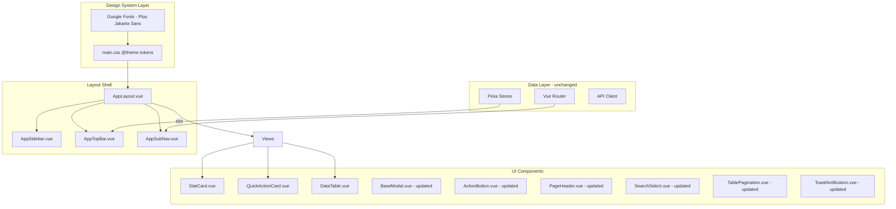

# Design Document: Admin Panel Redesign

## Overview

This design transforms the Teman Sekolah admin panel from a cold corporate SaaS aesthetic (slate colors, system fonts, minimal contrast) to a warm, education-focused design system optimized for non-tech-savvy users (school staff, teachers, parents). The redesign touches three layers:

1. **Design Tokens** — Restructure `main.css` @theme block with warm color palette, Plus Jakarta Sans typography, larger spacing, and education-appropriate visual language
2. **Layout Shell** — Replace the current white sidebar + plain top bar with a dark teal icon sidebar (expand-on-hover) + blue gradient top bar + contextual sub-navigation tabs
3. **Component Library** — Update all reusable components and introduce new ones (StatCard, QuickActionCard, SubNav) following the new token system

The validated mockup (`mockup-redesign.html`) serves as the reference implementation. The design preserves existing data flow, routing, Pinia stores, and API integration — only the presentation layer changes.

### Key Design Decisions

| Decision | Choice | Rationale |
|----------|--------|-----------|
| Token strategy | Single @theme block, no separate CSS files | Tailwind CSS 4 @theme provides native custom property mapping; keeps everything in one place and enables `bg-primary-600` usage directly |
| Sidebar behavior | Hover-to-expand (96→240px) | Maximizes content area for data-heavy views while keeping navigation accessible without a click |
| Sub-navigation source | Route meta + composable mapping | Avoids hardcoding tab configurations in the layout; each sidebar section declares its tabs via a centralized config |
| Font loading | Google Fonts CDN link in index.html | Simpler than bundling; Plus Jakarta Sans is the single custom font, loaded with `display=swap` for performance |
| Migration approach | Token replacement first, then layout, then components | Allows incremental migration; views automatically pick up new colors via Tailwind utilities once tokens change |

---

## Architecture



### Architectural Approach

The layout shell is decomposed from a single monolithic `AppLayout.vue` into four focused components:

- **AppLayout.vue** — Orchestrator: composes sidebar, top bar, sub-nav, and content slot into a flex viewport
- **AppSidebar.vue** — Icon sidebar with hover expansion, navigation items, logo, user avatar
- **AppTopBar.vue** — Blue gradient bar with page title and school context badge
- **AppSubNav.vue** — Horizontal tabs driven by active route section

This decomposition enables independent testing and reduces the complexity of the current 300+ line AppLayout.vue.

---

## Components and Interfaces

### New Components

#### 1. AppSidebar.vue

```typescript
// Props
interface AppSidebarProps {
  // No props — derives state from route and auth store
}

// Emits
interface AppSidebarEmits {
  (e: 'navigate', path: string): void
}

// Internal state
interface SidebarNavItem {
  icon: string        // SVG icon identifier
  label: string       // Navigation label (Bahasa Indonesia)
  sectionKey: string  // Maps to sub-nav configuration
  path: string        // Base route path
  roles?: Role[]      // Role-based visibility
}
```

**Behavior:**
- Default width: 96px (icon + 10px label below)
- Hover width: 240px (icon + 14px label inline), 300ms cubic-bezier transition
- Active item: amber left bar indicator + 15% white background
- Dark teal gradient background (#1A3A3A → #0F2424)
- Logo (52px white container) at top, user avatar (44px amber circle) at bottom

#### 2. AppTopBar.vue

```typescript
interface AppTopBarProps {
  title: string            // Current page title
  schoolName?: string      // Active school name from tenant context
}

// Emits
interface AppTopBarEmits {
  (e: 'toggleMobileMenu'): void
}
```

**Behavior:**
- 70px height, blue gradient (primary-600 → primary-700)
- Page title: 20px/700 white
- School badge: frosted glass (rgba white + backdrop-blur), building icon
- Mobile: shows hamburger menu button (< 1024px)

#### 3. AppSubNav.vue

```typescript
interface SubNavTab {
  label: string    // Tab display text
  path: string     // Route path to navigate to
}

interface AppSubNavProps {
  tabs: SubNavTab[]    // Tabs for current section
  activePath: string   // Current route path for active highlighting
}
```

**Behavior:**
- 62px height, primary-50 background, 3px bottom border primary-200
- Active tab: filled primary-600 background, white text
- Inactive tab: 60% white background, primary-800 text
- Hover: white background, primary-300 border, subtle shadow

#### 4. StatCard.vue

```typescript
type StatCardVariant = 'blue' | 'green' | 'amber' | 'purple'

interface StatCardProps {
  label: string
  value: string | number
  variant: StatCardVariant
  icon: string              // SVG icon identifier
  change?: string           // e.g., "+12 semester ini"
}
```

#### 5. QuickActionCard.vue

```typescript
interface QuickActionCardProps {
  title: string
  description: string
  icon: string
  iconColor: string         // Tailwind bg class e.g. 'bg-primary-600'
  to?: string               // Optional route path
}

interface QuickActionCardEmits {
  (e: 'click'): void
}
```

### Updated Components

#### PageHeader.vue (updated)

```typescript
interface PageHeaderProps {
  title: string
  subtitle?: string
  actions?: boolean   // Slot control for action buttons
}
```

Changes: title at 26px/800 weight, subtitle at 15px secondary text, stone-family colors.

#### ActionButton.vue (updated)

Changes: padding 10px/18px, font 14px/600, primary uses colored box-shadow, secondary uses 2px border.

#### BaseModal.vue (updated)

Changes: 16px border-radius, Plus Jakarta Sans, updated button styles within modal.

#### SearchSelect.vue (updated)

Changes: 8px border-radius, 15px font, warm border colors, focus ring in primary-500.

#### TablePagination.vue (updated)

Changes: 40px minimum touch targets, 14px font, primary-color active page indicator.

#### ToastNotification.vue (updated)

Changes: 12px border-radius, 15px font, colored left-border indicators, shadow-lg.

---

## Data Models

### Sub-Navigation Configuration

The sub-navigation tab configuration is the primary new data structure. It maps sidebar sections to their respective tab items.

```typescript
// src/composables/useSubNavigation.ts

interface SubNavConfig {
  [sectionKey: string]: SubNavTab[]
}

const SUB_NAV_CONFIG: SubNavConfig = {
  dashboard: [
    { label: 'Ringkasan', path: '/' },
    { label: 'Siswa', path: '/siswa' },
    { label: 'Kelas', path: '/kelas' },
    { label: 'Mata Pelajaran', path: '/mata-pelajaran' },
    { label: 'Jadwal', path: '/jadwal' },
  ],
  absensi: [
    { label: 'Input Absensi', path: '/absensi/input' },
    { label: 'Edit Absensi', path: '/absensi/edit' },
    { label: 'Rekap Absensi', path: '/absensi/rekap' },
  ],
  rapor: [
    { label: 'Komponen Nilai', path: '/rapor/komponen' },
    { label: 'Input Nilai', path: '/rapor/input' },
    { label: 'Finalisasi', path: '/rapor/finalize' },
    { label: 'Lihat Rapor', path: '/rapor' },
  ],
  rpp: [
    { label: 'Portal RPP', path: '/rpp/portal' },
    { label: 'Buat RPP', path: '/rpp/create' },
    { label: 'Favorit', path: '/rpp/favorites' },
  ],
  keuangan: [
    { label: 'Tagihan', path: '/tagihan' },
  ],
  pengumuman: [
    { label: 'Pengumuman', path: '/pengumuman' },
  ],
  pengaturan: [
    { label: 'Tahun Ajaran', path: '/tahun-ajaran' },
    { label: 'Konfigurasi', path: '/konfigurasi' },
    { label: 'Pengguna', path: '/users' },
    { label: 'Audit Log', path: '/audit-logs' },
    { label: 'Tenant', path: '/tenants' },
  ],
}
```

### Composable: useSubNavigation

```typescript
// Returns reactive sub-nav tabs based on current route

export function useSubNavigation() {
  const route = useRoute()
  const authStore = useAuthStore()

  const activeSection = computed<string>(() => {
    // Derive section from route path prefix
    if (route.path === '/') return 'dashboard'
    if (route.path.startsWith('/absensi')) return 'absensi'
    if (route.path.startsWith('/rapor')) return 'rapor'
    if (route.path.startsWith('/rpp')) return 'rpp'
    if (route.path.startsWith('/tagihan')) return 'keuangan'
    if (route.path.startsWith('/pengumuman')) return 'pengumuman'
    // Academic routes under dashboard section
    if (['/siswa', '/kelas', '/mata-pelajaran', '/jadwal', '/kenaikan-kelas'].some(p => route.path.startsWith(p))) {
      return 'dashboard'
    }
    // Settings routes
    if (['/tahun-ajaran', '/konfigurasi', '/users', '/audit-logs', '/tenants'].some(p => route.path.startsWith(p))) {
      return 'pengaturan'
    }
    return 'dashboard'
  })

  const tabs = computed<SubNavTab[]>(() => {
    const config = SUB_NAV_CONFIG[activeSection.value] ?? []
    // Filter by user role
    return config.filter(tab => {
      const routeConfig = router.getRoutes().find(r => r.path === tab.path)
      if (!routeConfig?.meta?.roles?.length) return true
      return authStore.hasRole(...routeConfig.meta.roles)
    })
  })

  return { activeSection, tabs }
}
```

### Sidebar Navigation Items (restructured)

```typescript
// Flat icon-based sidebar items (replaces the grouped NavGroup[] structure)
interface SidebarItem {
  key: string          // Section key matching SUB_NAV_CONFIG
  icon: string         // Heroicon name
  label: string        // Short label
  basePath: string     // Primary path for this section
  roles?: Role[]       // Role filter
}

const SIDEBAR_ITEMS: SidebarItem[] = [
  { key: 'dashboard', icon: 'home', label: 'Dashboard', basePath: '/' },
  { key: 'akademik', icon: 'book-open', label: 'Akademik', basePath: '/siswa', roles: [Role.ADMIN, Role.GURU, Role.KEPALA_SEKOLAH] },
  { key: 'absensi', icon: 'clipboard-check', label: 'Absensi', basePath: '/absensi/input', roles: [Role.ADMIN, Role.GURU, Role.KEPALA_SEKOLAH] },
  { key: 'rapor', icon: 'document-text', label: 'Rapor', basePath: '/rapor/komponen', roles: [Role.ADMIN, Role.GURU, Role.KEPALA_SEKOLAH] },
  { key: 'rpp', icon: 'folder', label: 'RPP', basePath: '/rpp/portal', roles: [Role.ADMIN, Role.GURU, Role.KEPALA_SEKOLAH] },
  { key: 'keuangan', icon: 'credit-card', label: 'Keuangan', basePath: '/tagihan', roles: [Role.ADMIN, Role.BENDAHARA] },
  { key: 'pengumuman', icon: 'megaphone', label: 'Pengumuman', basePath: '/pengumuman', roles: [Role.ADMIN, Role.KEPALA_SEKOLAH] },
  { key: 'pengaturan', icon: 'cog', label: 'Pengaturan', basePath: '/tahun-ajaran', roles: [Role.ADMIN, Role.SUPER_ADMIN] },
]
```

---

## Error Handling

This redesign is purely a UI/presentation change. Error handling remains identical to the existing implementation:

- **API errors**: Handled by existing Axios interceptors and per-view error states
- **Route guard failures**: Unchanged — unauthorized users redirected to `/unauthorized`
- **Component rendering errors**: Vue's built-in `errorCaptured` + existing error boundaries
- **Font loading failure**: Plus Jakarta Sans configured with `display=swap` and system font fallback chain; the UI remains functional with system fonts if CDN is unreachable
- **Sidebar state on resize**: CSS-only expansion via `:hover` — no JS state to become stale. Mobile drawer uses existing `v-if` with backdrop overlay pattern.

No new error states or failure modes are introduced by this redesign.

---

## Correctness Properties

*A property is a characteristic or behavior that should hold true across all valid executions of a system — essentially, a formal statement about what the system should do. Properties serve as the bridge between human-readable specifications and machine-verifiable correctness guarantees.*

### Property 1: Sub-navigation route mapping consistency

*For any* valid route path in the application, the `useSubNavigation` composable SHALL return a deterministic, non-empty tab list corresponding to the correct sidebar section, and the active section derivation SHALL be idempotent (calling it multiple times with the same route produces the same result).

**Validates: Requirements 2.3, 2.4**

---

## Testing Strategy

### Why Property-Based Testing Does NOT Apply

This feature is a **UI redesign** — the acceptance criteria describe visual properties (colors, sizes, padding, font weights, transitions, border-radius values). These are:

1. **Declarative CSS values**, not computed functions with varying inputs
2. **Layout composition**, not data transformations
3. **Visual styling**, which doesn't produce outputs that can be meaningfully property-tested

There are no pure functions, serialization logic, parsing, or business rule transformations being introduced. The "inputs" are fixed design tokens and the "outputs" are rendered DOM — this is the textbook case where PBT adds no value.

### Recommended Testing Approach

#### 1. Visual Regression Tests (primary)

Use **Percy** or **Chromatic** (Storybook-based) to capture snapshots of each component state:

- StatCard in all 4 variants (blue, green, amber, purple) + hover state
- QuickActionCard default + hover
- AppSidebar collapsed + expanded
- AppSubNav with varying tab counts and active states
- DataTable with avatars, progress bars, badges
- All updated existing components (BaseModal, ActionButton, etc.)

#### 2. Component Unit Tests (Vitest + Vue Test Utils)

Example-based tests for:

- **AppSubNav**: Renders correct tabs for a given route path
- **useSubNavigation composable**: Returns correct section and filtered tabs for various routes and roles
- **AppSidebar**: Active item detection based on route
- **StatCard**: Renders correct variant classes based on prop
- **QuickActionCard**: Emits click event and renders props correctly
- **Responsive behavior**: Mobile menu toggle visibility at breakpoint

#### 3. Accessibility Tests

- **axe-core** integration: Run accessibility audit on each major layout state
- Verify contrast ratios meet 4.5:1 for body text, 3:1 for large text
- Verify focus ring visibility on all interactive elements
- Verify keyboard navigation through sidebar and sub-nav

#### 4. Integration/Smoke Tests

- Full app renders without console errors after token migration
- All 30+ views load without broken layout or missing styles
- Sidebar navigation reaches all sections
- Sub-nav tabs navigate to correct routes

### Token Validation

Since design tokens are the source of truth, validate them with a simple assertion file:

```typescript
// __tests__/design-tokens.test.ts
import { readFileSync } from 'fs'

describe('Design Token Integrity', () => {
  const css = readFileSync('src/assets/main.css', 'utf-8')

  it('defines warm surface color', () => {
    expect(css).toContain('--color-surface-warm: #F5F3EF')
  })

  it('uses stone-family neutrals (not slate)', () => {
    expect(css).toContain('--color-text-primary: #1c1917')
    expect(css).not.toContain('#0f172a') // old slate-900
  })

  it('defines sidebar dimensions', () => {
    expect(css).toContain('--sidebar-width: 240px')
    expect(css).toContain('--sidebar-collapsed-width: 96px')
  })
})
```

---

## Migration Strategy

### Phase 1: Token Replacement (main.css)

Replace the entire @theme block with the new warm palette. This is a single-file change that immediately shifts all Tailwind utility classes to use the new colors.

**Key changes:**
- `surface-50` (#f8fafc slate) → `surface-warm` (#F5F3EF cream) 
- Text colors: slate → stone family
- Border: slate-200 → stone-200
- Add new token families: accent (amber), purple, teal
- Add sidebar dimensions (96px/240px)
- Add typography tokens (font-family)
- Update radius scale (8/12/16px)
- Update shadow scale (add hover-lift shadows)

### Phase 2: Font Integration

Add Plus Jakarta Sans to `index.html`:
```html
<link rel="preconnect" href="https://fonts.googleapis.com">
<link rel="preconnect" href="https://fonts.gstatic.com" crossorigin>
<link href="https://fonts.googleapis.com/css2?family=Plus+Jakarta+Sans:wght@400;500;600;700;800&display=swap" rel="stylesheet">
```

Update body font-family in main.css base styles.

### Phase 3: Layout Shell Decomposition

1. Create `AppSidebar.vue`, `AppTopBar.vue`, `AppSubNav.vue`
2. Create `useSubNavigation` composable
3. Rewrite `AppLayout.vue` to compose the new sub-components
4. Remove the old sidebar/header code from AppLayout

### Phase 4: New Components

1. Create `StatCard.vue` and `QuickActionCard.vue`
2. Update dashboard views to use new stat/action card components

### Phase 5: Existing Component Updates

Update each component in `src/components/ui/` to use new tokens:
- BaseModal, ActionButton, PageHeader, SearchSelect, TablePagination, ToastNotification

### Phase 6: View Pages

Iterate through all 30+ views to:
- Replace hardcoded colors with token-based utilities
- Update spacing to match new scale (32px page padding)
- Apply new typography scale (26px headings, 15px body)
- Replace slate/cold references with stone/warm tokens

### Rollback Strategy

Each phase is independently deployable behind a feature flag (CSS class on `<html>` element):
```css
html.redesign-v2 { /* new tokens active */ }
```

This allows A/B testing and instant rollback by toggling the class.
