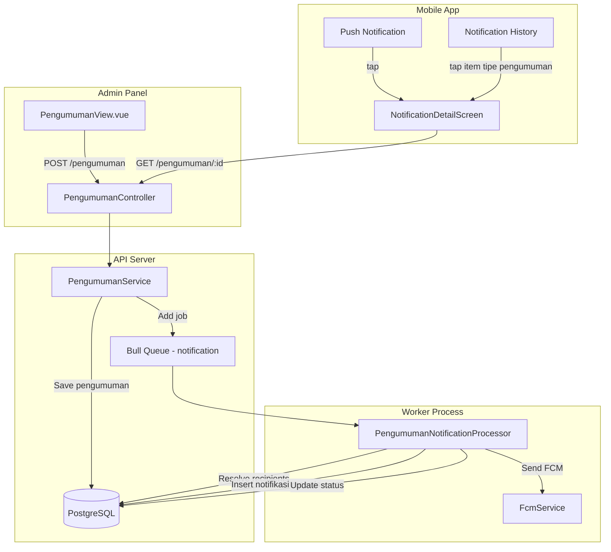

# Design Document: Announcement (Pengumuman)

## Overview

Fitur Pengumuman menambahkan kemampuan bagi admin sekolah untuk membuat dan mengirim pengumuman ke orang tua siswa, baik secara broadcast (seluruh sekolah) maupun targeted (siswa tertentu). Fitur ini membangun di atas infrastruktur notifikasi yang sudah ada (`notifikasi` table, `FcmService`, `device_token`, `notification.processor`) dan menambahkan:

1. Tabel `pengumuman` sebagai sumber data pengumuman
2. Tabel junction `pengumuman_penerima` untuk tracking penerima
3. Bull queue job baru `send-pengumuman-notification` pada queue `notification` yang sudah ada
4. CRUD endpoints untuk admin panel
5. Detail endpoint untuk mobile app
6. Screen baru di mobile untuk navigasi dari push notification ke detail pengumuman

### Key Design Decisions

- **Reuse existing `notifikasi` table**: Setiap penerima tetap mendapat record di `notifikasi` dengan `tipe: 'pengumuman'` dan `data: { pengumuman_id }`. Ini memastikan pengumuman muncul di riwayat notifikasi yang sudah ada.
- **Separate `pengumuman` table**: Pengumuman disimpan terpisah dari notifikasi karena memiliki lifecycle sendiri (draft → sent) dan data tambahan (mode, jumlah penerima).
- **Junction table `pengumuman_penerima`**: Untuk mengontrol akses detail — hanya penerima yang bisa melihat konten pengumuman. Juga berguna untuk audit trail.
- **Reuse existing queue**: Job pengumuman masuk ke `QUEUE_NAMES.NOTIFICATION` yang sama, dengan nama proses berbeda (`send-pengumuman-notification`).
- **Status `draft` saat create, update ke `terkirim` setelah queue selesai**: Admin melihat status pengiriman secara real-time.

## Architecture



### Component Interaction Flow

1. **Create & Send (Admin → API → Queue)**:
   - Admin mengisi form → POST `/pengumuman` → PengumumanService validates, saves with status `draft`, resolves recipients, inserts `pengumuman_penerima` records, enqueues job → returns response with `pengumuman_id` dan `jumlah_penerima`

2. **Process (Worker)**:
   - Worker picks up job → queries `pengumuman_penerima` → batch queries `device_token` → builds FCM messages → sends via `FcmService.sendBatch` → inserts `notifikasi` records → updates `pengumuman.status` to `terkirim` or `gagal`

3. **View Detail (Mobile)**:
   - Orang tua taps notification → extracts `pengumuman_id` from payload → navigates to detail screen → GET `/pengumuman/:id` → displays full content

## Components and Interfaces

### API Module: `modules/pengumuman/`

```
modules/pengumuman/
├── pengumuman.module.ts
├── pengumuman.controller.ts
├── pengumuman.service.ts
├── pengumuman.dto.ts
└── pengumuman.spec.ts
```

### Controller Endpoints

```typescript
// POST /pengumuman — Create + send announcement
@Post()
@Roles(Role.ADMIN, Role.KEPALA_SEKOLAH)
createPengumuman(@Body() dto: CreatePengumumanDto, @CurrentUser() user: RequestUser)
// Response: { pengumuman_id, judul, mode, jumlah_penerima, status, created_at }

// GET /pengumuman — List announcements (admin, paginated)
@Get()
@Roles(Role.ADMIN, Role.KEPALA_SEKOLAH)
listPengumuman(@Query() query: ListPengumumanQueryDto, @CurrentUser() user: RequestUser)
// Response: { data: Pengumuman[], meta: { page, page_size, total_count, total_pages } }

// GET /pengumuman/:id — Detail (orang_tua only, restricted to recipients)
@Get(':id')
@Roles(Role.ORANG_TUA)
getDetailPengumuman(@Param('id') id: string, @CurrentUser() user: RequestUser)
// Response: { id, judul, deskripsi, nama_sekolah, created_at }
```

### DTOs

```typescript
class CreatePengumumanDto {
  @IsString() @MinLength(1) @MaxLength(255)
  judul: string;

  @IsString() @MinLength(1) @MaxLength(5000)
  deskripsi: string;

  @IsEnum(['broadcast', 'targeted'])
  mode: 'broadcast' | 'targeted';

  @IsOptional() @IsArray() @ArrayMinSize(1) @ArrayMaxSize(100) @IsUUID('4', { each: true })
  siswa_ids?: string[]; // Required when mode = 'targeted'
}

class ListPengumumanQueryDto extends PaginationQueryDto {
  // Inherits page, page_size from common PaginationQueryDto
  // Default page_size overridden to 15
}
```

### Service Methods

```typescript
class PengumumanService {
  // Create pengumuman, resolve recipients, enqueue FCM job
  async create(dto: CreatePengumumanDto, user: RequestUser): Promise<CreatePengumumanResponse>

  // List pengumuman for admin's tenant (paginated, desc by created_at)
  async list(query: ListPengumumanQueryDto, tenantId: string): Promise<PaginatedResponse<PengumumanListItem>>

  // Get detail for orang_tua (validates recipient access)
  async getDetail(pengumumanId: string, userId: string): Promise<PengumumanDetail>
}
```

### Worker: `jobs/pengumuman-notification.processor.ts`

```typescript
interface PengumumanJobData {
  pengumuman_id: string;
  tenant_id: string;
  judul: string;
  deskripsi: string;
  penerima_user_ids: string[];
}

@Processor(QUEUE_NAMES.NOTIFICATION)
class PengumumanNotificationProcessor extends BaseProcessor {
  @Process('send-pengumuman-notification')
  async handle(job: Job<PengumumanJobData>): Promise<void>
}
```

### Mobile: New Screen + Route

```dart
// Route: /orang-tua/pengumuman/:pengumumanId
// Screen: PengumumanDetailScreen(pengumumanId: String)
// Provider: pengumumanDetailProvider(pengumumanId)
```

### Admin Panel: New View

```
views/PengumumanView.vue — List + Create form (single page with tabs/modal)
```

## Data Models

### Table: `pengumuman`

```sql
CREATE TABLE pengumuman (
  id            UUID PRIMARY KEY DEFAULT gen_random_uuid(),
  tenant_id     UUID NOT NULL REFERENCES tenant(id),
  created_by    UUID NOT NULL REFERENCES "user"(id),
  judul         VARCHAR(255) NOT NULL,
  deskripsi     TEXT NOT NULL,
  mode          VARCHAR(20) NOT NULL, -- 'broadcast' | 'targeted'
  jumlah_penerima INTEGER NOT NULL DEFAULT 0,
  status        VARCHAR(20) NOT NULL DEFAULT 'draft', -- 'draft' | 'terkirim' | 'gagal'
  created_at    TIMESTAMPTZ NOT NULL DEFAULT NOW(),
  updated_at    TIMESTAMPTZ NOT NULL DEFAULT NOW()
);

CREATE INDEX idx_pengumuman_tenant_created ON pengumuman(tenant_id, created_at DESC);
```

### Table: `pengumuman_penerima`

```sql
CREATE TABLE pengumuman_penerima (
  id              UUID PRIMARY KEY DEFAULT gen_random_uuid(),
  pengumuman_id   UUID NOT NULL REFERENCES pengumuman(id),
  user_id         UUID NOT NULL, -- orang_tua user ID
  created_at      TIMESTAMPTZ NOT NULL DEFAULT NOW()
);

CREATE UNIQUE INDEX idx_pengumuman_penerima_unique ON pengumuman_penerima(pengumuman_id, user_id);
CREATE INDEX idx_pengumuman_penerima_user ON pengumuman_penerima(user_id);
```

### Drizzle Schema: `apps/api/src/drizzle/schema/pengumuman.ts`

```typescript
import { pgTable, uuid, varchar, text, integer, timestamp, uniqueIndex, index } from 'drizzle-orm/pg-core';
import { tenant } from './tenant';
import { user } from './user';

export const pengumumanModeEnum = pgEnum('pengumuman_mode', ['broadcast', 'targeted']);
export const pengumumanStatusEnum = pgEnum('pengumuman_status', ['draft', 'terkirim', 'gagal']);

export const pengumuman = pgTable('pengumuman', {
  id: uuid('id').primaryKey().defaultRandom(),
  tenantId: uuid('tenant_id').notNull().references(() => tenant.id),
  createdBy: uuid('created_by').notNull().references(() => user.id),
  judul: varchar('judul', { length: 255 }).notNull(),
  deskripsi: text('deskripsi').notNull(),
  mode: pengumumanModeEnum('mode').notNull(),
  jumlahPenerima: integer('jumlah_penerima').notNull().default(0),
  status: pengumumanStatusEnum('status').notNull().default('draft'),
  createdAt: timestamp('created_at', { withTimezone: true }).notNull().defaultNow(),
  updatedAt: timestamp('updated_at', { withTimezone: true }).notNull().defaultNow(),
}, (table) => ({
  tenantCreatedIdx: index('idx_pengumuman_tenant_created').on(table.tenantId, table.createdAt),
}));

export const pengumumanPenerima = pgTable('pengumuman_penerima', {
  id: uuid('id').primaryKey().defaultRandom(),
  pengumumanId: uuid('pengumuman_id').notNull().references(() => pengumuman.id),
  userId: uuid('user_id').notNull().references(() => user.id),
  createdAt: timestamp('created_at', { withTimezone: true }).notNull().defaultNow(),
}, (table) => ({
  uniquePengumumanUser: uniqueIndex('idx_pengumuman_penerima_unique').on(table.pengumumanId, table.userId),
  userIdx: index('idx_pengumuman_penerima_user').on(table.userId),
}));
```

### Interaction with Existing `notifikasi` Table

Pengumuman notifications insert into the existing `notifikasi` table with:
- `tipe`: `'pengumuman'`
- `judul`: Judul pengumuman
- `pesan`: 200 karakter pertama deskripsi + "..." if truncated
- `data`: `{ pengumuman_id: string, tipe: 'pengumuman' }`
- `siswaId`: NULL (pengumuman bukan per-siswa)

This ensures pengumuman appears in the existing notification history screen.


## Correctness Properties

*A property is a characteristic or behavior that should hold true across all valid executions of a system — essentially, a formal statement about what the system should do. Properties serve as the bridge between human-readable specifications and machine-verifiable correctness guarantees.*

### Property 1: Input Validation Rejects Invalid, Accepts Valid

*For any* string `s`, if `s.trim()` is empty (length 0) or `s.trim().length` exceeds the field's maximum (255 for judul, 5000 for deskripsi), then validation SHALL reject `s`. Conversely, if `s.trim().length` is between 1 and the maximum (inclusive), validation SHALL accept `s`.

**Validates: Requirements 1.3, 1.4, 1.5**

### Property 2: Recipient Resolution Deduplicates Parents

*For any* set of target students (all active students in tenant for broadcast, or the selected subset for targeted), the resolved recipient list SHALL contain exactly one entry per unique `orang_tua_id` — even when a parent has multiple children in the target set. The recipient count SHALL equal the number of distinct active parents linked to valid target students.

**Validates: Requirements 2.1, 2.2, 3.2, 3.3**

### Property 3: Notification Body Truncation

*For any* deskripsi string, the notification body SHALL equal `deskripsi.substring(0, 200) + "..."` when `deskripsi.length > 200`, and SHALL equal `deskripsi` unchanged when `deskripsi.length <= 200`.

**Validates: Requirements 4.1**

### Property 4: Delivery Status Determination

*For any* set of FCM send results for a single recipient (across all their device tokens), the notification status SHALL be `'terkirim'` if at least one result is successful, and SHALL be `'gagal'` only if all results have failed after maximum retry attempts.

**Validates: Requirements 4.3, 4.4**

### Property 5: Tenant Isolation

*For any* pengumuman query by an admin user with `tenant_id = T`, the list endpoint SHALL return only pengumuman where `pengumuman.tenant_id = T`. Furthermore, *for any* broadcast or targeted recipient resolution, all resolved recipients SHALL have at least one active student with `siswa.tenant_id = T`.

**Validates: Requirements 5.4, 7.2, 7.4**

### Property 6: Recipient-Only Access Control

*For any* user U and pengumuman P, the detail endpoint SHALL return the pengumuman content if and only if there exists a record in `pengumuman_penerima` where `user_id = U.id` AND the pengumuman's `tenant_id` is in U's tenant list. Otherwise, the endpoint SHALL return HTTP 403.

**Validates: Requirements 6.6, 7.5, 7.6**

### Property 7: List Ordering Invariant

*For any* paginated list of pengumuman returned by the list endpoint, for all consecutive pairs `(item[i], item[i+1])`, `item[i].created_at >= item[i+1].created_at` (descending order).

**Validates: Requirements 5.2**

### Property 8: Graceful Degradation for Invalid Students

*For any* targeted pengumuman with a mixed list of valid and invalid student IDs (non-existent, inactive, or without linked parents), the service SHALL skip invalid entries and successfully send to valid ones. The resulting `jumlah_penerima` SHALL equal the count of distinct valid parents (not the count of input student IDs).

**Validates: Requirements 3.5, 3.6, 2.5**

## Error Handling

### API Layer (PengumumanController)

| Scenario | HTTP Status | Response Body |
|----------|-------------|---------------|
| Judul/deskripsi gagal validasi | 400 Bad Request | `{ message: "Validation failed", errors: [{ field, constraint }] }` |
| Mode targeted tanpa siswa_ids | 400 Bad Request | `{ message: "Minimal satu siswa harus dipilih" }` |
| Semua siswa dalam daftar invalid | 400 Bad Request | `{ message: "Tidak ada penerima valid" }` |
| User bukan admin/kepala_sekolah | 403 Forbidden | `{ message: "You do not have permission..." }` |
| Orang tua akses pengumuman bukan miliknya | 403 Forbidden | `{ message: "Pengumuman tidak tersedia" }` |
| Pengumuman ID tidak ditemukan | 404 Not Found | `{ message: "Pengumuman tidak ditemukan" }` |
| Internal server error | 500 | `{ message: "Internal server error" }` |

### Worker Layer (PengumumanNotificationProcessor)

| Scenario | Handling |
|----------|----------|
| FCM partial failure (some tokens fail) | Mark successful tokens as terkirim, retry failed tokens up to 3 attempts |
| FCM total failure for a recipient | After 3 retries, mark notifikasi as `gagal` |
| FCM token-not-registered error | Deactivate token via `FcmService.deactivateStaleTokens` (existing behavior) |
| Job processing failure (exception) | Bull auto-retry (3 attempts, 60s backoff via BaseProcessor) |
| Dead letter (all retries exhausted) | Override `handleDeadLetter`: update `pengumuman.status` to `gagal`, log error |

### Mobile Layer

| Scenario | Handling |
|----------|----------|
| Network error fetching detail | Show error message + "Coba Lagi" retry button |
| 403 Forbidden response | Show "Pengumuman tidak tersedia" + back button |
| 404 Not Found response | Show "Pengumuman tidak ditemukan" + back button |
| Deep link with invalid pengumuman_id | Navigate to detail screen, show error state |

## Testing Strategy

### Property-Based Tests (fast-check)

Property-based testing is appropriate for this feature because:
- The service contains pure logic for validation, recipient resolution, deduplication, truncation, and status determination
- Input spaces are large (string lengths, student/parent combinations, FCM result combinations)
- Universal properties hold across all valid inputs

**Library**: fast-check (already in project)
**Minimum iterations**: 100 per property
**Tag format**: `Feature: announcement, Property {N}: {description}`

Each of the 8 correctness properties above should be implemented as a property-based test:

1. **Validation property**: Generate random strings (empty, whitespace-only, valid, overlength) → verify accept/reject
2. **Deduplication property**: Generate random parent-student graphs → verify unique parents in output
3. **Truncation property**: Generate random strings of varying length → verify truncation logic
4. **Status determination**: Generate random FCM result arrays → verify status assignment
5. **Tenant isolation**: Generate multi-tenant data → verify filtering
6. **Access control**: Generate user/pengumuman/penerima combinations → verify access decisions
7. **Ordering**: Generate random timestamps → verify descending sort
8. **Graceful degradation**: Generate mixed valid/invalid student lists → verify correct filtering

### Unit Tests (Jest)

Focus on specific examples and integration points:
- Controller endpoint authorization (role guard behavior)
- DTO validation (class-validator decorators)
- Service happy-path: broadcast with 3 parents, 5 students
- Service happy-path: targeted with 2 specific students
- Edge cases: empty tenant, all invalid students, duplicate student IDs in input

### Integration Tests

- Full flow: create pengumuman → verify Bull job enqueued → process job → verify notifikasi records created
- FCM batch sending with mocked Firebase Admin SDK
- Pagination behavior with real database
- Multi-tenant isolation with multiple tenants in database

### Mobile Tests

- Widget tests for PengumumanDetailScreen (loading, success, error states)
- Navigation test: push notification payload → correct route
- Provider test: API response parsing and state management
