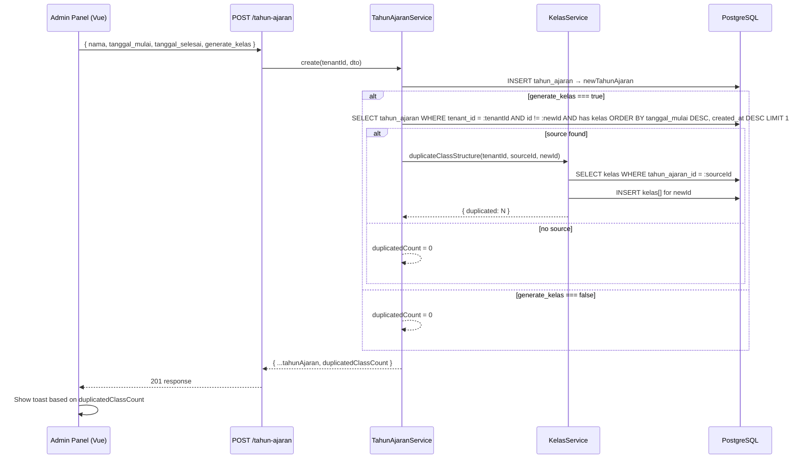

# Design Document: Auto-Generate Kelas

## Overview

This feature improves the kelas auto-generation mechanism triggered when creating a new tahun ajaran. The current implementation in `TahunAjaranService.create()` sources kelas records exclusively from the active tahun ajaran (status = 'aktif'). This fails when no tahun ajaran is currently active (e.g., during the gap between deactivating one and activating another).

The redesign changes the source selection to use the **most recent tahun ajaran that has kelas records** (ordered by `tanggal_mulai DESC`, then `created_at DESC` as tiebreaker), regardless of status. It also adds an opt-out mechanism via a `generate_kelas` boolean field in the DTO/API request and a corresponding checkbox in the admin form, along with toast notifications for user feedback.

### Key Design Decisions

1. **Source selection is status-agnostic** — Any tahun ajaran with kelas records qualifies as a source, because the class structure (names, grade levels, capacity) rarely changes between years. The most recent one is the best proxy regardless of lifecycle status.
2. **Opt-out rather than opt-in** — Auto-generation defaults to `true` because >95% of use cases want kelas copied. The rare restructuring scenario is handled by unchecking.
3. **Backend owns the logic** — The frontend sends a boolean flag; all selection logic lives in the service layer. This avoids the frontend needing to know about source selection internals.
4. **Reuse existing `duplicateClassStructure`** — The `KelasService.duplicateClassStructure()` method already correctly copies nama, tingkat, kapasitas and nulls wali_kelas_id. No changes needed there.

## Architecture



## Components and Interfaces

### Backend Changes

#### 1. `CreateTahunAjaranDto` (modify existing)

**File:** `apps/api/src/modules/tahun-ajaran/dto/create-tahun-ajaran.dto.ts`

Add optional `generate_kelas` field:

```typescript
import { IsString, IsNotEmpty, IsDateString, MaxLength, IsOptional, IsBoolean } from 'class-validator';

export class CreateTahunAjaranDto {
  @IsString()
  @IsNotEmpty()
  @MaxLength(50)
  nama: string;

  @IsDateString()
  @IsNotEmpty()
  tanggal_mulai: string;

  @IsDateString()
  @IsNotEmpty()
  tanggal_selesai: string;

  @IsOptional()
  @IsBoolean()
  generate_kelas?: boolean; // defaults to true when omitted
}
```

#### 2. `TahunAjaranService.create()` (modify existing)

**File:** `apps/api/src/modules/tahun-ajaran/tahun-ajaran.service.ts`

Replace the current "find aktif" source selection with:

```typescript
async create(tenantId: string, dto: CreateTahunAjaranDto) {
  // Validate dates
  if (dto.tanggal_mulai >= dto.tanggal_selesai) {
    throw new BadRequestException('Tanggal mulai harus sebelum tanggal selesai');
  }

  // Insert new tahun ajaran
  const [created] = await this.db
    .insert(tahunAjaran)
    .values({
      tenantId,
      nama: dto.nama,
      tanggalMulai: dto.tanggal_mulai,
      tanggalSelesai: dto.tanggal_selesai,
      status: 'disiapkan',
    })
    .returning();

  // Determine whether to generate kelas (default: true)
  const shouldGenerate = dto.generate_kelas !== false;
  let duplicatedCount = 0;

  if (shouldGenerate) {
    const sourceTahunAjaran = await this.findSourceTahunAjaran(tenantId, created.id);
    if (sourceTahunAjaran) {
      const result = await this.kelasService.duplicateClassStructure(
        tenantId,
        sourceTahunAjaran.id,
        created.id,
      );
      duplicatedCount = result.duplicated;
    }
  }

  return {
    ...created,
    duplicatedClassCount: duplicatedCount,
  };
}
```

#### 3. New private method: `findSourceTahunAjaran()`

```typescript
/**
 * Find the most recent tahun ajaran (by tanggal_mulai DESC, created_at DESC)
 * within the same tenant that has at least one kelas record.
 * Excludes the provided excludeId (the newly created tahun ajaran).
 */
private async findSourceTahunAjaran(
  tenantId: string,
  excludeId: string,
): Promise<{ id: string } | null> {
  const result = await this.db
    .select({ id: tahunAjaran.id })
    .from(tahunAjaran)
    .innerJoin(kelas, and(
      eq(kelas.tahunAjaranId, tahunAjaran.id),
      eq(kelas.tenantId, tenantId),
    ))
    .where(and(
      eq(tahunAjaran.tenantId, tenantId),
      sql`${tahunAjaran.id} != ${excludeId}`,
    ))
    .orderBy(desc(tahunAjaran.tanggalMulai), desc(tahunAjaran.createdAt))
    .limit(1);

  return result[0] ?? null;
}
```

The INNER JOIN ensures only tahun ajaran with at least one kelas record is returned. The `GROUP BY` is not needed because we only need existence (INNER JOIN + LIMIT 1 suffices; duplicates from multiple kelas rows are acceptable since we only read `tahunAjaran.id`). However, to avoid duplicates in the result, we use `DISTINCT` or leverage the fact that `LIMIT 1` returns just one row regardless.

**Note:** Since `INNER JOIN` can produce multiple rows per tahun_ajaran (one per kelas), and we only `SELECT tahunAjaran.id` with `LIMIT 1`, the result is correct. The ordering is stable because `tanggal_mulai` + `created_at` uniquely determines order. Alternatively, using a subquery with `EXISTS` would be cleaner:

```typescript
private async findSourceTahunAjaran(
  tenantId: string,
  excludeId: string,
): Promise<{ id: string } | null> {
  const result = await this.db
    .select({ id: tahunAjaran.id })
    .from(tahunAjaran)
    .where(and(
      eq(tahunAjaran.tenantId, tenantId),
      sql`${tahunAjaran.id} != ${excludeId}`,
      sql`EXISTS (SELECT 1 FROM kelas WHERE kelas.tahun_ajaran_id = ${tahunAjaran.id} AND kelas.tenant_id = ${tenantId})`,
    ))
    .orderBy(desc(tahunAjaran.tanggalMulai), desc(tahunAjaran.createdAt))
    .limit(1);

  return result[0] ?? null;
}
```

The `EXISTS` approach is preferred for clarity and avoids join-induced row multiplication.

### Frontend Changes

#### 4. `TahunAjaranView.vue` — Form Enhancement

**File:** `apps/admin/src/views/TahunAjaranView.vue`

Changes:
- Add `generate_kelas: boolean` to form state (default: `true`)
- Add checkbox in the create modal
- Send `generate_kelas` in POST payload
- Show toast notifications based on response `duplicatedClassCount`
- On error, display toast and preserve form input

```typescript
// Form interface addition
interface TahunAjaranForm {
  nama: string;
  tanggal_mulai: string;
  tanggal_selesai: string;
  generate_kelas: boolean;
}

// Default form state
const form = ref<TahunAjaranForm>({
  nama: '',
  tanggal_mulai: '',
  tanggal_selesai: '',
  generate_kelas: true,
});
```

Toast logic after successful creation:

```typescript
const toast = useToast();

async function saveTahunAjaran() {
  formError.value = '';
  try {
    const { data } = await api.post('/tahun-ajaran', {
      nama: form.value.nama,
      tanggal_mulai: form.value.tanggal_mulai,
      tanggal_selesai: form.value.tanggal_selesai,
      generate_kelas: form.value.generate_kelas,
    });

    showFormModal.value = false;

    if (!form.value.generate_kelas) {
      toast.success('Berhasil membuat tahun ajaran tanpa generate kelas.');
    } else if (data.duplicatedClassCount > 0) {
      toast.success(
        `Berhasil membuat tahun ajaran. ${data.duplicatedClassCount} kelas di-generate dari tahun sebelumnya.`
      );
    } else {
      toast.info(
        'Berhasil membuat tahun ajaran. Tidak ada kelas di-generate karena tidak ditemukan data kelas di tahun ajaran sebelumnya.'
      );
    }

    await fetchItems();
  } catch (error) {
    const msg = error.response?.data?.message;
    formError.value = Array.isArray(msg) ? msg.join(', ') : (msg || 'Gagal membuat tahun ajaran.');
    toast.error(formError.value);
  }
}
```

## Data Models

### Existing Schema (No Changes)

**tahun_ajaran table:**
| Column | Type | Notes |
|--------|------|-------|
| id | UUID | PK |
| tenant_id | UUID | FK → tenant |
| nama | VARCHAR(50) | e.g. "2024/2025" |
| tanggal_mulai | DATE | Start date |
| tanggal_selesai | DATE | End date |
| status | ENUM | 'disiapkan' / 'aktif' / 'nonaktif' |
| created_at | TIMESTAMP(tz) | Auto |

**kelas table:**
| Column | Type | Notes |
|--------|------|-------|
| id | UUID | PK |
| tenant_id | UUID | FK → tenant |
| tahun_ajaran_id | UUID | FK → tahun_ajaran |
| nama | VARCHAR(50) | e.g. "1A", "6B" |
| tingkat | INTEGER | Grade level |
| wali_kelas_id | UUID | FK → user (nullable) |
| kapasitas | INTEGER | Nullable |
| created_at | TIMESTAMP(tz) | Auto |
| updated_at | TIMESTAMP(tz) | Auto |

### API Request/Response Contract

**POST /tahun-ajaran** — Request body:
```json
{
  "nama": "2025/2026",
  "tanggal_mulai": "2025-07-14",
  "tanggal_selesai": "2026-06-30",
  "generate_kelas": true
}
```

**POST /tahun-ajaran** — Response (201):
```json
{
  "id": "uuid",
  "tenantId": "uuid",
  "nama": "2025/2026",
  "tanggalMulai": "2025-07-14",
  "tanggalSelesai": "2026-06-30",
  "status": "disiapkan",
  "createdAt": "2025-07-01T...",
  "duplicatedClassCount": 12
}
```

No database migrations are required — this feature only changes application logic and the DTO validation layer.


## Correctness Properties

*A property is a characteristic or behavior that should hold true across all valid executions of a system — essentially, a formal statement about what the system should do. Properties serve as the bridge between human-readable specifications and machine-verifiable correctness guarantees.*

### Property 1: Source selection returns the most recent tahun ajaran with kelas

*For any* set of tahun_ajaran records within the same tenant (with varying statuses, dates, and kelas counts including zero), the source selection algorithm SHALL return the tahun_ajaran with the greatest `tanggal_mulai` (using `created_at` as tiebreaker) that has at least one kelas record, excluding the newly created tahun_ajaran. If no candidate has kelas records, the result SHALL be null.

**Validates: Requirements 1.1, 1.2, 1.3, 1.4, 6.1**

### Property 2: Duplication preserves fields correctly and enforces invariants

*For any* set of source kelas records (with arbitrary nama, tingkat, kapasitas, and wali_kelas_id values), after duplication, every generated kelas record SHALL have: (a) matching nama, tingkat, and kapasitas from the source, (b) wali_kelas_id set to null, (c) tahun_ajaran_id set to the target tahun_ajaran, and (d) tenant_id matching the source tenant.

**Validates: Requirements 2.1, 2.2, 2.3, 6.2**

### Property 3: Duplication count equals source count

*For any* source tahun_ajaran with N kelas records (where N ≥ 1), the duplication SHALL produce exactly N new kelas records, and the `duplicatedClassCount` in the API response SHALL equal N.

**Validates: Requirements 2.4, 4.4**

### Property 4: Opt-out skips all duplication

*For any* valid tahun_ajaran creation request where `generate_kelas` is explicitly set to `false`, the system SHALL create zero kelas records regardless of available source data, and SHALL return `duplicatedClassCount` equal to 0.

**Validates: Requirements 3.2, 4.3**

### Property 5: Omitting generate_kelas defaults to generation enabled

*For any* valid tahun_ajaran creation request where the `generate_kelas` field is omitted from the payload, the system SHALL behave identically to a request with `generate_kelas` set to `true` — producing the same `duplicatedClassCount` and kelas records.

**Validates: Requirements 4.2**

## Error Handling

| Scenario | Behavior | HTTP Status |
|----------|----------|-------------|
| `tanggal_mulai >= tanggal_selesai` | Reject with validation error | 400 |
| `generate_kelas` is non-boolean | Reject via class-validator | 400 |
| No source tahun_ajaran found (no kelas in tenant) | Create tahun_ajaran, return `duplicatedClassCount: 0` | 201 |
| Database error during kelas duplication | Transaction rollback, return 500 | 500 |
| Tenant isolation violation (defensive) | Query inherently scopes by tenant_id; impossible via normal flow | N/A |

**Frontend error handling:**
- API failure → show `toast.error()` with message from response, keep modal open with form data preserved
- Network timeout → show generic error toast, keep modal open

## Testing Strategy

### Property-Based Tests (fast-check)

- **Library:** fast-check (already in project)
- **Minimum iterations:** 100 per property
- **Location:** `apps/api/src/modules/tahun-ajaran/__tests__/` 

Each correctness property maps to a single property-based test:

1. **Source selection property** — Generate arrays of `{tanggalMulai, createdAt, kelasCount, status}` objects, run the selection logic (extracted as a pure function or tested against a mocked DB), verify the result matches the expected most-recent-with-kelas candidate.
2. **Duplication field correctness** — Generate random kelas arrays with varying field values, run `duplicateClassStructure`, verify output field invariants.
3. **Duplication count** — Generate random-length source arrays (1-50 kelas), verify output length equals input length.
4. **Opt-out property** — Generate random source data + `generate_kelas=false`, verify zero output.
5. **Default behavior** — Compare results of omitted vs explicit `true` for same source data.

Tag format: `Feature: auto-generate-kelas, Property {N}: {description}`

### Unit Tests (Jest)

- **DTO validation:** Verify `generate_kelas` is optional, accepts boolean, rejects non-boolean
- **Toast messages:** Verify correct toast type and message content for each scenario (success with count, info with zero, success without generation, error)
- **Form state:** Verify checkbox default state, verify form data preserved on error

### Integration Tests

- **Full create flow:** POST /tahun-ajaran with real DB, verify kelas records created
- **Tenant isolation:** Create tahun_ajaran in tenant A, verify kelas from tenant B are never copied
- **Empty tenant:** Create first tahun_ajaran in a tenant with no prior data, verify graceful zero-count response
