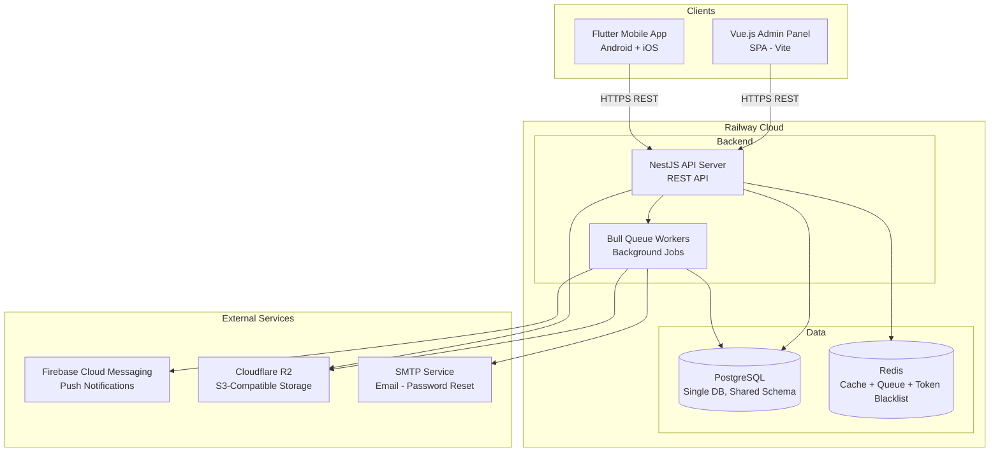
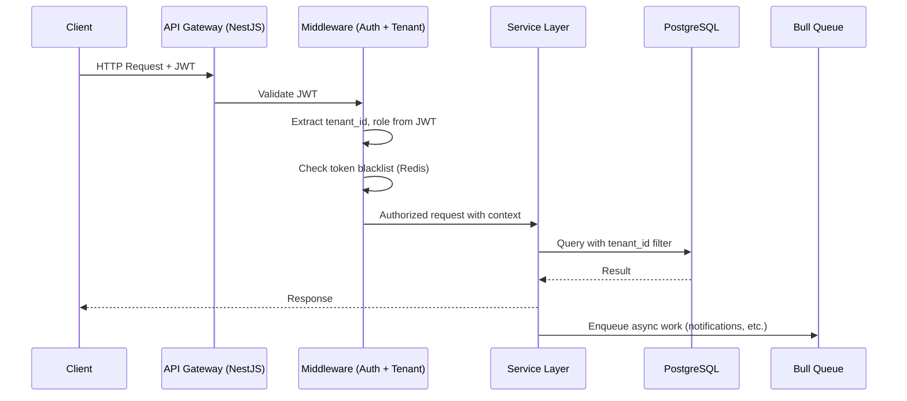
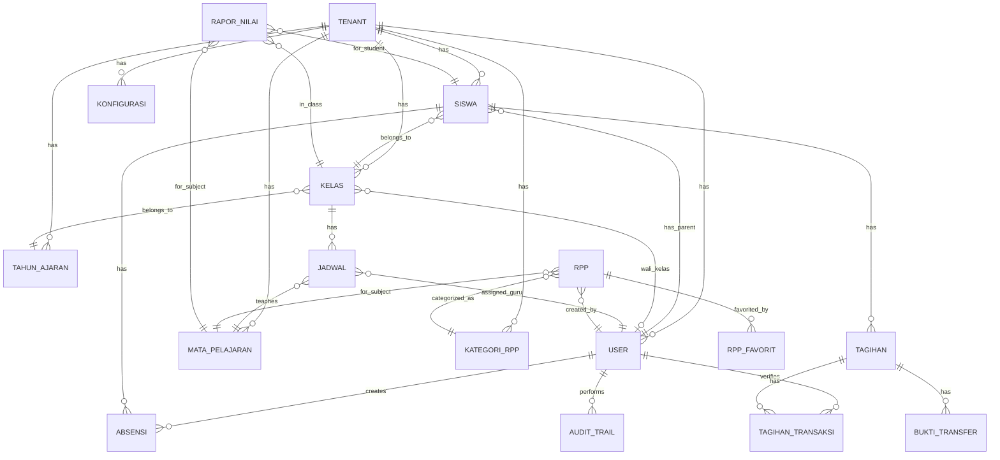
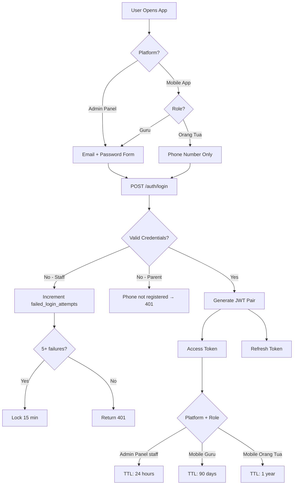
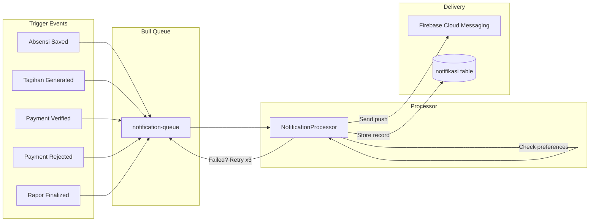
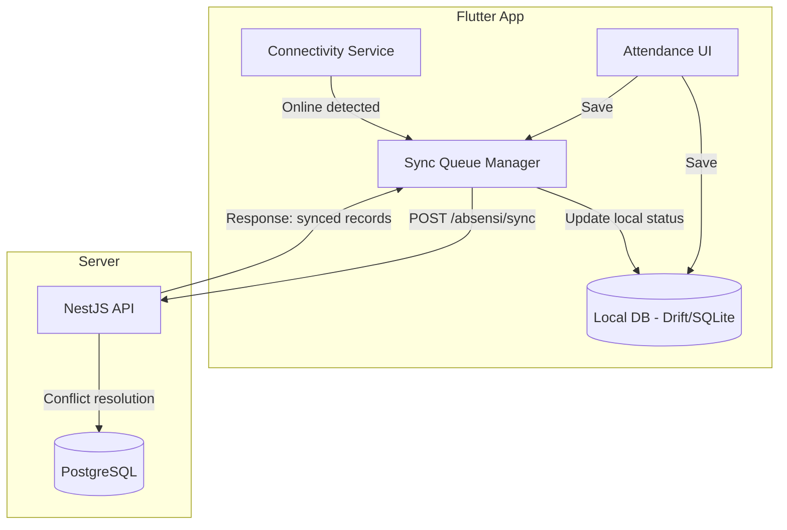
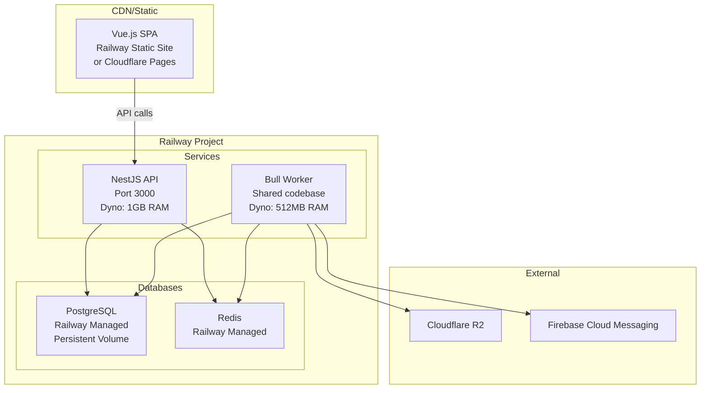

# Design Document: Edu School Management System

## Overview

Sistem manajemen sekolah multi-tenant yang melayani sekolah-sekolah (tenant) melalui dua platform:
- **Admin Panel (Vue.js SPA)**: untuk admin, bendahara, kepala_sekolah, guru — operasi manajemen data, laporan, input nilai
- **Aplikasi Mobile (Flutter)**: untuk guru (absensi + offline mode) dan orang_tua (lihat absensi, tagihan, rapor, notifikasi)

Arsitektur: monolithic NestJS backend dengan PostgreSQL (shared schema multi-tenancy), Redis untuk caching/queue, FCM untuk push notifications, S3-compatible storage untuk file uploads.

### Key Design Decisions

| Decision | Choice | Rationale | ADR |
|----------|--------|-----------|-----|
| Multi-tenancy | Shared schema, `tenant_id` on every table + PostgreSQL RLS | Simpler ops for MVP with defense-in-depth isolation | [ADR-001](../../docs/adr/ADR-001-postgresql-rls-tenant-isolation.md) |
| Parent user model | Single user record with `tenant_id = NULL` | Clean cross-tenant identity, atomic phone changes | [ADR-002](../../docs/adr/ADR-002-parent-user-model.md) |
| ORM | Drizzle ORM | Type-safe, lightweight, excellent PostgreSQL support, SQL-like syntax | — |
| Auth (staff) | Email + password → JWT (access 24h + refresh) | Standard, well-understood | — |
| Auth (orang_tua) | Phone number only → JWT (access 1 year) | Low friction for parents, no password to forget | — |
| Offline sync | Local DB (Drift) → sync queue → event-time LWW with authority override | Correct conflict resolution respecting Kepala Sekolah override authority | [ADR-003](../../docs/adr/ADR-003-offline-sync-conflict-resolution.md) |
| API versioning | URL prefix (`/api/v1/`) | Mobile apps can't be force-updated; breaking changes need graceful migration | [ADR-004](../../docs/adr/ADR-004-api-versioning.md) |
| Rate limiting | Tiered Redis-backed sliding window | Prevent phone enumeration and resource abuse | [ADR-005](../../docs/adr/ADR-005-rate-limiting.md) |
| File storage | S3-compatible (Cloudflare R2) | Cost-efficient, Railway-compatible | — |
| Background jobs | Bull queue (Redis-backed) | Notifications, image compression, CSV processing, file cleanup | — |
| Pagination | Cursor-based | Better performance at scale vs offset-based | — |
| Audit trail | Append-only table, never mutated | Immutability guarantee for billing audit | — |
| Billing idempotency | INSERT ON CONFLICT DO NOTHING + Redis mutex | Safe double-click and retry handling for batch operations | [ADR-007](../../docs/adr/ADR-007-billing-idempotency.md) |

## Architecture

### High-Level Architecture



### Request Flow



### Module Decomposition (NestJS Modules)

```
src/
├── common/              # Shared guards, interceptors, pipes, decorators
│   ├── guards/          # JwtAuthGuard, RolesGuard, TenantGuard
│   ├── interceptors/    # TenantInterceptor (auto-inject tenant_id)
│   ├── decorators/      # @Roles(), @CurrentUser(), @TenantId()
│   └── pipes/           # ValidationPipe, ParseCursorPipe
├── modules/
│   ├── auth/            # Login, refresh, reset password, token blacklist
│   ├── tenant/          # Super admin tenant management
│   ├── user/            # User CRUD, bulk import, deactivation
│   ├── siswa/           # Student management, enrollment, soft-delete
│   ├── kelas/           # Class management, academic year
│   ├── tahun-ajaran/    # Academic year lifecycle
│   ├── mata-pelajaran/  # Subject management
│   ├── jadwal/          # Schedule management, substitute teacher
│   ├── absensi/         # Attendance input, edit, recap, dashboard
│   ├── tagihan/         # Billing, payment, verification, audit
│   ├── notifikasi/      # Push notifications, preferences, history
│   ├── rapor/           # Grade input, finalization, export
│   ├── rpp/             # RPP/Modul Ajar CRUD, portal, favorites
│   ├── konfigurasi/     # Per-school configuration
│   └── kenaikan-kelas/  # Class promotion
├── jobs/                # Bull queue job processors
│   ├── notification.processor.ts
│   ├── image-compression.processor.ts
│   ├── csv-import.processor.ts
│   ├── file-cleanup.processor.ts
│   └── export.processor.ts
└── drizzle/             # Drizzle schema, migrations, seed
```

## Components and Interfaces

### Authentication Module

```typescript
// POST /auth/login
interface LoginRequest {
  email?: string;
  password?: string;
  phone?: string;        // For orang_tua login
  platform: 'admin_panel' | 'mobile';
}

interface LoginResponse {
  access_token: string;
  refresh_token: string;
  user: {
    id: string;
    name: string;
    role: Role;
    tenant_id: string | null;  // null for super_admin
    tenants?: TenantInfo[];    // For cross-tenant orang_tua
  };
}

// POST /auth/refresh
interface RefreshRequest { refresh_token: string; }

// POST /auth/reset-password/request
interface ResetPasswordRequest { email: string; }

// POST /auth/reset-password/confirm
interface ResetPasswordConfirm { token: string; new_password: string; }

// POST /auth/change-password
interface ChangePasswordRequest { old_password: string; new_password: string; }
```

### Absensi Module

```typescript
// GET /absensi/kelas-hari-ini
// Returns classes scheduled for logged-in teacher today

// GET /absensi/kelas/:kelasId/tanggal/:tanggal
// Returns attendance data for a class on a date

// POST /absensi/kelas/:kelasId
interface CreateAbsensiRequest {
  tanggal: string;  // ISO date
  records: {
    siswa_id: string;
    status: 'hadir' | 'izin' | 'sakit' | 'alpa';
  }[];
}

// PATCH /absensi/:absensiId
interface UpdateAbsensiRequest {
  status: 'hadir' | 'izin' | 'sakit' | 'alpa';
}

// GET /absensi/rekap?kelas_id=&bulan=&tahun=&periode=bulanan|semester
// GET /absensi/dashboard  (kepala_sekolah only)

// POST /absensi/sync (mobile offline sync)
interface SyncAbsensiRequest {
  records: {
    siswa_id: string;
    kelas_id: string;
    tanggal: string;
    status: 'hadir' | 'izin' | 'sakit' | 'alpa';
    event_timestamp: string;  // When teacher pressed save (event-time, NOT sync-time)
  }[];
}
```

#### Peak Traffic Strategy (Morning Attendance 07:00-08:30)

Attendance submission creates a thundering herd: hundreds of teachers submitting 30-student classes simultaneously. The system uses batch processing at every layer to handle this efficiently.

**1. Batch DB Insert (30→1 round-trip per class)**

```typescript
// Single batch INSERT per class submission (not 30 individual inserts)
await db.insert(absensi).values(
  records.map(r => ({
    tenant_id: tenantId,
    siswa_id: r.siswa_id,
    kelas_id: kelasId,
    tanggal: tanggal,
    status: r.status,
    guru_id: guruId,
  }))
).onConflictDoNothing({ target: [absensi.siswaId, absensi.tanggal] });
```

**2. Batch Notification Enqueueing (30→1 job per class)**

```typescript
// ONE queue job per class (not per student)
await this.notificationQueue.add('send-batch-attendance-notification', {
  tenant_id: tenantId,
  kelas_id: kelasId,
  kelas_nama: kelasNama,
  tanggal: tanggal,
  waktu_input: new Date().toISOString(),
  records: records.map(r => ({ siswa_id: r.siswa_id, status: r.status })),
}, {
  delay: Math.floor(Math.random() * 5000), // 0-5s jitter to smooth FCM spike
});
```

**3. FCM Multicast (30→1 API call per class)**

```typescript
// Notification processor: batch FCM calls using sendEachForMulticast
async processBatchAttendanceNotification(job) {
  const { records, tanggal, kelas_nama, waktu_input } = job.data;

  // Resolve which parents need notification (preference check)
  const notifications = await this.resolveParentsWithPreferences(records);

  // Group tokens (FCM supports up to 500 tokens per multicast)
  for (const chunk of _.chunk(notifications, 500)) {
    const messages = chunk.map(n => ({
      token: n.fcm_token,
      notification: {
        title: `Absensi ${n.siswa_nama}`,
        body: `Status: ${n.status} — ${kelas_nama}, ${tanggal}. Dicatat pada ${waktu_input}`,
      },
      data: { type: 'absensi', siswa_id: n.siswa_id },
    }));
    
    const result = await messaging.sendEach(messages);
    // Handle failures, deactivate stale tokens
  }

  // Batch store notification records
  await db.insert(notifikasi).values(notifications.map(n => ({...})));
}
```

**Throughput at scale:**

| Scale | Teachers peak/min | DB round-trips/min | Queue jobs/min | FCM calls/min |
|-------|---|---|---|---|
| 50 schools (MVP) | ~50 | ~50 | ~50 | ~50 |
| 200 schools | ~200 | ~200 | ~200 | ~200 |
| 500 schools | ~500 | ~500 | ~500 | ~500 |

Without batching these numbers would be 30x higher (15,000 DB calls/min at 500 schools).

### Tagihan Module

```typescript
// POST /tagihan/generate
interface GenerateTagihanRequest {
  bulan?: number;
  tahun?: number;
  tahun_ajaran_id?: string;  // For full-year generation
}

// POST /tagihan/:tagihanId/upload-bukti
// multipart/form-data: file (image), nominal_bayar (number)

// PATCH /tagihan/:tagihanId/verify
interface VerifyPaymentRequest {
  action: 'approve' | 'reject';
  alasan_penolakan?: string;
}

// POST /tagihan/:tagihanId/manual-payment
interface ManualPaymentRequest {
  jumlah_bayar: number;
  metode: 'tunai' | 'transfer_manual';
  catatan?: string;
}

// PATCH /tagihan/:tagihanId/cancel
interface CancelTagihanRequest { alasan: string; }

// GET /tagihan/tunggakan?kelas_id=&cursor=
// GET /tagihan/verifikasi (pending verifications)
// GET /tagihan/siswa/:siswaId (parent view)
// GET /tagihan/:tagihanId/bukti-bayar (download receipt PDF)
// GET /tagihan/export?format=xlsx|csv&periode=
```

### Rapor Module

```typescript
// GET /rapor/mata-pelajaran (teacher's assigned subjects)
// GET /rapor/kelas/:kelasId/mapel/:mapelId/periode/:periodeId
// Returns student list with grade components

// POST /rapor/nilai
interface InputNilaiRequest {
  kelas_id: string;
  mata_pelajaran_id: string;
  periode_rapor_id: string;
  nilai: {
    siswa_id: string;
    komponen: { komponen_id: string; nilai: string | number; }[];
    capaian_pembelajaran?: string;
  }[];
  status: 'draft' | 'submitted';
}

// POST /rapor/kelas/:kelasId/periode/:periodeId/finalize
// POST /rapor/kelas/:kelasId/periode/:periodeId/revert
// GET /rapor/siswa/:siswaId (parent view - only final)
// GET /rapor/export?kelas_id=&periode_id=&format=xlsx
```

### RPP Module

```typescript
// POST /rpp (create - multipart for file upload or JSON for rich text)
interface CreateRPPRequest {
  judul: string;
  mata_pelajaran_id: string;
  kategori: string;       // Auto-creates if new
  tahun_terbit: number;
  konten_type: 'richtext' | 'file';
  konten?: string;        // Rich text HTML content
  status: 'draft' | 'published';
}
// File upload: multipart/form-data with file field

// GET /rpp?kategori=&mapel=&tahun=&search=&cursor=
// GET /rpp/:rppId
// PATCH /rpp/:rppId
// DELETE /rpp/:rppId
// GET /rpp/:rppId/download
// POST /rpp/:rppId/favorite (toggle)
// GET /rpp/favorit (my favorites)
```

### Notification Module

```typescript
// GET /notifikasi/riwayat?cursor=
// GET /notifikasi/preferensi
// PATCH /notifikasi/preferensi
interface UpdatePreferensiRequest {
  anak_id: string;
  kehadiran_enabled: boolean;
  ketidakhadiran_enabled: boolean;
}
```

## Data Models

### Core Entity Relationship



### Database Schema (Key Tables)

```sql
-- Multi-tenant base
CREATE TABLE tenant (
    id UUID PRIMARY KEY DEFAULT gen_random_uuid(),
    nama VARCHAR(255) NOT NULL,
    alamat TEXT,
    telepon VARCHAR(20),
    email VARCHAR(255),
    logo_url VARCHAR(500),
    is_active BOOLEAN DEFAULT true,
    created_at TIMESTAMPTZ DEFAULT NOW(),
    updated_at TIMESTAMPTZ DEFAULT NOW()
);

CREATE TABLE "user" (
    id UUID PRIMARY KEY DEFAULT gen_random_uuid(),
    tenant_id UUID REFERENCES tenant(id),  -- NULL for super_admin
    nama VARCHAR(255) NOT NULL,
    email VARCHAR(255),
    phone VARCHAR(20),
    password_hash VARCHAR(255),  -- NULL for orang_tua
    role VARCHAR(20) NOT NULL CHECK (role IN ('super_admin','admin','kepala_sekolah','guru','bendahara','orang_tua')),
    is_active BOOLEAN DEFAULT true,
    must_change_password BOOLEAN DEFAULT false,
    failed_login_attempts INT DEFAULT 0,
    locked_until TIMESTAMPTZ,
    created_at TIMESTAMPTZ DEFAULT NOW(),
    updated_at TIMESTAMPTZ DEFAULT NOW()
);

CREATE UNIQUE INDEX idx_user_email_tenant ON "user"(email, tenant_id) WHERE email IS NOT NULL;
CREATE INDEX idx_user_phone ON "user"(phone) WHERE phone IS NOT NULL;

CREATE TABLE tahun_ajaran (
    id UUID PRIMARY KEY DEFAULT gen_random_uuid(),
    tenant_id UUID NOT NULL REFERENCES tenant(id),
    nama VARCHAR(50) NOT NULL,       -- e.g. "2024/2025"
    tanggal_mulai DATE NOT NULL,
    tanggal_selesai DATE NOT NULL,
    status VARCHAR(20) NOT NULL DEFAULT 'disiapkan' CHECK (status IN ('disiapkan','aktif','nonaktif')),
    created_at TIMESTAMPTZ DEFAULT NOW()
);

CREATE TABLE kelas (
    id UUID PRIMARY KEY DEFAULT gen_random_uuid(),
    tenant_id UUID NOT NULL REFERENCES tenant(id),
    tahun_ajaran_id UUID NOT NULL REFERENCES tahun_ajaran(id),
    nama VARCHAR(50) NOT NULL,       -- e.g. "1A", "6B"
    tingkat INT NOT NULL,            -- 1-6 (SD), 1-3 (SMP), etc.
    wali_kelas_id UUID REFERENCES "user"(id),
    kapasitas INT,
    created_at TIMESTAMPTZ DEFAULT NOW(),
    updated_at TIMESTAMPTZ DEFAULT NOW()
);

CREATE TABLE siswa (
    id UUID PRIMARY KEY DEFAULT gen_random_uuid(),
    tenant_id UUID NOT NULL REFERENCES tenant(id),
    kelas_id UUID REFERENCES kelas(id),
    nama VARCHAR(255) NOT NULL,
    nisn VARCHAR(20),
    jenis_kelamin VARCHAR(1) CHECK (jenis_kelamin IN ('L','P')),
    tanggal_lahir DATE,
    alamat TEXT,
    orang_tua_id UUID REFERENCES "user"(id),
    status VARCHAR(20) DEFAULT 'aktif' CHECK (status IN ('aktif','pindah_sekolah','keluar','lulus')),
    tanggal_keluar DATE,
    alasan_keluar TEXT,
    processed_by UUID REFERENCES "user"(id),
    created_at TIMESTAMPTZ DEFAULT NOW(),
    updated_at TIMESTAMPTZ DEFAULT NOW()
);

CREATE UNIQUE INDEX idx_siswa_nisn_tenant ON siswa(nisn, tenant_id) WHERE nisn IS NOT NULL AND status = 'aktif';

CREATE TABLE mata_pelajaran (
    id UUID PRIMARY KEY DEFAULT gen_random_uuid(),
    tenant_id UUID NOT NULL REFERENCES tenant(id),
    nama VARCHAR(100) NOT NULL,
    kode VARCHAR(20),
    created_at TIMESTAMPTZ DEFAULT NOW()
);

CREATE TABLE jadwal_pelajaran (
    id UUID PRIMARY KEY DEFAULT gen_random_uuid(),
    tenant_id UUID NOT NULL REFERENCES tenant(id),
    kelas_id UUID NOT NULL REFERENCES kelas(id),
    mata_pelajaran_id UUID NOT NULL REFERENCES mata_pelajaran(id),
    guru_id UUID NOT NULL REFERENCES "user"(id),
    tahun_ajaran_id UUID NOT NULL REFERENCES tahun_ajaran(id),
    semester INT NOT NULL CHECK (semester IN (1, 2)),
    hari VARCHAR(10) NOT NULL CHECK (hari IN ('senin','selasa','rabu','kamis','jumat','sabtu')),
    jam_mulai TIME NOT NULL,
    jam_selesai TIME NOT NULL,
    tanggal_mulai_berlaku DATE NOT NULL,
    tanggal_selesai_berlaku DATE NOT NULL,
    is_vacant BOOLEAN DEFAULT false,
    created_at TIMESTAMPTZ DEFAULT NOW(),
    updated_at TIMESTAMPTZ DEFAULT NOW()
);

CREATE TABLE guru_pengganti (
    id UUID PRIMARY KEY DEFAULT gen_random_uuid(),
    tenant_id UUID NOT NULL REFERENCES tenant(id),
    guru_pengganti_id UUID NOT NULL REFERENCES "user"(id),
    kelas_id UUID NOT NULL REFERENCES kelas(id),
    mata_pelajaran_id UUID NOT NULL REFERENCES mata_pelajaran(id),
    tanggal DATE NOT NULL,
    ditugaskan_oleh UUID NOT NULL REFERENCES "user"(id),
    created_at TIMESTAMPTZ DEFAULT NOW()
);

-- Attendance
CREATE TABLE absensi (
    id UUID PRIMARY KEY DEFAULT gen_random_uuid(),
    tenant_id UUID NOT NULL REFERENCES tenant(id),
    siswa_id UUID NOT NULL REFERENCES siswa(id),
    kelas_id UUID NOT NULL REFERENCES kelas(id),
    tanggal DATE NOT NULL,
    status VARCHAR(10) NOT NULL CHECK (status IN ('hadir','izin','sakit','alpa')),
    guru_id UUID NOT NULL REFERENCES "user"(id),
    created_at TIMESTAMPTZ DEFAULT NOW(),
    updated_at TIMESTAMPTZ DEFAULT NOW(),
    UNIQUE(siswa_id, tanggal)
);

CREATE TABLE absensi_audit (
    id UUID PRIMARY KEY DEFAULT gen_random_uuid(),
    absensi_id UUID NOT NULL REFERENCES absensi(id),
    user_id UUID NOT NULL REFERENCES "user"(id),
    role VARCHAR(20) NOT NULL,
    status_sebelum VARCHAR(10) NOT NULL,
    status_sesudah VARCHAR(10) NOT NULL,
    created_at TIMESTAMPTZ DEFAULT NOW()
);

-- Billing
CREATE TABLE tagihan (
    id UUID PRIMARY KEY DEFAULT gen_random_uuid(),
    tenant_id UUID NOT NULL REFERENCES tenant(id),
    siswa_id UUID NOT NULL REFERENCES siswa(id),
    bulan INT NOT NULL CHECK (bulan BETWEEN 1 AND 12),
    tahun INT NOT NULL,
    tahun_ajaran_id UUID REFERENCES tahun_ajaran(id),
    nominal BIGINT NOT NULL,          -- in rupiah
    total_dibayar BIGINT DEFAULT 0,
    status VARCHAR(25) NOT NULL DEFAULT 'belum_bayar'
        CHECK (status IN ('belum_bayar','menunggu_verifikasi','cicilan','lunas','ditolak','dibatalkan')),
    tanggal_jatuh_tempo DATE,
    alasan_pembatalan TEXT,
    created_at TIMESTAMPTZ DEFAULT NOW(),
    updated_at TIMESTAMPTZ DEFAULT NOW(),
    UNIQUE(siswa_id, bulan, tahun)
);

CREATE TABLE tagihan_transaksi (
    id UUID PRIMARY KEY DEFAULT gen_random_uuid(),
    tenant_id UUID NOT NULL REFERENCES tenant(id),
    tagihan_id UUID NOT NULL REFERENCES tagihan(id),
    jumlah_bayar BIGINT NOT NULL,
    metode VARCHAR(30) NOT NULL CHECK (metode IN ('upload_bukti','tunai','transfer_manual')),
    status VARCHAR(20) NOT NULL DEFAULT 'pending'
        CHECK (status IN ('pending','approved','rejected')),
    bukti_transfer_url VARCHAR(500),
    catatan TEXT,
    alasan_penolakan TEXT,
    verified_by UUID REFERENCES "user"(id),
    verified_at TIMESTAMPTZ,
    uploaded_by UUID REFERENCES "user"(id),
    nomor_referensi VARCHAR(50) UNIQUE,
    created_at TIMESTAMPTZ DEFAULT NOW()
);

CREATE TABLE audit_trail (
    id UUID PRIMARY KEY DEFAULT gen_random_uuid(),
    tenant_id UUID NOT NULL REFERENCES tenant(id),
    user_id UUID NOT NULL REFERENCES "user"(id),
    jenis_aksi VARCHAR(50) NOT NULL,
    entity_type VARCHAR(50) NOT NULL,
    entity_id UUID NOT NULL,
    nilai_sebelum JSONB,
    nilai_sesudah JSONB,
    alasan TEXT,
    created_at TIMESTAMPTZ DEFAULT NOW()
    -- NO updated_at — immutable
);

-- Notifications
CREATE TABLE notifikasi (
    id UUID PRIMARY KEY DEFAULT gen_random_uuid(),
    tenant_id UUID NOT NULL REFERENCES tenant(id),
    user_id UUID NOT NULL REFERENCES "user"(id),    -- recipient (orang_tua)
    siswa_id UUID REFERENCES siswa(id),
    tipe VARCHAR(50) NOT NULL,          -- 'absensi', 'tagihan_baru', 'verifikasi', 'rapor', etc.
    judul VARCHAR(255) NOT NULL,
    pesan TEXT NOT NULL,
    data JSONB,                          -- Additional structured data
    status_pengiriman VARCHAR(20) DEFAULT 'pending'
        CHECK (status_pengiriman IN ('pending','terkirim','gagal')),
    retry_count INT DEFAULT 0,
    sent_at TIMESTAMPTZ,
    created_at TIMESTAMPTZ DEFAULT NOW()
);

CREATE TABLE notifikasi_preferensi (
    id UUID PRIMARY KEY DEFAULT gen_random_uuid(),
    user_id UUID NOT NULL REFERENCES "user"(id),
    siswa_id UUID NOT NULL REFERENCES siswa(id),
    kehadiran_enabled BOOLEAN DEFAULT false,
    ketidakhadiran_enabled BOOLEAN DEFAULT true,
    created_at TIMESTAMPTZ DEFAULT NOW(),
    updated_at TIMESTAMPTZ DEFAULT NOW(),
    UNIQUE(user_id, siswa_id)
);

-- Rapor
CREATE TABLE komponen_penilaian (
    id UUID PRIMARY KEY DEFAULT gen_random_uuid(),
    tenant_id UUID NOT NULL REFERENCES tenant(id),
    nama VARCHAR(100) NOT NULL,
    tipe VARCHAR(20) NOT NULL CHECK (tipe IN ('angka','huruf','deskripsi')),
    skala_min INT,                      -- e.g. 0
    skala_max INT,                      -- e.g. 100
    is_wajib BOOLEAN DEFAULT true,
    urutan INT DEFAULT 0,
    created_at TIMESTAMPTZ DEFAULT NOW()
);

CREATE TABLE rapor (
    id UUID PRIMARY KEY DEFAULT gen_random_uuid(),
    tenant_id UUID NOT NULL REFERENCES tenant(id),
    kelas_id UUID NOT NULL REFERENCES kelas(id),
    tahun_ajaran_id UUID NOT NULL REFERENCES tahun_ajaran(id),
    periode VARCHAR(30) NOT NULL CHECK (periode IN ('uts_semester_1','semester_1','uts_semester_2','semester_2')),
    status VARCHAR(20) NOT NULL DEFAULT 'draft' CHECK (status IN ('draft','final')),
    finalized_by UUID REFERENCES "user"(id),
    finalized_at TIMESTAMPTZ,
    created_at TIMESTAMPTZ DEFAULT NOW(),
    updated_at TIMESTAMPTZ DEFAULT NOW(),
    UNIQUE(kelas_id, tahun_ajaran_id, periode)
);

CREATE TABLE rapor_nilai (
    id UUID PRIMARY KEY DEFAULT gen_random_uuid(),
    tenant_id UUID NOT NULL REFERENCES tenant(id),
    rapor_id UUID NOT NULL REFERENCES rapor(id),
    siswa_id UUID NOT NULL REFERENCES siswa(id),
    mata_pelajaran_id UUID NOT NULL REFERENCES mata_pelajaran(id),
    guru_id UUID NOT NULL REFERENCES "user"(id),
    komponen_nilai JSONB NOT NULL,       -- [{komponen_id, nilai}]
    capaian_pembelajaran TEXT,
    status VARCHAR(20) NOT NULL DEFAULT 'draft' CHECK (status IN ('draft','submitted')),
    peringkat INT,
    rata_rata DECIMAL(5,2),
    catatan_wali_kelas TEXT,
    p5_deskripsi JSONB,                  -- [{dimensi, deskripsi}]
    created_at TIMESTAMPTZ DEFAULT NOW(),
    updated_at TIMESTAMPTZ DEFAULT NOW()
);

-- RPP
CREATE TABLE kategori_rpp (
    id UUID PRIMARY KEY DEFAULT gen_random_uuid(),
    tenant_id UUID NOT NULL REFERENCES tenant(id),
    nama VARCHAR(100) NOT NULL,
    created_at TIMESTAMPTZ DEFAULT NOW(),
    UNIQUE(tenant_id, nama)
);

CREATE TABLE rpp (
    id UUID PRIMARY KEY DEFAULT gen_random_uuid(),
    tenant_id UUID NOT NULL REFERENCES tenant(id),
    guru_id UUID NOT NULL REFERENCES "user"(id),
    mata_pelajaran_id UUID NOT NULL REFERENCES mata_pelajaran(id),
    kategori_id UUID NOT NULL REFERENCES kategori_rpp(id),
    judul VARCHAR(255) NOT NULL,
    konten_type VARCHAR(20) NOT NULL CHECK (konten_type IN ('richtext','file')),
    konten TEXT,                          -- Rich text HTML
    file_url VARCHAR(500),               -- S3 path for uploaded file
    file_nama VARCHAR(255),
    file_size INT,
    tahun_terbit INT NOT NULL,
    status VARCHAR(20) NOT NULL DEFAULT 'draft' CHECK (status IN ('draft','published')),
    tanggal_publish TIMESTAMPTZ,
    created_at TIMESTAMPTZ DEFAULT NOW(),
    updated_at TIMESTAMPTZ DEFAULT NOW()
);

CREATE TABLE rpp_favorit (
    id UUID PRIMARY KEY DEFAULT gen_random_uuid(),
    guru_id UUID NOT NULL REFERENCES "user"(id),
    rpp_id UUID NOT NULL REFERENCES rpp(id),
    created_at TIMESTAMPTZ DEFAULT NOW(),
    UNIQUE(guru_id, rpp_id)
);

-- Configuration
CREATE TABLE konfigurasi_sekolah (
    id UUID PRIMARY KEY DEFAULT gen_random_uuid(),
    tenant_id UUID NOT NULL REFERENCES tenant(id),
    key VARCHAR(100) NOT NULL,
    value JSONB NOT NULL,
    created_at TIMESTAMPTZ DEFAULT NOW(),
    updated_at TIMESTAMPTZ DEFAULT NOW(),
    UNIQUE(tenant_id, key)
);

CREATE TABLE hari_libur (
    id UUID PRIMARY KEY DEFAULT gen_random_uuid(),
    tenant_id UUID NOT NULL REFERENCES tenant(id),
    tanggal DATE NOT NULL,
    keterangan VARCHAR(255),
    created_at TIMESTAMPTZ DEFAULT NOW(),
    UNIQUE(tenant_id, tanggal)
);

-- Kenaikan Kelas History
CREATE TABLE riwayat_kelas (
    id UUID PRIMARY KEY DEFAULT gen_random_uuid(),
    tenant_id UUID NOT NULL REFERENCES tenant(id),
    siswa_id UUID NOT NULL REFERENCES siswa(id),
    kelas_id UUID NOT NULL REFERENCES kelas(id),
    tahun_ajaran_id UUID NOT NULL REFERENCES tahun_ajaran(id),
    created_at TIMESTAMPTZ DEFAULT NOW()
);

-- FCM Token Storage
CREATE TABLE device_token (
    id UUID PRIMARY KEY DEFAULT gen_random_uuid(),
    user_id UUID NOT NULL REFERENCES "user"(id),
    fcm_token VARCHAR(500) NOT NULL,
    platform VARCHAR(10) CHECK (platform IN ('android','ios')),
    is_active BOOLEAN DEFAULT true,
    created_at TIMESTAMPTZ DEFAULT NOW(),
    updated_at TIMESTAMPTZ DEFAULT NOW()
);
```

### Indexing Strategy

```sql
-- Tenant isolation (critical for performance)
CREATE INDEX idx_absensi_tenant_kelas_tanggal ON absensi(tenant_id, kelas_id, tanggal);
CREATE INDEX idx_tagihan_tenant_status ON tagihan(tenant_id, status);
CREATE INDEX idx_tagihan_siswa ON tagihan(siswa_id, tahun);
CREATE INDEX idx_notifikasi_user ON notifikasi(user_id, created_at DESC);
CREATE INDEX idx_jadwal_guru_hari ON jadwal_pelajaran(guru_id, hari, tanggal_mulai_berlaku, tanggal_selesai_berlaku);
CREATE INDEX idx_rapor_nilai_rapor ON rapor_nilai(rapor_id, siswa_id);
CREATE INDEX idx_rpp_tenant_status ON rpp(tenant_id, status, tanggal_publish DESC);
CREATE INDEX idx_audit_trail_tenant ON audit_trail(tenant_id, created_at DESC);
CREATE INDEX idx_siswa_orang_tua ON siswa(orang_tua_id);
```

## Authentication & Authorization

### Login Flows



### JWT Payload Structure

```typescript
interface JwtPayload {
  sub: string;           // user.id
  role: Role;
  tenant_id: string | null;
  tenants?: string[];    // For cross-tenant orang_tua
  platform: 'admin_panel' | 'mobile';
  iat: number;
  exp: number;
}
```

### Token Invalidation

- Redis SET `blacklisted_tokens` stores JTI (JWT ID) of revoked tokens
- TTL on each entry = remaining token lifetime (auto-cleanup)
- Checked on every authenticated request by `JwtAuthGuard`
- Triggers: password reset, deactivation, tenant disable, forced logout

### Role-Based Access Control

Implemented via NestJS Guards + decorators:

```typescript
@Roles('admin', 'bendahara')
@UseGuards(JwtAuthGuard, RolesGuard)
@Post('/tagihan/generate')
async generateTagihan(...) {}
```

Middleware auto-injects `tenant_id` into every Drizzle query via `TenantInterceptor`:

```typescript
// Pseudocode - TenantInterceptor
intercept(context, next) {
  const user = context.getUser();
  if (user.role !== 'super_admin') {
    // Drizzle: inject tenant_id filter via custom query wrapper
    context.setTenantFilter((qb) => qb.where(eq(table.tenant_id, user.tenant_id)));
  }
  return next.handle();
}
```

#### Defense-in-Depth: PostgreSQL Row-Level Security

> See [ADR-001](../../docs/adr/ADR-001-postgresql-rls-tenant-isolation.md) for full rationale.

In addition to application-layer filtering, PostgreSQL RLS is enabled on all tenant-scoped tables as a safety net:

```sql
-- Enable RLS on every tenant-scoped table
ALTER TABLE siswa ENABLE ROW LEVEL SECURITY;
ALTER TABLE absensi ENABLE ROW LEVEL SECURITY;
ALTER TABLE tagihan ENABLE ROW LEVEL SECURITY;
-- ... all tenant-scoped tables

-- Policy enforces isolation at DB level
CREATE POLICY tenant_isolation ON siswa
  USING (tenant_id = current_setting('app.tenant_id')::uuid);
```

The NestJS TenantInterceptor sets the session variable before any queries:

```typescript
// Set on each request before any DB queries
await db.execute(sql`SET LOCAL app.tenant_id = ${user.tenant_id}`);
```

This means even if application code has a bug that misses a tenant filter, the database itself rejects unauthorized rows. Two independent layers must both fail for a cross-tenant breach.

### Cross-Tenant Access (Orang Tua)

> See [ADR-002](../../docs/adr/ADR-002-parent-user-model.md) for full rationale on the user model decision.

Parents have a **single user record with `tenant_id = NULL`** (similar to super_admin). Tenant association is derived from their children's enrollment, not stored on the user record.

**User Model:**
```sql
-- Parent user: tenant_id IS NULL, identity is phone-based
INSERT INTO "user" (nama, phone, role, tenant_id)
VALUES ('Ibu Sari', '081234567890', 'orang_tua', NULL);
```

**Login Resolution:**
```sql
SELECT u.id, u.nama, u.phone,
       array_agg(DISTINCT s.tenant_id) as accessible_tenants
FROM "user" u
JOIN siswa s ON s.orang_tua_id = u.id
WHERE u.phone = $1
  AND u.role = 'orang_tua'
  AND s.status = 'aktif'
GROUP BY u.id;
```

**Cross-tenant behavior:**
1. On login, queries all active `siswa` records linked to this parent user across all tenants
2. Returns `tenants[]` array in JWT with list of accessible tenant_ids
3. API endpoints for orang_tua accept optional `tenant_id` query param to scope data
4. `TenantGuard` for orang_tua validates requested tenant_id is in their JWT `tenants[]`
5. RLS uses `app.tenant_ids` (plural) for parent sessions instead of `app.tenant_id`

**Deduplication on onboarding:**
When a new school registers a parent's phone, the system checks if a user with that phone and role `orang_tua` already exists globally. If yes, the new `siswa` record is linked to the existing user (no duplicate user created).

## Notification System Design



### Notification Processing Logic

```typescript
// Batch notification processor — ONE job per class (not per student)
async processBatchAttendanceNotification(job) {
  const { tenant_id, kelas_nama, tanggal, waktu_input, records } = job.data;

  // Batch resolve: get all students + parents + preferences in 2-3 queries
  const siswaIds = records.map(r => r.siswa_id);
  const studentsWithParents = await db.query.siswa.findMany({
    where: inArray(siswa.id, siswaIds),
    with: { orang_tua: { with: { device_tokens: true, notifikasi_preferensi: true } } },
  });

  // Filter by preferences, build notification list
  const toNotify = [];
  for (const student of studentsWithParents) {
    const record = records.find(r => r.siswa_id === student.id);
    const prefs = student.orang_tua?.notifikasi_preferensi
      ?.find(p => p.siswa_id === student.id);

    if (record.status === 'hadir' && !prefs?.kehadiran_enabled) continue;
    if (record.status !== 'hadir' && !prefs?.ketidakhadiran_enabled) continue;

    const tokens = student.orang_tua?.device_tokens?.filter(t => t.is_active) || [];
    for (const token of tokens) {
      toNotify.push({
        fcm_token: token.fcm_token,
        siswa_nama: student.nama,
        siswa_id: student.id,
        parent_id: student.orang_tua_id,
        status: record.status,
      });
    }
  }

  // Batch FCM send (up to 500 per call)
  for (const chunk of _.chunk(toNotify, 500)) {
    const messages = chunk.map(n => ({
      token: n.fcm_token,
      notification: {
        title: `Absensi ${n.siswa_nama}`,
        body: `Status: ${n.status} — ${kelas_nama}, ${tanggal}. Dicatat pada ${waktu_input}`,
      },
      data: { type: 'absensi', siswa_id: n.siswa_id },
    }));

    const result = await messaging.sendEach(messages);

    // Deactivate stale tokens
    result.responses.forEach((resp, i) => {
      if (resp.error?.code === 'messaging/registration-token-not-registered') {
        deactivateToken(chunk[i].fcm_token);
      }
    });
  }

  // Batch insert notification records
  await db.insert(notifikasi).values(
    toNotify.map(n => ({
      tenant_id,
      user_id: n.parent_id,
      siswa_id: n.siswa_id,
      tipe: 'absensi',
      judul: `Absensi ${n.siswa_nama}`,
      pesan: `Status: ${n.status} — ${kelas_nama}, ${tanggal}`,
      status_pengiriman: 'terkirim',
      sent_at: new Date(),
    }))
  );
}
```

### Retry Strategy

- Max 3 retries per batch notification job
- Backoff: 60 seconds between retries (fixed interval per requirement)
- Failed after 3 retries: mark individual notifications as `gagal` in DB, log error
- Stale FCM tokens: deactivate `device_token` record on `messaging/registration-token-not-registered`
- Partial failure handling: if some tokens fail within a batch, only those are retried (not the entire batch)

### Latency Target

- Online attendance → notification delivered within 30 seconds
- Budget: 0-5s queue jitter + <1s processing (batch DB lookups + FCM multicast) = well within SLA
- Achieved via: Bull queue with concurrency 10, batch processing reduces per-job work significantly

## Offline Sync Strategy (Flutter)

### Architecture



### Sync Queue Design

```dart
// Local DB schema (Drift)
class AbsensiLocal extends Table {
  TextColumn get id => text()();       // UUID generated locally
  TextColumn get siswaId => text()();
  TextColumn get kelasId => text()();
  TextColumn get tanggal => text()();  // ISO date
  TextColumn get status => text()();
  TextColumn get guruId => text()();
  DateTimeColumn get timestamp => dateTime()();  // Client timestamp
  BoolColumn get isSynced => boolean().withDefault(const Constant(false))();
  IntColumn get syncAttempts => integer().withDefault(const Constant(0))();
}
```

### Conflict Resolution: Event-Time with Authority Override

> See [ADR-003](../../docs/adr/ADR-003-offline-sync-conflict-resolution.md) for full rationale.

When sync request arrives at server, conflicts are resolved using **event-time** (when the teacher actually pressed save) combined with **authority-based rules**:

```typescript
async resolveConflict(serverRecord, clientRecord): Resolution {
  // Rule 1: Kepala_Sekolah edits always win (override authority per Req 2.4)
  if (serverRecord.last_edited_by_role === 'kepala_sekolah') {
    return { winner: 'server', reason: 'authority_override' };
  }

  // Rule 2: Server edited after client event-time → server wins
  if (serverRecord.updated_at > clientRecord.event_timestamp) {
    return { winner: 'server', reason: 'server_newer' };
  }

  // Rule 3: Client event-time is newer → client wins
  return { winner: 'client', reason: 'client_newer' };
}
```

**Key distinction**: `event_timestamp` is when the teacher pressed save locally (captured on device), NOT when the sync request reaches the server. This prevents stale offline data from overwriting newer online corrections.

**Clock skew protection:**
- Server rejects sync records with `event_timestamp > server_now + 5 minutes`
- App periodically validates device clock against server time
- Conflicts are reported back to the teacher in sync response for transparency

Return format: `{synced: [...ids], conflicts: [...{id, winner, reason, server_value}]}`

### Connectivity Handling

- Monitor connectivity with `connectivity_plus` package
- Auto-sync triggers: app foreground + online, connectivity restored, manual pull-to-refresh
- Visual indicator: banner showing "Offline — data tersimpan lokal" / "Online — sinkronisasi..."
- Pending queue badge: shows count of unsynced records

## File Storage & Compression Strategy

### Storage Architecture

```
Cloudflare R2 (S3-compatible)
├── bukti-transfer/
│   └── {tenant_id}/{tahun}/{bulan}/{tagihan_id}_{timestamp}.webp
├── rpp/
│   └── {tenant_id}/{guru_id}/{rpp_id}_{filename}
└── exports/
    └── {tenant_id}/{type}/{timestamp}_{filename}
```

### Image Compression Pipeline (Bukti Transfer)

```typescript
// Bull job: image-compression
async processImageCompression(job) {
  const { file_buffer, tagihan_id, tenant_id } = job.data;
  
  // Validate: JPG/JPEG/PNG, max 5MB (already checked at upload)
  // Compress + convert to WebP using sharp
  const compressed = await sharp(file_buffer)
    .webp({ quality: 80 })
    .resize({ width: 1920, height: 1920, fit: 'inside', withoutEnlargement: true })
    .toBuffer();
  
  // Upload to R2
  const key = `bukti-transfer/${tenant_id}/${year}/${month}/${tagihan_id}_${Date.now()}.webp`;
  await s3.putObject({ Bucket, Key: key, Body: compressed, ContentType: 'image/webp' });
  
  // Update DB with file URL
  await db.update(tagihanTransaksi).set({ bukti_transfer_url: key }).where(eq(tagihanTransaksi.id, id));
}
```

### File Retention Policy

Background job (cron: daily at 2 AM):
1. Query `tagihan_transaksi` WHERE `status = 'approved'` AND `verified_at < NOW() - INTERVAL '3 years'`
2. Delete files from R2
3. Set `bukti_transfer_url = NULL` (metadata preserved)

### RPP File Handling

- Upload: validate type (PDF, DOC, DOCX, PPT, PPTX) and size (max 10MB)
- Store original file in R2 (no conversion)
- On delete RPP: delete associated file from R2
- Download: generate pre-signed URL (expires in 5 min)

## Background Jobs

| Job | Queue | Trigger | Concurrency |
|-----|-------|---------|-------------|
| `send-batch-attendance-notification` | notification | Absensi class saved (1 job per class, not per student) | 10 |
| `send-notification` | notification | Tagihan generated, payment verified/rejected, rapor finalized | 5 |
| `compress-image` | image | Bukti transfer uploaded | 3 |
| `process-csv-import` | import | Bulk user/siswa import | 1 |
| `generate-export` | export | Report export requested | 2 |
| `cleanup-files` | cron | Daily 2 AM | 1 |
| `send-email` | email | Password reset, credential delivery | 3 |

### Cron Jobs

```typescript
// Scheduled via @nestjs/schedule
@Cron('0 2 * * *')  // Daily 2 AM
async cleanupOldFiles() {
  // Delete bukti transfer > 3 years old
}

@Cron('0 3 * * *')  // Daily 3 AM
async cleanupExpiredTokens() {
  // Remove expired entries from Redis blacklist (redundant safety)
}
```

## Deployment Architecture on Railway



### Environment Variables

```env
DATABASE_URL=postgresql://...
REDIS_URL=redis://...
JWT_SECRET=...
JWT_REFRESH_SECRET=...
R2_ENDPOINT=...
R2_ACCESS_KEY=...
R2_SECRET_KEY=...
R2_BUCKET=...
FCM_PROJECT_ID=...
FCM_PRIVATE_KEY=...
SMTP_HOST=...
SMTP_USER=...
SMTP_PASS=...
```

### Scaling Considerations (Post-MVP)

> See [ADR-006](../../docs/adr/ADR-006-load-estimation-and-scaling.md) for full load estimation and resource sizing.

**MVP Baseline (10-50 schools):**
- Peak concurrent users: ~200-500 (morning attendance window 07:00-08:30)
- Daily API requests: ~50,000-100,000
- Notification throughput: ~250/min during peak

**Resource Sizing (MVP):**
| Resource | Size |
|----------|------|
| API Server | 1GB RAM, 1 vCPU |
| Worker | 512MB RAM, 0.5 vCPU |
| PostgreSQL | 1GB RAM, 10GB storage |
| Redis | 256MB |

**Scaling Triggers:**
| Metric | Threshold | Action |
|--------|-----------|--------|
| API p95 > 500ms | Sustained 5 min | Add API replica |
| Queue depth > 500 | Sustained 2 min | Scale worker |
| DB connections > 80% | Sustained | Add read replica |
| Notification p95 > 25s | Any | Investigate immediately |

**Growth Path:**
- 50-200 schools: Add API replica, add read replica for reporting queries (dashboards, rekap)
- 200-500 schools: Add PgBouncer in transaction mode (1,000+ virtual connections → 50 real PG connections), separate worker into dedicated service with higher concurrency
- 500+ schools: Evaluate splitting notification service, consider regional deployment

## API Versioning

> See [ADR-004](../../docs/adr/ADR-004-api-versioning.md) for full rationale.

All API endpoints use URL path prefix versioning:

```
https://api.example.com/api/v1/absensi/kelas-hari-ini
https://api.example.com/api/v1/tagihan/generate
```

**Rules:**
- Current version: `v1` at launch
- Backwards-compatible changes (new fields, new endpoints, new optional params): no version bump
- Breaking changes (removing fields, changing types, altering required params): new version required
- Deprecation: old version supported minimum 6 months after new version
- Minimum app version: server returns `X-Minimum-App-Version` header; mobile app shows "update required" when below minimum

```typescript
// NestJS setup
app.setGlobalPrefix('api/v1');
```

## Rate Limiting

> See [ADR-005](../../docs/adr/ADR-005-rate-limiting.md) for full rationale.

Tiered rate limiting using Redis-backed sliding window counters:

| Endpoint Category | Limit | Window | Key |
|---|---|---|---|
| Parent login (phone-based) | 5 attempts | 1 hour | Phone number |
| File upload | 10 requests | 5 minutes | User ID |
| Billing generation | 2 requests | 1 minute | Tenant ID |
| Export endpoints | 5 requests | 10 minutes | User ID |
| General API | 100 requests | 1 minute | User ID |
| Unauthenticated | 30 requests | 1 minute | IP address |

**Anti-enumeration for phone login:**
- After 5 failed attempts, ALL subsequent attempts return the same 429 response regardless of whether the phone exists
- Failed login response is always generic: "Login gagal. Pastikan nomor telepon terdaftar."
- Redis failure strategy: fail-open (skip rate check, allow request)

## Billing Generation Idempotency

> See [ADR-007](../../docs/adr/ADR-007-billing-idempotency.md) for full rationale.

Billing generation uses `INSERT ... ON CONFLICT DO NOTHING` with a Redis-based distributed lock:

```typescript
// Redis mutex prevents concurrent generation
const lockKey = `billing-gen:${tenantId}:${tahunAjaranId}`;
const acquired = await redis.set(lockKey, '1', 'NX', 'EX', 300);
if (!acquired) {
  throw new ConflictException('Proses generate tagihan sedang berjalan.');
}

// Per-record idempotent insert (duplicates silently skipped)
INSERT INTO tagihan (...) VALUES (...)
ON CONFLICT (siswa_id, bulan, tahun) DO NOTHING
RETURNING id;
```

**Batch processing:** chunked in groups of 100 students per transaction to avoid timeout on large schools. Partial results are preserved across retries.


## Correctness Properties

*A property is a characteristic or behavior that should hold true across all valid executions of a system — essentially, a formal statement about what the system should do. Properties serve as the bridge between human-readable specifications and machine-verifiable correctness guarantees.*

### Property 1: Multi-Tenant Data Isolation

*For any* authenticated user with a given `tenant_id`, all database queries SHALL return exclusively data belonging to that tenant — no records from other tenants SHALL ever appear in query results, regardless of the query parameters or filters applied.

**Validates: Requirements 23.1, 23.2, 23.3, 23.4**

### Property 2: Attendance Authorization Enforcement

*For any* user attempting to input or edit attendance for a class on a given day, the system SHALL permit the operation if and only if the user is (a) a guru with an active schedule entry for that class on that day, (b) a guru_pengganti assigned to that class on that date, or (c) a user with role kepala_sekolah in the same tenant. All other users (including admin) SHALL be rejected.

**Validates: Requirements 1.7, 2.1, 2.2, 2.3, 2.4, 3.3**

### Property 3: Attendance Completeness Validation

*For any* attendance submission for a class, the system SHALL reject the save if the number of status records is less than the number of active students in that class — every active student must have exactly one status assigned.

**Validates: Requirements 1.4, 1.5**

### Property 4: Attendance Uniqueness Per Student Per Day

*For any* student and date combination, the system SHALL maintain at most one attendance record — duplicate submissions for the same student on the same day SHALL be prevented.

**Validates: Requirements 1.8**

### Property 5: Attendance Percentage Calculation

*For any* student in a class for a given period, the attendance percentage SHALL equal `(count of 'hadir' records / total_hari_efektif) × 100`, where `total_hari_efektif` is either the manually-overridden value (if set) or the calculated value (school days minus configured holidays). Holiday dates SHALL be excluded from the effective days count.

**Validates: Requirements 1.14, 4.3, 4.5, 4.6**

### Property 6: Attendance Aggregation Correctness

*For any* class and time period (month or semester), the sum of (hadir + izin + sakit + alpa) counts per student SHALL equal the total number of attendance records for that student in that period, and no record SHALL be counted in more than one category.

**Validates: Requirements 4.1, 4.2, 5.1, 5.2, 8.2**

### Property 7: Alpa Threshold Alerting

*For any* student whose accumulated `alpa` count within the current month exceeds the configured threshold for that tenant, the system SHALL include that student in the "perhatian khusus" list. Students at or below the threshold SHALL NOT appear in the list.

**Validates: Requirements 5.3**

### Property 8: Billing Generation Idempotency and Correctness

*For any* billing generation request (per-month or per-year), the system SHALL create exactly one tagihan per active student per month within the specified range, with nominal matching the class configuration. If a tagihan already exists for a student-month combination, it SHALL be skipped. Running generation multiple times SHALL produce the same final state (no duplicates).

**Validates: Requirements 9.1, 9.2, 9.3, 10.1, 10.2, 10.3, 10.4**

### Property 9: Billing State Machine Transitions

*For any* tagihan, the status transitions SHALL follow these rules: (a) `belum_bayar` → `menunggu_verifikasi` (on parent upload), (b) `menunggu_verifikasi` → `lunas` (if approved amount ≥ remaining), (c) `menunggu_verifikasi` → `cicilan` (if approved amount < remaining), (d) `menunggu_verifikasi` → `ditolak` (on rejection), (e) `ditolak` → `menunggu_verifikasi` (on re-upload), (f) `cicilan` → `menunggu_verifikasi` (on next upload), (g) `cicilan` → `lunas` (when manual payments reach full amount), (h) `belum_bayar` → `lunas` (on manual full payment), (i) `belum_bayar` → `cicilan` (on manual partial payment), (j) `belum_bayar` → `dibatalkan` (on cancellation). No other transitions SHALL be permitted.

**Validates: Requirements 11.1, 11.4, 11.8, 12.2, 12.3, 12.4, 12.6, 13.1, 13.2, 13.4, 34.5**

### Property 10: Payment Amount Validation

*For any* payment attempt (upload or manual), the system SHALL reject the payment if: (a) the amount is less than Rp 10,000 (for parent uploads only), or (b) the amount exceeds the remaining balance (`nominal - total_dibayar`). For parent uploads where one cicilan already exists and is approved, the second payment amount SHALL equal exactly the remaining balance.

**Validates: Requirements 11.9, 11.10, 11.13, 11.14, 13.7**

### Property 11: New Student Billing Range

*For any* student added to a class in month M of an active tahun ajaran spanning months [start..end], the system SHALL generate tagihan only for months [M..end] and SHALL NOT create tagihan for months [start..M-1].

**Validates: Requirements 9.5, 9.6, 9.7**

### Property 12: Notification Preference Filtering

*For any* attendance event, the system SHALL send a notification to the parent if and only if: (a) the status is NOT 'hadir' AND the parent's `ketidakhadiran_enabled` preference is true, OR (b) the status IS 'hadir' AND the parent's `kehadiran_enabled` preference is true. Default preferences SHALL be: kehadiran OFF, ketidakhadiran ON.

**Validates: Requirements 6.1, 6.4, 6.5, 25.1, 25.2, 25.3**

### Property 13: Per-Child Notification Separation

*For any* parent with N children in a school, when attendance is recorded for all N children, the system SHALL generate exactly N separate notifications — one per child, each containing that specific child's information.

**Validates: Requirements 6.6, 6.8**

### Property 14: Notification History Ordering

*For any* parent's notification history query, the returned list SHALL be sorted in strictly descending order by `created_at` timestamp — the most recent notification first.

**Validates: Requirements 7.1**

### Property 15: Offline Sync Conflict Resolution (Last-Write-Wins)

*For any* pair of conflicting attendance records (same student + same date, one local and one server), the system SHALL resolve the conflict by keeping the record with the later timestamp, regardless of source (local or server).

**Validates: Requirements 26.3**

### Property 16: Billing Mutation Restrictions

*For any* tagihan with status other than `belum_bayar`, the system SHALL reject attempts to: delete the tagihan, edit its nominal, or cancel it. Only tagihan with status `belum_bayar` SHALL allow these mutations.

**Validates: Requirements 34.1, 34.2, 34.3, 34.4, 34.5, 34.6**

### Property 17: Audit Trail Immutability

*For any* record in the audit trail, the system SHALL reject all UPDATE and DELETE operations — audit records are append-only and immutable once created.

**Validates: Requirements 29.1, 29.2**

### Property 18: Payment Reference Uniqueness

*For any* two distinct payment transactions in the system, their `nomor_referensi` values SHALL be different — no two transactions share the same reference number.

**Validates: Requirements 14.4**

### Property 19: Rapor Visibility Control

*For any* rapor queried by a parent (orang_tua), the system SHALL return only rapor records with status `final`. Draft rapor SHALL never be visible to parents.

**Validates: Requirements 38.7, 39.1, 39.2**

### Property 20: Rapor Finalization Guard

*For any* finalization attempt on a rapor for a class, the system SHALL reject the finalization if there exists at least one mata_pelajaran assigned to that class (via jadwal_pelajaran) whose guru has not yet submitted (status = 'submitted') the grades for that period.

**Validates: Requirements 38.1, 38.2, 38.3**

### Property 21: RPP Ownership Enforcement

*For any* RPP, only the guru who created it (guru_id = creator) SHALL be permitted to edit or delete it. All other users (including admin and kepala_sekolah) SHALL be denied edit/delete access.

**Validates: Requirements 42.1, 42.4**

### Property 22: RPP Portal Visibility

*For any* RPP query in the portal by any user, the system SHALL return only RPP records with status `published` AND belonging to the same tenant. Draft RPP and RPP from other tenants SHALL be excluded.

**Validates: Requirements 41.6, 41.11, 43.1**

### Property 23: Single Active Tahun Ajaran Per Tenant

*For any* tenant at any point in time, there SHALL be at most one tahun_ajaran with status `aktif`. Activating a new tahun_ajaran SHALL deactivate the previously active one atomically.

**Validates: Requirements 17.7, 17.8**

### Property 24: Cursor-Based Pagination Completeness

*For any* paginated list endpoint, iterating through all pages using cursor tokens SHALL yield every record in the dataset exactly once — no records are duplicated across pages and no records are missing.

**Validates: Requirements 35.1, 35.2, 35.3**

## Error Handling

### Error Response Format

```typescript
interface ErrorResponse {
  statusCode: number;
  error: string;
  message: string;
  details?: Record<string, any>;  // Validation errors, field-specific
  timestamp: string;
}
```

### Error Categories

| Category | HTTP Status | Handling |
|----------|-------------|----------|
| Validation errors | 400 | Return field-specific error messages |
| Authentication failed | 401 | Generic message, no credential hints |
| Authorization denied | 403 | "Anda tidak memiliki akses ke fitur ini" |
| Resource not found | 404 | "Data tidak ditemukan" |
| Conflict (duplicate) | 409 | Specific: "NISN sudah terdaftar" |
| File too large | 413 | "Ukuran file melebihi batas maksimal" |
| Rate limited | 429 | "Terlalu banyak percobaan, coba lagi nanti" |
| Server error | 500 | Generic message, log full error internally |

### Specific Error Handling

- **Offline sync failures**: Queue failed records, retry on next connectivity. Never lose local data.
- **FCM delivery failures**: 3 retries with 60s interval. After 3 failures, mark as `gagal` and log.
- **File upload failures**: Return error immediately, client retries. No partial state.
- **Bulk import errors**: Process all rows, collect errors, return summary of successes and failures (never fail entire batch on single row error).
- **Database constraint violations**: Catch unique constraint errors, translate to user-friendly messages.
- **Token expiry during long operations**: Frontend handles 401 by refreshing token and retrying request transparently.
- **Tenant deactivation**: All active sessions immediately invalidated via Redis blacklist + broadcast.

### Transaction Boundaries

- Billing generation: chunked transactions (100 students per chunk) with `ON CONFLICT DO NOTHING` — see [ADR-007](../../docs/adr/ADR-007-billing-idempotency.md)
- Kenaikan kelas: wrap in DB transaction — all promotions or none
- Attendance batch save: wrap in DB transaction — all students or none
- Rapor finalization: wrap in DB transaction — status change + ranking calculation atomic

## Testing Strategy

### Testing Stack

- **Unit tests**: Jest (NestJS default)
- **Property-based tests**: fast-check (TypeScript PBT library)
- **Integration tests**: Jest + Supertest + test PostgreSQL
- **E2E tests**: Cypress (Admin Panel), Flutter integration tests (Mobile)

### Property-Based Testing Configuration

```typescript
// fast-check configuration
import fc from 'fast-check';

// Minimum 100 iterations per property
const PBT_CONFIG = { numRuns: 100 };

// Example property test structure
describe('Billing State Machine', () => {
  it('Property 9: only valid state transitions are permitted', () => {
    // Feature: edu-school-management, Property 9: Billing State Machine Transitions
    fc.assert(
      fc.property(
        arbitraryTagihan(),
        arbitraryTransitionAttempt(),
        (tagihan, transition) => {
          const result = applyTransition(tagihan, transition);
          expect(isValidTransition(tagihan.status, transition)).toBe(result.success);
        }
      ),
      PBT_CONFIG
    );
  });
});
```

### Test Organization

```
tests/
├── unit/                    # Pure logic, no DB
│   ├── billing/
│   │   ├── state-machine.spec.ts       # Property 9
│   │   ├── amount-validation.spec.ts   # Property 10
│   │   ├── generation.spec.ts          # Property 8, 11
│   │   └── mutation-restrictions.spec.ts # Property 16
│   ├── attendance/
│   │   ├── authorization.spec.ts       # Property 2
│   │   ├── completeness.spec.ts        # Property 3
│   │   ├── aggregation.spec.ts         # Property 5, 6
│   │   └── conflict-resolution.spec.ts # Property 15
│   ├── notification/
│   │   ├── preference-filter.spec.ts   # Property 12
│   │   └── per-child.spec.ts           # Property 13
│   ├── rapor/
│   │   ├── finalization-guard.spec.ts  # Property 20
│   │   └── visibility.spec.ts          # Property 19
│   └── common/
│       ├── tenant-isolation.spec.ts    # Property 1
│       ├── pagination.spec.ts          # Property 24
│       └── audit-immutability.spec.ts  # Property 17
├── integration/             # With DB + Redis
│   ├── auth.integration.spec.ts
│   ├── billing-flow.integration.spec.ts
│   ├── notification-delivery.integration.spec.ts
│   └── file-upload.integration.spec.ts
└── e2e/                     # Full stack
    ├── admin-panel/
    └── mobile-api/
```

### Unit Test Focus Areas

- Specific examples for each status transition edge case
- Boundary values: exactly Rp 10,000, exactly at sisa, exactly 5 failed logins
- Error messages in correct language (Bahasa Indonesia)
- Date edge cases: month boundaries, year boundaries, leap years
- Empty states: no students, no schedule, no configuration

### Integration Test Focus Areas

- Full authentication flow (login → token → refresh → logout)
- File upload → compression → storage → retrieval
- Notification trigger → queue → delivery (mocked FCM)
- CSV bulk import → validation → creation
- Cross-tenant parent access pattern

### Coverage Targets

- Unit tests: 80%+ line coverage on service/business logic layers
- Property tests: 100% coverage of all 24 correctness properties
- Integration tests: all happy paths + critical error paths
- E2E tests: core user journeys (attendance input, payment upload, rapor view)

## Architecture Decision Records

All significant architectural decisions are documented in ADR format at `docs/adr/`:

| ADR | Title | Status |
|-----|-------|--------|
| [ADR-001](../../docs/adr/ADR-001-postgresql-rls-tenant-isolation.md) | PostgreSQL RLS for Multi-Tenant Isolation | Proposed |
| [ADR-002](../../docs/adr/ADR-002-parent-user-model.md) | Parent User Model — Single Record with NULL tenant_id | Proposed |
| [ADR-003](../../docs/adr/ADR-003-offline-sync-conflict-resolution.md) | Offline Sync Conflict Resolution — Event-Time with Authority Override | Proposed |
| [ADR-004](../../docs/adr/ADR-004-api-versioning.md) | API Versioning via URL Prefix | Proposed |
| [ADR-005](../../docs/adr/ADR-005-rate-limiting.md) | Rate Limiting Strategy | Proposed |
| [ADR-006](../../docs/adr/ADR-006-load-estimation-and-scaling.md) | Load Estimation and Scaling Strategy | Proposed |
| [ADR-007](../../docs/adr/ADR-007-billing-idempotency.md) | Billing Generation Idempotency via INSERT ON CONFLICT | Proposed |
