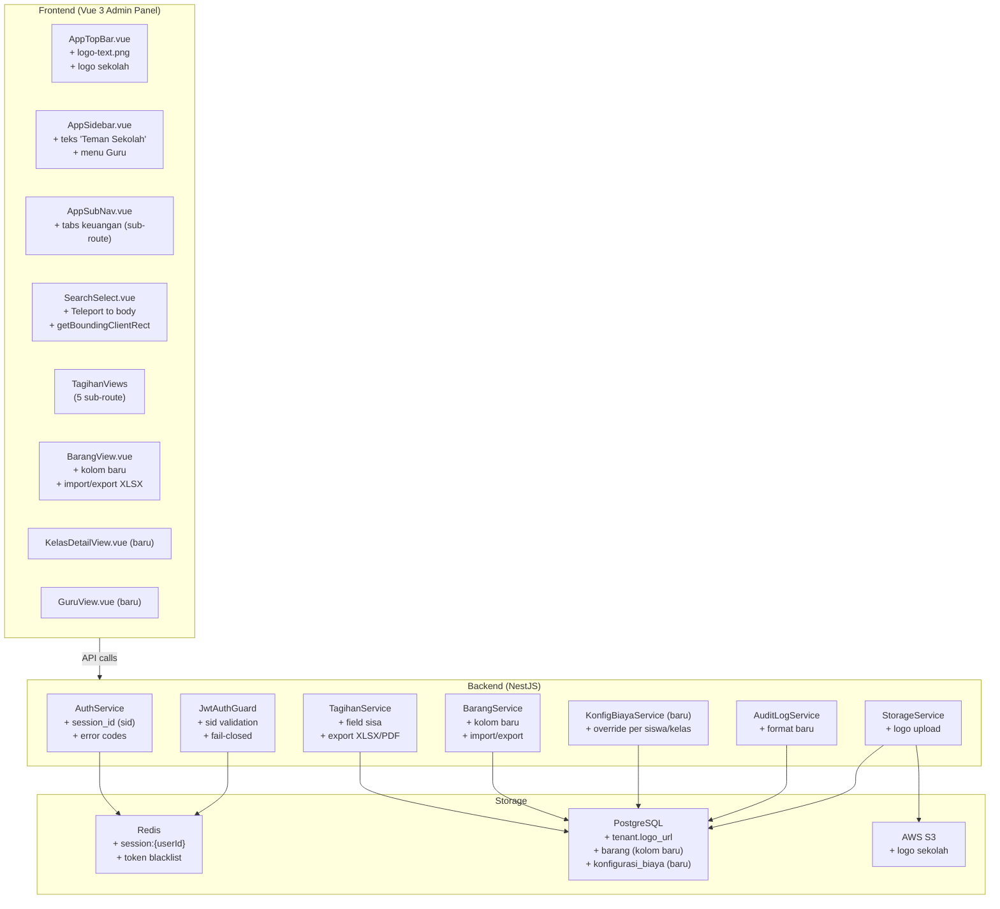

# Design Document: Sistem Pengembangan V2

## Overview

Dokumen ini menjabarkan desain teknis untuk 12 item pengembangan platform Teman Sekolah pada batch v2. Scope mencakup perbaikan bug, perluasan fitur, dan peningkatan keamanan yang melibatkan tiga layer utama: backend NestJS, frontend Vue 3 admin panel, dan skema database PostgreSQL.

### Ringkasan Perubahan

| Req | Kategori | Kompleksitas |
|-----|----------|--------------|
| 1 | Branding — logo sekolah di topbar | Sedang |
| 2 | Branding — identitas "Teman Sekolah" | Rendah |
| 3 | Navigasi akademik — detail kelas & daftar guru | Sedang |
| 4 | Bugfix — SearchSelect dropdown z-index | Sedang |
| 5 | Inventarisasi — kolom baru + import/export XLSX | Tinggi |
| 6 | Biaya sekolah — konfigurasi per siswa/kelas | Tinggi |
| 7 | Bugfix — NaN sisa tagihan | Rendah |
| 8 | Audit Trail — format baru human-readable | Sedang |
| 9 | Ekspor tagihan/tunggakan XLSX dan PDF | Sedang |
| 10 | Navigasi keuangan — refactor tab → sub-route | Sedang |
| 11 | Token — error code expired | Rendah |
| 12 | Keamanan — single device login + session_id | Tinggi |


---

## Architecture

### Gambaran Interaksi Komponen




### Prinsip Desain

1. **Backward compatibility**: Semua perubahan schema menggunakan kolom nullable atau dengan default value sehingga data lama tetap valid.
2. **Fail-closed security**: Req 12 (session validation) fail-closed saat Redis down — lebih aman daripada fail-open.
3. **Server-authoritative data**: Req 7 (sisa tagihan) dihitung di server, client hanya render. Ini mencegah bug aritmetika JS dengan `undefined`.
4. **Teleport pattern**: Req 4 (dropdown) menggunakan Teleport + positional calc, bukan solusi z-index saja — karena z-index tidak membantu jika parent memiliki `overflow:hidden`.

---

## Components and Interfaces

### Req 1 — Logo Sekolah di Topbar

**File yang diubah:**
- `apps/admin/src/components/layout/AppTopBar.vue`
- `apps/admin/src/stores/tenant-context.ts` (tambah `logoUrl` ke state)
- `apps/api/src/modules/tenant/tenant.controller.ts` (endpoint upload logo)
- `apps/api/src/modules/storage/storage.service.ts` (validasi + upload S3)

**Perubahan AppTopBar.vue:**
```vue
<!-- Kiri: logo-text.png | Kanan: logo sekolah + nama sekolah -->
<div class="flex items-center gap-3">
  
  <h1>{{ title }}</h1>
</div>
<div v-if="schoolName" class="flex items-center gap-2">
  
  
  <span>{{ schoolName }}</span>
</div>
```

**Props baru AppTopBar:**
```typescript
interface Props {
  title: string;
  schoolName?: string;
  logoUrl?: string | null;   // TAMBAH
}
```

**StorageService — validasi upload logo:**
```typescript
interface UploadLogoOptions {
  file: Express.Multer.File;
  tenantId: string;
}
// Validasi MIME: image/jpeg, image/png, image/webp
// Validasi ukuran: ≤ 2 MB (2 * 1024 * 1024 bytes)
// Resize dengan Sharp ke max 512x512, format WebP untuk efisiensi
// Upload ke S3, kembalikan URL publik
```

**Catatan penting:** `tenant.ts` sudah memiliki kolom `logoUrl varchar(500)` — tidak perlu migration untuk schema tenant. Perlu:
1. Backend endpoint `PATCH /tenant/:id/logo` yang menerima multipart/form-data
2. Frontend: tambah field upload di `TenantManagementView.vue` atau form tenant baru


### Req 2 — Branding "Teman Sekolah"

**File yang diubah:**
- `apps/admin/src/components/layout/AppTopBar.vue` (ditangani bersamaan dengan Req 1)
- `apps/admin/src/components/layout/AppSidebar.vue`

**Perubahan AppSidebar.vue — tambah teks branding di expanded state:**
```html
<!-- Di bagian sidebar__logo, setelah img logo: -->
<div class="sidebar__logo">
  <div class="sidebar__logo-container">
    
  </div>
  <!-- Muncul saat hover (expanded) -->
  <span class="sidebar__brand-text">Teman Sekolah</span>
</div>
```

```css
.sidebar__brand-text {
  display: none;
  font-size: 12px;
  font-weight: 600;
  color: rgba(255, 255, 255, 0.7);
  margin-top: 4px;
}
.sidebar:hover .sidebar__brand-text {
  display: block;
}
```

**Fallback AppTopBar jika logo-text.png gagal:**
```typescript
const brandFallback = ref(false);
function useFallbackBranding() { brandFallback.value = true; }
// Template: v-if="!brandFallback" untuk img, v-else untuk teks
```


### Req 3 — Halaman Detail Kelas dan Daftar Guru

**File baru:**
- `apps/admin/src/views/KelasDetailView.vue`
- `apps/admin/src/views/GuruView.vue`

**File yang diubah:**
- `apps/admin/src/router/index.ts` (tambah routes)
- `apps/admin/src/components/layout/AppSidebar.vue` (tambah menu Guru di grup Akademik)
- `apps/api/src/modules/kelas/kelas.controller.ts` (endpoint GET /kelas/:id/siswa)
- `apps/api/src/modules/user/user.controller.ts` (endpoint GET /users?role=guru)

**Router — routes baru:**
```typescript
{
  path: '/kelas/:id',
  name: 'kelas-detail',
  component: () => import('@/views/KelasDetailView.vue'),
  meta: { roles: [Role.ADMIN, Role.KEPALA_SEKOLAH] },
},
{
  path: '/guru',
  name: 'guru',
  component: () => import('@/views/GuruView.vue'),
  meta: { roles: [Role.ADMIN, Role.KEPALA_SEKOLAH] },
},
```

**AppSidebar — tambah navigasi Guru:**
Perlu memecah item `akademik` menjadi lebih granular, atau menambah `/guru` sebagai path yang dikenali dalam prefix akademik:
```typescript
// Di sectionPrefixes.akademik, tambah:
akademik: ['/siswa', '/kelas', '/mata-pelajaran', '/jadwal', '/kenaikan-kelas', '/guru'],
// Di sectionTabPaths.akademik, tambah:
akademik: ['/siswa', '/kelas', '/mata-pelajaran', '/jadwal', '/kenaikan-kelas', '/guru'],
```

Sub-navigasi Akademik menggunakan `AppSubNav` dengan tabs yang di-filter berdasarkan role.

**API — GET /kelas/:id/siswa:**
```typescript
// Response
interface KelasDetailResponse {
  id: string;
  nama: string;
  tingkat: number;
  waliKelasNama: string | null;
  siswa: {
    id: string;
    nama: string;
    nisn: string | null;
    status: 'aktif' | 'tidak_aktif' | 'pindah' | 'lulus';
  }[];
}
```

**API — GET /users?role=guru:**
```typescript
// Response (menggunakan endpoint user yang sudah ada, filter by role)
interface GuruListResponse {
  data: {
    id: string;
    nama: string;
    email: string;
    telepon: string | null;
  }[];
}
```


### Req 4 — Fix SearchSelect Dropdown (Teleport + getBoundingClientRect)

**File yang diubah:**
- `apps/admin/src/components/ui/SearchSelect.vue`

**Root cause:** Dropdown saat ini menggunakan `position: absolute` relatif terhadap container. Jika container atau salah satu ancestor-nya memiliki `overflow: hidden` atau `overflow: clip` (termasuk `BaseModal` yang memakai `overflow-y-auto`), dropdown terpotong. Menaikkan z-index saja tidak cukup karena clipping terjadi sebelum z-index dievaluasi.

**Solusi: Teleport + positional calculation:**

```typescript
// State tambahan
const triggerRef = ref<HTMLElement | null>(null);
const dropdownStyle = ref<{top: string; left: string; width: string}>({
  top: '0px', left: '0px', width: '0px'
});

function updateDropdownPosition() {
  if (!triggerRef.value) return;
  const rect = triggerRef.value.getBoundingClientRect();
  dropdownStyle.value = {
    top: `${rect.bottom + window.scrollY}px`,
    left: `${rect.left + window.scrollX}px`,
    width: `${rect.width}px`,
  };
}

function open() {
  if (props.disabled) return;
  isOpen.value = true;
  searchQuery.value = '';
  highlightedIndex.value = -1;
  nextTick(() => {
    updateDropdownPosition();
    inputRef.value?.focus();
  });
}
```

**Template:**
```html
<div ref="triggerRef" class="relative w-full">
  <!-- Trigger button (tidak berubah) -->
  <button ref="buttonRef" @click="toggle" ...>...</button>
</div>

<Teleport to="body">
  <Transition ...>
    <div
      v-if="isOpen"
      :style="dropdownStyle"
      class="fixed z-[9999] bg-white border border-border shadow-lg ..."
    >
      <!-- Search input + options list -->
    </div>
  </Transition>
</Teleport>
```

**Catatan:** `position: fixed` digunakan (bukan `absolute`) pada dropdown yang di-teleport ke body, dikombinasikan dengan koordinat dari `getBoundingClientRect()`. Ini memastikan posisi akurat meski ada scroll. `handleClickOutside` tetap dibutuhkan karena Teleport memindahkan dropdown ke luar `containerRef`.

**Scroll resync:** Tambahkan listener `scroll` dan `resize` pada `window` saat dropdown terbuka untuk memperbarui posisi jika halaman di-scroll.


### Req 5 — Perluasan Inventarisasi Barang

**File yang diubah:**
- `apps/api/src/drizzle/schema/barang.ts` (tambah 4 kolom)
- `apps/api/src/modules/barang/barang.controller.ts` (endpoint import/export)
- `apps/api/src/modules/barang/barang.service.ts` (logic import/export, filter baru)
- `apps/admin/src/views/BarangView.vue` (form fields baru, import/export UI)

**Schema changes (lihat bagian Database Schema).**

**API — endpoint baru:**
```typescript
// GET /barang/export?format=xlsx&sumber_dana=yayasan&kondisi_barang=bagus&...
// → mengembalikan file XLSX (Content-Disposition: attachment)

// POST /barang/import (multipart/form-data, field "file")
// → Response:
interface ImportResult {
  berhasilDitambahkan: number;
  dilewati: { baris: number; nama: string; alasan: string }[];
}
```

**Kolom XLSX template dan import:**
```
nama | deskripsi | jumlah | lokasi | kondisi_barang | sumber_dana | kategori
```

**Validasi import per baris:**
- `kondisi_barang` harus salah satu dari: `bagus`, `perlu_perbaikan`, `rusak`
- `sumber_dana` harus salah satu dari: `yayasan`, `unit_sekolah`, `bos`
- `kategori` harus salah satu dari: `peralatan`, `perlengkapan`
- Nama barang tidak boleh duplikat dalam tenant (case-insensitive check)
- `jumlah` harus integer ≥ 0

**Library yang digunakan:**
- Backend: `exceljs` (sudah tersedia di project atau perlu ditambah sebagai dependency)
- Frontend: download via blob URL (sudah diimplementasi di fungsi `exportTunggakan` yang ada)

**Filter API baru:**
```
GET /barang?search=...&sumber_dana=...&kondisi_barang=...&kategori=...&page=...&page_size=...
```


### Req 6 — Konfigurasi Biaya Sekolah per Siswa/Kelas

**File baru:**
- `apps/api/src/drizzle/schema/konfigurasi-biaya.ts`
- `apps/api/src/modules/konfigurasi-biaya/konfigurasi-biaya.module.ts`
- `apps/api/src/modules/konfigurasi-biaya/konfigurasi-biaya.controller.ts`
- `apps/api/src/modules/konfigurasi-biaya/konfigurasi-biaya.service.ts`
- `apps/admin/src/views/KonfigurasiBiayaView.vue`

**File yang diubah:**
- `apps/api/src/modules/tagihan/tagihan.service.ts` (logic generate menggunakan hierarki biaya)
- `apps/admin/src/router/index.ts` (tambah route /konfigurasi-biaya)

**API endpoints:**
```typescript
// GET /konfigurasi-biaya — list semua konfigurasi tenant
// POST /konfigurasi-biaya — buat/update override per kelas atau per siswa
// DELETE /konfigurasi-biaya/:id — hapus override

// Request body:
interface UpsertKonfigBiayaDto {
  type: 'per_kelas' | 'per_siswa';
  kelasId?: string;   // wajib jika type=per_kelas
  siswaId?: string;   // wajib jika type=per_siswa
  nominal: number;    // 1 - 999_999_999
}
```

**Logic generate tagihan (hierarki prioritas):**
```typescript
async function resolveNominalForSiswa(
  siswaId: string, kelasId: string, tenantId: string
): Promise<number> {
  // 1. Override per siswa
  const perSiswa = await db.query.konfigBiaya.findFirst({
    where: and(eq(konfigBiaya.siswaId, siswaId), eq(konfigBiaya.tenantId, tenantId))
  });
  if (perSiswa?.nominal > 0) return perSiswa.nominal;

  // 2. Override per kelas
  const perKelas = await db.query.konfigBiaya.findFirst({
    where: and(eq(konfigBiaya.kelasId, kelasId), eq(konfigBiaya.tenantId, tenantId))
  });
  if (perKelas?.nominal > 0) return perKelas.nominal;

  // 3. Global tenant (dari konfigurasi yang sudah ada)
  const global = await db.query.konfigurasi.findFirst({
    where: eq(konfigurasi.tenantId, tenantId)
  });
  if (global?.nominalSpp > 0) return global.nominalSpp;

  // Tidak ada nominal → throw error
  throw new BadRequestException('Tidak ada nominal biaya yang dikonfigurasi...');
}
```


### Req 7 — Fix NaN Sisa Tagihan

**File yang diubah:**
- `apps/api/src/modules/tagihan/tagihan.service.ts` (tambah field `sisa` di response tunggakan)
- `apps/admin/src/views/TagihanView.vue` → subpage Tunggakan (fallback logic)

**Perubahan backend — kalkulasi server-side:**
```typescript
// Di query tunggakan, tambahkan computed field:
const tunggakanWithSisa = tunggakanRaw.map(t => ({
  ...t,
  sisa: Math.max(0, t.nominal - t.totalDibayar),
}));
```

**Response interface yang diupdate:**
```typescript
interface TunggakanItem {
  id: string;
  siswaId: string;
  siswaNama: string;
  kelasNama: string;
  bulan: number;
  tahun: number;
  nominal: number;
  totalDibayar: number;
  sisa: number;         // ← field baru, selalu non-negative integer
  status: StatusTagihan;
  tanggalJatuhTempo: string | null;
}
```

**Frontend — fallback logic jika field sisa tidak ada:**
```typescript
function getSisaTagihan(tunggakan: Tunggakan): number {
  if (typeof tunggakan.sisa === 'number' && !isNaN(tunggakan.sisa)) {
    return tunggakan.sisa;
  }
  // Fallback: kalkulasi client-side dengan null-safe operators
  return Math.max(0, (tunggakan.nominal ?? 0) - (tunggakan.totalDibayar ?? 0));
}
```

**Catatan:** Penyebab NaN asli: `Tunggakan.sisa` tidak ada di response API sebelumnya, sehingga `tunggakan.sisa` adalah `undefined`. Operasi `formatCurrency(undefined)` menghasilkan NaN. Solusi server-side adalah yang paling robust.


### Req 8 — Perbaikan Audit Trail

**Konteks penting:** Ada dua tabel berbeda di codebase:
- `audit_trail` (di `tagihan.ts`) — khusus tagihan, pakai struktur `nilaiSebelum`/`nilaiSesudah` jsonb
- `audit_logs` (di `audit-log.ts`) — general purpose, pakai `beforeValues`/`afterValues`

Berdasarkan requirements dan `TagihanView.vue` yang memanggil `/tagihan/audit-log`, yang perlu diupdate adalah **tabel `audit_trail`** dan cara data disimpan/ditampilkan.

**File yang diubah:**
- `apps/api/src/drizzle/schema/tagihan.ts` (kolom baru di `auditTrail`)
- `apps/api/src/modules/tagihan/tagihan.service.ts` (cara menyimpan audit log)
- `apps/admin/src/views/TagihanView.vue` → subpage Audit Trail (rendering)

**Perubahan schema `auditTrail` (migration additive):**
```typescript
// Tambah kolom baru ke tabel audit_trail:
aksiLabel: varchar('aksi_label', { length: 100 }),
perubahan: jsonb('perubahan'), // PerubahanItem[]
```

**Type untuk perubahan:**
```typescript
interface PerubahanItem {
  namaField: string;      // Nama teknis kolom
  labelField: string;     // Label Bahasa Indonesia, e.g., "Nominal"
  nilaiSebelum: unknown;
  nilaiSesudah: unknown;
}
```

**Cara menyimpan audit log baru di service:**
```typescript
// Contoh untuk aksi edit nominal tagihan:
await db.insert(auditTrail).values({
  tenantId,
  userId: currentUser.id,
  jenisAksi: 'UPDATE',
  entityType: 'tagihan',
  entityId: tagihanId,
  aksiLabel: 'Mengubah nominal tagihan',
  perubahan: [
    {
      namaField: 'nominal',
      labelField: 'Nominal',
      nilaiSebelum: tagihanLama.nominal,
      nilaiSesudah: dto.nominal,
    }
  ],
  alasan: dto.alasan ?? null,
  nilaiSebelum: tagihanLama,
  nilaiSesudah: { ...tagihanLama, nominal: dto.nominal },
});
```

**Frontend rendering (helper function):**
```typescript
function formatAuditEntry(log: AuditLog): string {
  if (log.jenisAksi === 'CREATE') return 'Data baru dibuat';
  if (!log.perubahan?.length) return log.aksiLabel ?? log.jenisAksi;
  return log.perubahan
    .map(p => `${p.labelField}: ${p.nilaiSebelum} → ${p.nilaiSesudah}`)
    .join('\n');
}
```


### Req 9 — Ekspor Tagihan dan Tunggakan

**File yang diubah:**
- `apps/api/src/modules/tagihan/tagihan.controller.ts` (endpoint export)
- `apps/api/src/modules/tagihan/tagihan.service.ts` (generate XLSX/PDF)
- `apps/admin/src/views/tagihan/TagihanListView.vue` (tombol ekspor)
- `apps/admin/src/views/tagihan/TunggakanView.vue` (tombol ekspor)

**API endpoints:**
```typescript
// GET /tagihan/export?format=xlsx&status=...&kelas_id=...&bulan=...&tahun=...
// GET /tagihan/tunggakan/export?format=xlsx&kelas_id=...
// GET /tagihan/export?format=pdf&...
// GET /tagihan/tunggakan/export?format=pdf&...
// Response: file binary dengan Content-Disposition: attachment; filename=...
```

**Urutan kolom XLSX (persis sesuai Req 9.3):**
```
nama_siswa | kelas | bulan | tahun | nominal | total_dibayar | sisa | status | tanggal_jatuh_tempo
```

**PDF generation:** Gunakan library `pdfkit` atau `@pdfkit/pdfkit` di backend. PDF mencakup:
- Header: nama sekolah (dari tenant), tanggal cetak (format dd/MM/yyyy)
- Tabel data dengan kolom yang sama dengan XLSX

**Frontend download pattern (sudah ada contoh di TagihanView.exportTunggakan):**
```typescript
async function exportData(format: 'xlsx' | 'pdf') {
  exporting.value = true;
  try {
    const params = { format, ...activeFilters };
    const response = await api.get('/tagihan/export', {
      params, responseType: 'blob'
    });
    const ext = format === 'xlsx' ? 'xlsx' : 'pdf';
    const date = new Date().toISOString().slice(0, 10).replace(/-/g, '');
    const filename = `tagihan_list_${date}.${ext}`;
    downloadBlob(response.data, filename);
  } catch (err) {
    toast.error('Gagal mengekspor data');
  } finally {
    exporting.value = false;
  }
}

function downloadBlob(data: Blob, filename: string) {
  const url = URL.createObjectURL(data);
  const a = document.createElement('a');
  a.href = url; a.download = filename;
  document.body.appendChild(a); a.click();
  a.remove(); URL.revokeObjectURL(url);
}
```


### Req 10 — Navigasi Keuangan: Tab → Sub-Route

**File yang diubah:**
- `apps/admin/src/router/index.ts` (replace satu route `/tagihan` dengan 5 sub-route)
- `apps/admin/src/views/TagihanView.vue` (refactor menjadi 5 view terpisah)
- `apps/admin/src/components/layout/AppLayout.vue` atau `useSubNavigation.ts`

**File baru:**
- `apps/admin/src/views/tagihan/TagihanGenerateView.vue`
- `apps/admin/src/views/tagihan/TagihanListView.vue`
- `apps/admin/src/views/tagihan/TagihanVerifikasiView.vue`
- `apps/admin/src/views/tagihan/TunggakanView.vue`
- `apps/admin/src/views/tagihan/TagihanAuditView.vue`

**Router baru:**
```typescript
// Redirect /tagihan → /tagihan/list
{
  path: '/tagihan',
  redirect: '/tagihan/list',
},
// Sub-route generate: hanya admin + bendahara
{
  path: '/tagihan/generate',
  name: 'tagihan-generate',
  component: () => import('@/views/tagihan/TagihanGenerateView.vue'),
  meta: { roles: [Role.ADMIN, Role.BENDAHARA] },
},
{
  path: '/tagihan/list',
  name: 'tagihan-list',
  component: () => import('@/views/tagihan/TagihanListView.vue'),
  meta: { roles: [Role.ADMIN, Role.BENDAHARA] },
},
{
  path: '/tagihan/verifikasi',
  name: 'tagihan-verifikasi',
  component: () => import('@/views/tagihan/TagihanVerifikasiView.vue'),
  meta: { roles: [Role.ADMIN, Role.BENDAHARA] },
},
{
  path: '/tagihan/tunggakan',
  name: 'tagihan-tunggakan',
  component: () => import('@/views/tagihan/TunggakanView.vue'),
  meta: { roles: [Role.ADMIN, Role.BENDAHARA] },
},
{
  path: '/tagihan/audit',
  name: 'tagihan-audit',
  component: () => import('@/views/tagihan/TagihanAuditView.vue'),
  meta: { roles: [Role.ADMIN, Role.BENDAHARA] },
},
// Catch-all untuk /tagihan/* yang tidak dikenali:
{
  path: '/tagihan/:pathMatch(.*)*',
  redirect: '/tagihan/list',
},
```

**useSubNavigation.ts — tabs untuk keuangan:**
```typescript
// Composable sudah ada, perlu ditambah definisi tabs keuangan:
const KEUANGAN_TABS = [
  { label: 'Generate', path: '/tagihan/generate', roles: [Role.ADMIN, Role.BENDAHARA] },
  { label: 'Daftar Tagihan', path: '/tagihan/list', roles: [Role.ADMIN, Role.BENDAHARA] },
  { label: 'Verifikasi', path: '/tagihan/verifikasi', roles: [Role.ADMIN, Role.BENDAHARA] },
  { label: 'Tunggakan', path: '/tagihan/tunggakan', roles: [Role.ADMIN, Role.BENDAHARA] },
  { label: 'Audit Trail', path: '/tagihan/audit', roles: [Role.ADMIN, Role.BENDAHARA] },
];
// Filter berdasarkan role user, kembalikan saat path dimulai dengan /tagihan
```

**Persistensi filter:** Setiap subview menggunakan `useTableUrlState` yang menyimpan state ke query params URL. Filter tidak hilang saat navigasi karena Vue Router mempertahankan query params per route jika menggunakan `router.push` dengan `query: { ...currentQuery, ...newParams }`.


### Req 11 — Error Code Token Expired

**Konteks:** `getAccessTokenTTL()` sudah mengembalikan `'24h'` untuk `admin_panel` — tidak perlu perubahan logika TTL. Yang perlu ditambah hanya differentiated error codes di response.

**File yang diubah:**
- `apps/api/src/common/guards/jwt-auth.guard.ts`
- `apps/api/src/modules/auth/auth.service.ts` (method refresh — error code REFRESH_TOKEN_EXPIRED)
- `apps/api/src/common/filters/` (tambah atau update HTTP exception filter)

**Perubahan JwtAuthGuard — catch token expired:**
```typescript
// Di canActivate(), Passport sudah throw TokenExpiredError dari passport-jwt.
// Perlu override handleRequest untuk translate error:

handleRequest(err: any, user: any, info: any) {
  if (info?.name === 'TokenExpiredError') {
    throw new UnauthorizedException({
      code: 'TOKEN_EXPIRED',
      message: 'Token akses kedaluwarsa. Silakan perbarui sesi Anda.',
    });
  }
  if (err || !user) {
    throw err || new UnauthorizedException('Unauthorized');
  }
  return user;
}
```

**Perubahan AuthService.refresh() — REFRESH_TOKEN_EXPIRED:**
```typescript
try {
  payload = this.jwtService.verify(dto.refresh_token, { secret: refreshSecret });
} catch (err) {
  if (err?.name === 'TokenExpiredError') {
    throw new UnauthorizedException({
      code: 'REFRESH_TOKEN_EXPIRED',
      message: 'Sesi berakhir. Silakan login kembali.',
    });
  }
  throw new UnauthorizedException('Refresh token tidak valid atau sudah kadaluarsa');
}
```

**Frontend — intercept di Axios client:**
```typescript
// Di apps/admin/src/api/client.ts, interceptor response:
api.interceptors.response.use(
  (res) => res,
  async (error) => {
    const code = error.response?.data?.code;
    if (code === 'TOKEN_EXPIRED') {
      // Coba refresh token
      return attemptTokenRefresh(error.config);
    }
    if (code === 'REFRESH_TOKEN_EXPIRED' || code === 'SESSION_INVALIDATED') {
      // Logout paksa, redirect ke login
      authStore.logout();
      router.push('/login');
    }
    return Promise.reject(error);
  }
);
```


### Req 12 — Single Device Login

**File yang diubah:**
- `apps/api/src/modules/auth/interfaces/jwt-payload.interface.ts` (tambah `sid`)
- `apps/api/src/modules/auth/auth.service.ts` (generate session_id, simpan ke Redis)
- `apps/api/src/common/guards/jwt-auth.guard.ts` (validasi sid vs Session_Store)
- `apps/api/src/modules/redis/redis.service.ts` (helper session methods)

**JwtPayload interface — tambah `sid`:**
```typescript
export interface JwtPayload {
  sub: string;
  role: Role;
  tenant_id: string | null;
  tenants?: string[];
  platform: 'admin_panel' | 'mobile';
  jti: string;
  sid?: string;   // ← session_id (UUID v4), ada untuk role yang mendukung single device
  iat: number;
  exp: number;
}
```

**AuthService.generateTokenPair() — tambah session:**
```typescript
private async generateTokenPair(
  payload: Omit<JwtPayload, 'jti' | 'iat' | 'exp'>,
  platform: string, role: Role
): Promise<{ access_token: string; refresh_token: string }> {
  const accessJti = crypto.randomUUID();
  const refreshJti = crypto.randomUUID();

  // Generate session_id untuk role yang mendukung single device
  // orang_tua dikecualikan sesuai Req 12.9
  const isSessionRole = role !== Role.ORANG_TUA;
  const sessionId = isSessionRole ? crypto.randomUUID() : undefined;

  if (sessionId) {
    const refreshTtlSeconds = this.getRefreshTokenTTLSeconds(platform, role);
    // Simpan ke Redis — overwrite sesi lama (force logout)
    await this.redisService.set(
      `session:${payload.sub}`,
      sessionId,
      refreshTtlSeconds
    );
  }

  const tokenPayload = { ...payload, jti: accessJti, ...(sessionId && { sid: sessionId }) };
  // ... sign tokens
}
```

**JwtAuthGuard — validasi session_id:**
```typescript
// Setelah validasi blacklist dan tokensInvalidatedAt yang sudah ada:
if (requestUser.role !== Role.ORANG_TUA && payload.sid) {
  let storedSessionId: string | null;
  try {
    storedSessionId = await this.redisService.get(`session:${requestUser.id}`);
  } catch (redisError) {
    // Redis down → fail-closed (Req 12.7)
    throw new HttpException(
      { code: 'SERVICE_UNAVAILABLE', message: 'Layanan sementara tidak tersedia' },
      503
    );
  }

  if (!storedSessionId || storedSessionId !== payload.sid) {
    throw new UnauthorizedException({
      code: 'SESSION_INVALIDATED',
      message: 'Sesi tidak valid karena login dari perangkat lain.',
    });
  }
}
```

**AuthService.logout() — hapus session:**
```typescript
async logout(currentUser: RequestUser, refreshToken?: string): Promise<void> {
  // Hapus session dari Redis
  if (currentUser.role !== Role.ORANG_TUA) {
    await this.redisService.del(`session:${currentUser.id}`);
  }
  // ... blacklist token (kode yang sudah ada)
}
```

**Keputusan desain — fail-closed vs fail-open:**
Req 12.7 mengharuskan fail-closed (503) saat Redis down untuk role staff. Ini sengaja lebih ketat dari `tokensInvalidatedAt` (yang bisa cache miss dan fallback ke DB). Untuk session validation, tidak ada fallback karena tujuannya adalah memastikan sesi lama tidak bisa digunakan setelah login baru — jika kita tidak bisa memverifikasi, lebih aman menolak.


---

## Data Models

### Perubahan Schema Database

#### 1. Tabel `barang` — Req 5

Tambah 4 kolom baru:

```typescript
// apps/api/src/drizzle/schema/barang.ts
export const kondisiBarangEnum = pgEnum('kondisi_barang', [
  'bagus',
  'perlu_perbaikan',
  'rusak',
]);

export const sumberDanaEnum = pgEnum('sumber_dana', [
  'yayasan',
  'unit_sekolah',
  'bos',
]);

export const kategoriBarangEnum = pgEnum('kategori_barang', [
  'peralatan',
  'perlengkapan',
]);

export const barang = pgTable(
  'barang',
  {
    id: uuid('id').primaryKey().defaultRandom(),
    tenantId: uuid('tenant_id').notNull(),
    nama: varchar('nama', { length: 255 }).notNull(),
    deskripsi: text('deskripsi'),
    jumlah: integer('jumlah').notNull().default(0),
    // ─── Kolom baru Req 5 ───
    lokasi: varchar('lokasi', { length: 255 }),              // nullable, opsional
    kondisiBarang: kondisiBarangEnum('kondisi_barang'),       // nullable untuk data lama
    sumberDana: sumberDanaEnum('sumber_dana'),                // nullable untuk data lama
    kategori: kategoriBarangEnum('kategori'),                 // nullable untuk data lama
    // ────────────────────────
    createdAt: timestamp('created_at', { withTimezone: true }).notNull().defaultNow(),
    updatedAt: timestamp('updated_at', { withTimezone: true }).notNull().defaultNow(),
    deletedAt: timestamp('deleted_at', { withTimezone: true }),
  },
  (table) => ({
    tenantCreatedIdx: index('idx_barang_tenant_created').on(table.tenantId, table.createdAt),
    tenantNamaIdx: index('idx_barang_tenant_nama').on(table.tenantId, table.nama),
    // Index baru untuk filter
    kondisiIdx: index('idx_barang_kondisi').on(table.tenantId, table.kondisiBarang),
    sumberDanaIdx: index('idx_barang_sumber_dana').on(table.tenantId, table.sumberDana),
    kategoriIdx: index('idx_barang_kategori').on(table.tenantId, table.kategori),
  }),
);
```

**Catatan migrasi:** Kolom baru bersifat nullable — data barang lama tidak terpengaruh. Form edit akan mendorong user untuk mengisi kolom baru.

#### 2. Tabel baru `konfigurasi_biaya` — Req 6

```typescript
// apps/api/src/drizzle/schema/konfigurasi-biaya.ts
export const konfigBiayaTypeEnum = pgEnum('konfigurasi_biaya_type', [
  'per_siswa',
  'per_kelas',
]);

export const konfigurasiBiaya = pgTable(
  'konfigurasi_biaya',
  {
    id: uuid('id').primaryKey().defaultRandom(),
    tenantId: uuid('tenant_id').notNull(),
    type: konfigBiayaTypeEnum('type').notNull(),
    siswaId: uuid('siswa_id'),    // tidak null jika type=per_siswa
    kelasId: uuid('kelas_id'),    // tidak null jika type=per_kelas
    nominal: bigint('nominal', { mode: 'number' }).notNull(),
    createdAt: timestamp('created_at', { withTimezone: true }).notNull().defaultNow(),
    updatedAt: timestamp('updated_at', { withTimezone: true }).notNull().defaultNow(),
  },
  (table) => ({
    // Satu override per siswa per tenant
    uniqueSiswa: unique('uq_konfig_biaya_siswa').on(table.tenantId, table.siswaId),
    // Satu override per kelas per tenant
    uniqueKelas: unique('uq_konfig_biaya_kelas').on(table.tenantId, table.kelasId),
    tenantIdx: index('idx_konfig_biaya_tenant').on(table.tenantId),
  }),
);
```


#### 3. Tabel `audit_trail` — Req 8

Tambah kolom baru (additive migration):

```typescript
// Perubahan di apps/api/src/drizzle/schema/tagihan.ts
export const auditTrail = pgTable(
  'audit_trail',
  {
    // ... kolom yang sudah ada ...
    id: uuid('id').primaryKey().defaultRandom(),
    tenantId: uuid('tenant_id').notNull(),
    userId: uuid('user_id').notNull(),
    jenisAksi: varchar('jenis_aksi', { length: 50 }).notNull(),
    entityType: varchar('entity_type', { length: 50 }).notNull(),
    entityId: uuid('entity_id').notNull(),
    nilaiSebelum: jsonb('nilai_sebelum'),
    nilaiSesudah: jsonb('nilai_sesudah'),
    alasan: text('alasan'),
    // ─── Kolom baru Req 8 ───
    aksiLabel: varchar('aksi_label', { length: 100 }),    // "Mengubah nominal tagihan"
    perubahan: jsonb('perubahan'),                         // PerubahanItem[]
    // ────────────────────────
    createdAt: timestamp('created_at', { withTimezone: true }).notNull().defaultNow(),
  },
  // ... indexes yang ada ...
);
```

#### 4. Tabel `tenant` — Req 1 (sudah ada, tidak perlu migrasi)

`tenant.ts` sudah memiliki `logoUrl: varchar('logo_url', { length: 500 })`. Tidak perlu perubahan schema. Hanya perlu backend endpoint dan frontend UI.

#### 5. Redis Session Store — Req 12

Bukan tabel DB, tapi struktur Redis:

```
Key:   session:{userId}
Value: session_id (UUID string, e.g., "a3b4c5d6-...")
TTL:   7 hari (admin_panel) atau sesuai refresh token TTL platform mobile

Contoh:
  session:abc123 → "f47ac10b-58cc-4372-a567-0e02b2c3d479"  [TTL 604800s]
```


---

## API Changes Summary

| Method | Path | Perubahan | Requirement |
|--------|------|-----------|-------------|
| PATCH | `/tenant/:id/logo` | Endpoint baru — upload logo | Req 1 |
| GET | `/kelas/:id` | Tambah `siswa[]` di response | Req 3 |
| GET | `/users?role=guru` | Filter by role (jika belum ada) | Req 3 |
| GET | `/barang` | Tambah filter: `kondisi_barang`, `sumber_dana`, `kategori` | Req 5 |
| POST | `/barang` | Tambah fields: `lokasi`, `kondisi_barang`, `sumber_dana`, `kategori` | Req 5 |
| PATCH | `/barang/:id` | Tambah fields baru | Req 5 |
| GET | `/barang/export` | Endpoint baru — XLSX export | Req 5 |
| POST | `/barang/import` | Endpoint baru — XLSX import | Req 5 |
| GET | `/konfigurasi-biaya` | Endpoint baru | Req 6 |
| POST | `/konfigurasi-biaya` | Endpoint baru | Req 6 |
| DELETE | `/konfigurasi-biaya/:id` | Endpoint baru | Req 6 |
| GET | `/tagihan/tunggakan` | Tambah field `sisa` di response | Req 7 |
| GET | `/tagihan/export` | Endpoint baru — XLSX/PDF export | Req 9 |
| GET | `/tagihan/tunggakan/export` | Endpoint baru — XLSX/PDF export tunggakan | Req 9 |
| POST | `/auth/refresh` | Error code `REFRESH_TOKEN_EXPIRED` | Req 11 |
| POST | `/auth/login` | Generate + simpan `session_id` di Redis | Req 12 |
| POST | `/auth/logout` | Hapus `session:{userId}` dari Redis | Req 12 |

**Breaking changes:** Tidak ada. Semua perubahan bersifat additive (field baru di response, endpoint baru) kecuali perubahan error format di Req 11 yang sebelumnya hanya mengembalikan pesan string biasa.


---

## Correctness Properties

*A property is a characteristic or behavior that should hold true across all valid executions of a system — essentially, a formal statement about what the system should do. Properties serve as the bridge between human-readable specifications and machine-verifiable correctness guarantees.*

### Property 1: Validasi tipe file logo hanya menerima tipe valid

*Untuk semua* tipe MIME yang bukan `image/jpeg`, `image/png`, atau `image/webp`, validasi upload logo harus menolak file tersebut dengan pesan error yang sesuai.

**Validates: Requirements 1.3**

---

### Property 2: Logo fallback untuk semua nilai "empty-like"

*Untuk semua* nilai `logoUrl` yang berupa `null`, `undefined`, string kosong, atau string yang hanya berisi whitespace, AppTopBar harus menampilkan Logo_Default (`/logo.png`) dan tidak pernah menampilkan gambar dengan `src` kosong atau `src` yang tidak valid.

**Validates: Requirements 1.7**

---

### Property 3: Rendering kolom siswa di detail kelas

*Untuk semua* daftar siswa yang dikembalikan API endpoint `/kelas/:id`, setiap item yang dirender di `KelasDetailView` harus memiliki tiga elemen yang dapat dibaca: nama siswa, NISN (atau tanda "-" jika null), dan status yang merupakan salah satu dari empat nilai valid (`aktif`, `tidak_aktif`, `pindah`, `lulus`).

**Validates: Requirements 3.2**

---

### Property 4: Rendering kolom guru di daftar guru

*Untuk semua* daftar guru yang dikembalikan API, setiap item yang dirender di `GuruView` harus menampilkan nama lengkap, email, dan nomor telepon (atau "-" jika null).

**Validates: Requirements 3.4**

---

### Property 5: Posisi dropdown SearchSelect konsisten dengan posisi trigger

*Untuk semua* posisi trigger button (`getBoundingClientRect()`) di halaman mana pun, posisi dropdown yang di-teleport ke body harus: `top = triggerRect.bottom + window.scrollY` dan `left = triggerRect.left + window.scrollX`, dengan lebar sama dengan lebar trigger.

**Validates: Requirements 4.4**

---

### Property 6: Validasi form inventaris menolak semua kombinasi field wajib yang kosong

*Untuk semua* kombinasi submit form barang di mana setidaknya satu dari tiga field wajib (`kondisi_barang`, `sumber_dana`, `kategori`) tidak diisi, form harus menolak pengiriman dan menampilkan pesan error inline untuk setiap field yang kosong.

**Validates: Requirements 5.5**

---

### Property 7: Import XLSX — semua baris diproses, baris valid tidak ikut dibatalkan

*Untuk semua* file XLSX yang berisi campuran baris valid dan baris tidak valid (duplikat nama, tipe enum salah, dll.), prosesor import harus memastikan: `jumlah_berhasil + jumlah_dilewati = total_baris`, dan setiap baris yang dilewati memiliki alasan yang tidak kosong.

**Validates: Requirements 5.8**

---

### Property 8: Filter dan pencarian barang — hasil selalu sesuai kriteria

*Untuk semua* kombinasi query string dan nilai filter aktif (`sumber_dana`, `kondisi_barang`, `kategori`), setiap item dalam response API `/barang` harus memenuhi semua kriteria filter yang aktif secara bersamaan.

**Validates: Requirements 5.11**

---

### Property 9: Hierarki biaya — per siswa selalu menang

*Untuk semua* siswa yang memiliki setidaknya satu dari tiga level biaya terdefinisi (per-siswa, per-kelas, atau global), nominal tagihan yang di-generate harus sama dengan: (1) override per-siswa jika ada dan > 0, atau (2) override per-kelas jika ada dan > 0, atau (3) nominal global tenant. Tidak pernah menggunakan level yang lebih rendah ketika level yang lebih tinggi tersedia.

**Validates: Requirements 6.2, 6.4**

---

### Property 10: Validasi nominal biaya — menolak semua nilai di luar rentang

*Untuk semua* input nominal yang merupakan integer ≤ 0 atau > 999.999.999, form konfigurasi biaya harus menolak dan menampilkan pesan error. *Untuk semua* input nominal yang merupakan integer antara 1 dan 999.999.999 inklusif, form harus menerimanya.

**Validates: Requirements 6.3**

---

### Property 11: Field `sisa` tagihan selalu non-negatif

*Untuk semua* record tagihan dengan nilai `nominal` dan `totalDibayar` apapun (termasuk kasus di mana `totalDibayar > nominal` akibat koreksi manual), field `sisa` yang dikembalikan API harus selalu `≥ 0`. Secara formal: `sisa = Math.max(0, nominal - totalDibayar)`.

**Validates: Requirements 7.1**

---

### Property 12: Fallback `sisa` frontend selalu non-negatif

*Untuk semua* nilai `sisa` yang diterima dari API yang berupa `null`, `undefined`, `NaN`, atau non-number, fungsi fallback frontend harus menghasilkan `Math.max(0, (nominal ?? 0) - (totalDibayar ?? 0))` yang selalu `≥ 0` dan tidak pernah menghasilkan `NaN`.

**Validates: Requirements 7.3**

---

### Property 13: Rendering audit trail UPDATE — semua perubahan ditampilkan

*Untuk semua* entri audit trail dengan `jenisAksi = 'UPDATE'` dan array `perubahan` yang tidak kosong, setiap elemen dalam array harus dirender dengan format "LabelField: nilaiSebelum → nilaiSesudah", dan tidak ada JSON mentah yang tampil di UI.

**Validates: Requirements 8.2**

---

### Property 14: Struktur audit log tersimpan dengan invariant lengkap

*Untuk semua* aksi audit yang disimpan oleh `AuditLogService`, record yang tersimpan di database harus selalu memiliki: `aksiLabel` non-null, `perubahan` berupa array (boleh kosong), dan `alasan` yang boleh null. Tidak boleh ada entri yang menyimpan JSON mentah `nilaiSebelum`/`nilaiSesudah` sebagai satu-satunya representasi perubahan tanpa `perubahan[]`.

**Validates: Requirements 8.4**

---

### Property 15: Ekspor XLSX mempertahankan semua data tagihan

*Untuk semua* daftar tagihan yang di-export, file XLSX yang dihasilkan harus memiliki tepat 9 kolom dalam urutan yang benar (nama_siswa, kelas, bulan, tahun, nominal, total_dibayar, sisa, status, tanggal_jatuh_tempo), dan setiap baris data harus memiliki nilai yang identik dengan data source (round-trip test).

**Validates: Requirements 9.3**

---

### Property 16: Filter subpage keuangan dipertahankan saat navigasi kembali

*Untuk semua* kombinasi filter aktif (status, bulan, tahun, kelas_id) pada subpage keuangan mana pun, berpindah ke subpage lain dan kembali ke subpage semula harus menghasilkan filter state yang identik dengan sebelum navigasi (karena tersimpan di URL query params).

**Validates: Requirements 10.5**

---

### Property 17: Token expired menghasilkan kode error yang tepat

*Untuk semua* access token yang telah melewati waktu ekspirasi (`exp`), response API harus berupa HTTP 401 dengan body yang mengandung `{"code": "TOKEN_EXPIRED"}`. Kode ini harus berbeda dari error 401 karena token tidak valid secara kriptografis.

**Validates: Requirements 11.4**

---

### Property 18: Refresh token expired menghasilkan kode error yang tepat

*Untuk semua* refresh token yang telah melewati waktu ekspirasi, endpoint `/auth/refresh` harus mengembalikan HTTP 401 dengan `{"code": "REFRESH_TOKEN_EXPIRED"}`, berbeda dari `TOKEN_EXPIRED`.

**Validates: Requirements 11.5**

---

### Property 19: Login baru selalu menghasilkan JWT dengan `sid` yang cocok dengan Session_Store

*Untuk semua* login berhasil oleh role yang mendukung single device (bukan `orang_tua`), claim `sid` dalam JWT yang diterbitkan harus identik dengan nilai yang tersimpan di Redis key `session:{userId}` pada saat yang sama.

**Validates: Requirements 12.2**

---

### Property 20: Request dengan `sid` tidak cocok selalu ditolak

*Untuk semua* JWT yang valid secara kriptografis tetapi memiliki claim `sid` yang berbeda dari nilai `session:{userId}` di Redis (karena sudah ada login baru dari perangkat lain), `JwtAuthGuard` harus menolak request dengan HTTP 401 dan `{"code": "SESSION_INVALIDATED"}`.

**Validates: Requirements 12.3, 12.5**

---

### Property 21: Logout menghapus sesi dari Session_Store

*Untuk semua* user yang berhasil logout, setelah operasi logout selesai, Redis key `session:{userId}` harus tidak ada (returns null), sehingga semua token lama yang masih valid secara kriptografis tidak dapat digunakan kembali.

**Validates: Requirements 12.6**


---

## Error Handling

### Req 1 — Upload Logo
- File bukan JPEG/PNG/WebP → 400 dengan pesan validasi dari `class-validator`
- File > 2 MB → 400 "Ukuran file maksimum 2 MB."
- S3 upload gagal → 500 dengan log error internal; jangan expose S3 error ke client
- Frontend: jika `logoUrl` gagal load (event `@error` pada ``), fallback ke `/logo.png` tanpa error UI

### Req 5 — Import Barang
- File > 5 MB → 413 Payload Too Large (ditangani di Multer config) + pesan user-friendly
- Format file bukan XLSX → 400 "Format file harus XLSX"
- Partial import: selalu kembalikan summary; jangan throw error jika ada baris invalid (baris valid tetap diproses)
- Timeout untuk file besar: set timeout upload 60 detik di endpoint

### Req 6 — Konfigurasi Biaya
- Tidak ada nominal apapun saat generate → 400 "Tidak ada nominal biaya yang dikonfigurasi..."
- Override per siswa dan per kelas overlap: sistem tidak error, per siswa menang (hierarki)
- Nominal di luar range → 400 dengan ValidationPipe dari `@IsInt()`, `@Min(1)`, `@Max(999999999)`

### Req 11 — Token Error Codes
- `TokenExpiredError` dari passport-jwt → ditangani di `handleRequest()` override JwtAuthGuard
- Pastikan `HttpExceptionFilter` (jika ada) tidak meng-overwrite error body `code` yang sudah ditambahkan

### Req 12 — Session
- Redis down saat validasi `sid` → throw `503 Service Unavailable` (fail-closed), jangan log user masuk
- Redis down saat login → boleh degrade gracefully: login berhasil tapi tanpa session tracking (atau throw 503 tergantung level strictness yang diinginkan — **perlu keputusan**: rekomendasi throw 503 agar konsisten)
- Session tidak ditemukan (key expired tapi token belum expired) → perlakukan sama seperti mismatch → 401 `SESSION_INVALIDATED`


---

## Security Considerations

### Req 1 — Logo Upload
- Validasi MIME type **di backend** (jangan hanya percaya header dari browser). Gunakan `file-type` library atau Sharp untuk verifikasi konten file, bukan hanya `mimetype` dari Multer.
- Rename file sebelum upload ke S3 dengan UUID untuk mencegah path traversal dan nama file yang berbahaya.
- Upload ke bucket S3 dengan ACL `public-read` hanya untuk logo — objek lain tetap private.
- Batasi ukuran di Multer: `limits: { fileSize: 2 * 1024 * 1024 }`.

### Req 6 — Konfigurasi Biaya
- Tabel `konfigurasi_biaya` harus dilindungi RLS PostgreSQL mengikuti pola tenant isolation yang sudah ada. Pastikan `tenant_id` dari JWT (bukan dari request body) yang digunakan.
- Endpoint hanya dapat diakses role `admin` dan `bendahara` (sesuai requirements).

### Req 11 — Token Error Codes
- Pastikan error response tidak leak informasi internal (stack trace, nama library, dll.).
- `TOKEN_EXPIRED` dan `REFRESH_TOKEN_EXPIRED` adalah kode yang aman untuk dikembalikan ke client — mereka tidak mengekspos information yang bisa dieksploitasi.

### Req 12 — Single Device Login
- **Fail-closed** adalah pilihan yang benar. Jika Redis tidak tersedia, sistem tidak bisa memverifikasi bahwa session masih valid → tolak semua request dari role yang terdampak.
- Session ID adalah UUID v4 — cukup acak untuk tidak dapat ditebak.
- Jangan simpan session ID di JWT sebagai satu-satunya sumber kebenaran — Redis adalah sumber kebenaran, JWT hanya membawa claim untuk divalidasi.
- TTL Redis session harus sama persis dengan TTL refresh token agar tidak ada window di mana refresh token valid tapi session sudah expired (atau sebaliknya).
- Pertimbangkan rate limiting pada endpoint login untuk mencegah brute force session invalidation.

---

## Testing Strategy

### Unit Tests

Gunakan **Jest + ts-jest** (API) dan **Vitest** (admin frontend).

**Backend unit tests:**
- `AuthService.generateTokenPair()` — verifikasi `sid` disematkan dan disimpan ke Redis (mock RedisService)
- `JwtAuthGuard.canActivate()` — berbagai skenario: valid, token expired, session mismatch, Redis down
- `TagihanService.resolveNominalForSiswa()` — hierarki biaya dengan semua kombinasi override
- `BarangService.importFromXlsx()` — mixed valid/invalid rows, duplikat nama
- `TagihanService.getTunggakan()` — field `sisa` selalu `≥ 0`

**Frontend unit tests:**
- `SearchSelect` — `updateDropdownPosition()` menghitung koordinat yang benar dari mock `getBoundingClientRect`
- Audit trail helper — `formatAuditEntry()` dengan berbagai tipe entri
- `getSisaTagihan()` — fallback logic dengan berbagai nilai input

### Property-Based Tests

Library: **fast-check** (sudah ada di project sesuai tech stack).

Setiap property di atas harus diimplementasi sebagai satu property-based test. Konfigurasi: minimum **100 iterations** per property. Tag format: `// Feature: sistem-pengembangan-v2, Property X: <deskripsi singkat>`.

**Contoh implementasi (Property 11 — sisa selalu non-negatif):**
```typescript
// Feature: sistem-pengembangan-v2, Property 11: sisa selalu non-negative
import * as fc from 'fast-check';
import { resolveSisaTagihan } from '../tagihan.service';

test('sisa tagihan selalu non-negative untuk sembarang nominal dan totalDibayar', () => {
  fc.assert(
    fc.property(
      fc.integer({ min: 0, max: 100_000_000 }),  // nominal
      fc.integer({ min: 0, max: 150_000_000 }),  // totalDibayar (bisa lebih besar)
      (nominal, totalDibayar) => {
        const sisa = Math.max(0, nominal - totalDibayar);
        expect(sisa).toBeGreaterThanOrEqual(0);
        expect(Number.isNaN(sisa)).toBe(false);
      }
    ),
    { numRuns: 100 }
  );
});
```

**Contoh implementasi (Property 9 — hierarki biaya):**
```typescript
// Feature: sistem-pengembangan-v2, Property 9: hierarki per-siswa > per-kelas > global
import * as fc from 'fast-check';

test('nominal yang dipilih selalu mengikuti hierarki prioritas', () => {
  fc.assert(
    fc.property(
      fc.option(fc.integer({ min: 1, max: 999_999_999 })),  // per-siswa (null = tidak ada)
      fc.option(fc.integer({ min: 1, max: 999_999_999 })),  // per-kelas
      fc.option(fc.integer({ min: 1, max: 999_999_999 })),  // global
      (perSiswa, perKelas, global) => {
        const result = resolveNominalHierarchy(perSiswa, perKelas, global);
        if (perSiswa !== null) expect(result).toBe(perSiswa);
        else if (perKelas !== null) expect(result).toBe(perKelas);
        else if (global !== null) expect(result).toBe(global);
        else expect(result).toBeNull();
      }
    ),
    { numRuns: 100 }
  );
});
```

### Integration Tests

- Upload logo ke S3 (dengan mock S3): verifikasi URL tersimpan ke tenant record
- Import XLSX barang end-to-end: file → parse → DB insert → response summary
- Login → cek Redis `session:{userId}` → request dengan token → validasi sid
- Login baru → cek lama session dioverwrite → request dengan token lama → 401 SESSION_INVALIDATED

### Snapshot Tests (tidak ada PBT)

Untuk Req 2 (branding UI) dan Req 10 (routing structure): gunakan Vue Test Utils snapshot test untuk memverifikasi struktur rendered HTML tidak berubah secara tidak sengaja.

