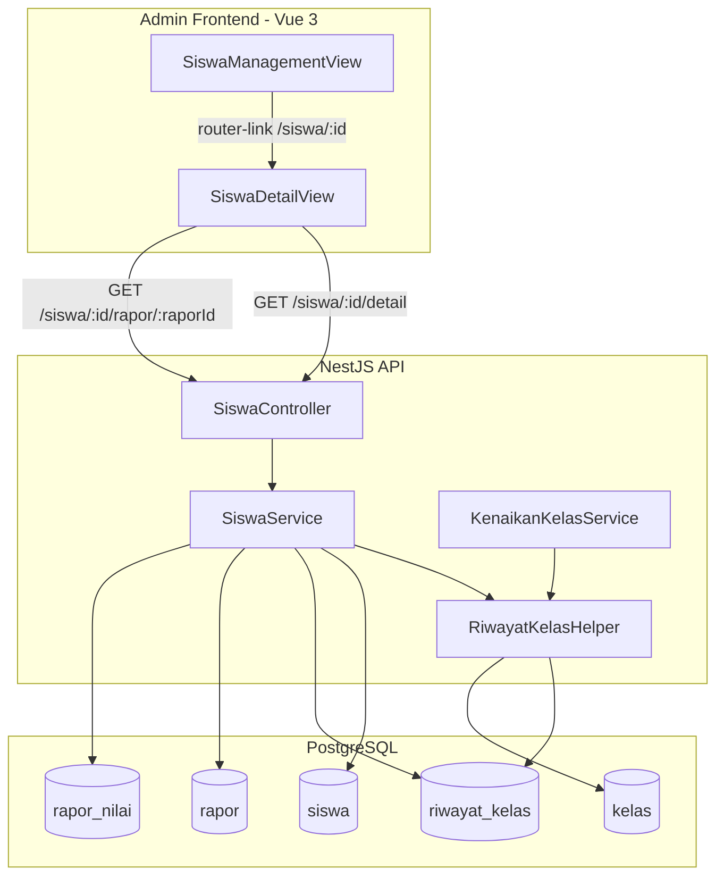
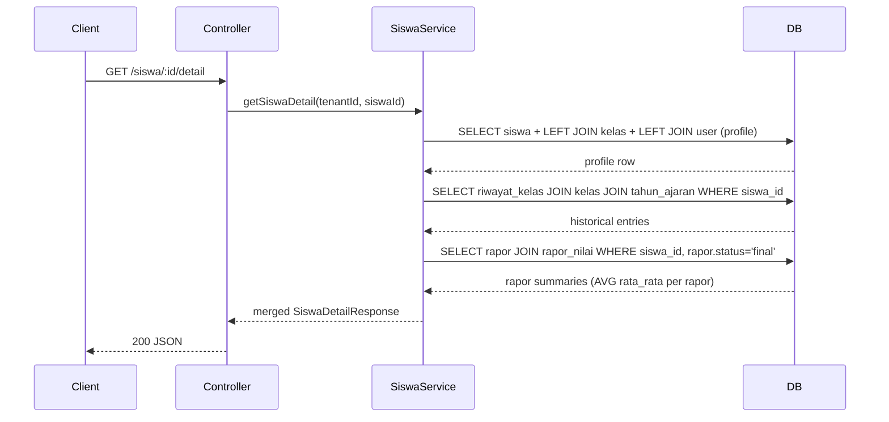

# Design Document: Student Detail Page

## Overview

This feature adds a comprehensive Student Detail Page to the admin panel, providing profile information, class history timeline, and report card summaries for individual students. It also introduces reliable riwayat_kelas (class history) recording across all class-change operations, backed by a database migration adding `tanggal_mulai` to the `riwayat_kelas` table.

**Key capabilities:**
- Automatic riwayat_kelas recording on every class change (create, edit, promote, import)
- Aggregated student detail API endpoint (`GET /siswa/:id/detail`)
- Per-period rapor detail API endpoint (`GET /siswa/:id/rapor/:raporId`)
- Frontend detail page with profile, timeline, and expandable rapor sections

## Architecture



### Design Decisions

1. **RiwayatKelasHelper as a shared utility** — Rather than duplicating riwayat insertion logic in SiswaService, KenaikanKelasService, and import flows, we extract a `RiwayatKelasHelper` injectable service. All three call sites use it, ensuring consistency. The helper is injected into both SiswaService and KenaikanKelasService.

2. **Single aggregated detail endpoint** — Instead of multiple calls (profile + riwayat + rapor), we serve everything from `GET /siswa/:id/detail` in one query roundtrip. The rapor detail (per-subject breakdown) is a separate lazy-loaded endpoint because it's user-initiated (accordion expand).

3. **Current kelas merged into riwayat timeline** — The current `siswa.kelas_id` is merged as the first entry in the timeline (marked with `is_current: true`). This avoids a gap between the last riwayat_kelas entry and the student's current placement.

4. **tanggal_mulai as DATE, not TIMESTAMP** — Date-only precision is sufficient for "when did the student start in this class." Avoids timezone display issues on the frontend.

5. **Nullable tanggal_mulai for migration** — Existing records get backfilled from `created_at::date`. New records always have non-null `tanggal_mulai`. The column remains nullable at the schema level to support the migration, but application code always provides a value.

## Components and Interfaces

### Backend Components

#### 1. RiwayatKelasHelper (`apps/api/src/modules/siswa/riwayat-kelas.helper.ts`)

Reusable injectable service for recording class history entries.

```typescript
@Injectable()
export class RiwayatKelasHelper {
  constructor(@Inject(DRIZZLE) private readonly db: NodePgDatabase) {}

  /**
   * Records a riwayat_kelas entry. Called from:
   * - SiswaService.createSiswa (if kelas_id is non-null)
   * - SiswaService.updateSiswa (if kelas_id changes to a non-null value)
   * - SiswaService.importCsvExecute (for each student with non-null kelas_id)
   * - KenaikanKelasService.promoteStudents (for each promoted/graduated student)
   */
  async record(params: {
    tenantId: string;
    siswaId: string;
    kelasId: string;
    tahunAjaranId: string;
    tanggalMulai?: string; // YYYY-MM-DD, defaults to today
  }): Promise<void>;

  /**
   * Batch record for bulk operations (import, promotion).
   */
  async recordBatch(entries: Array<{
    tenantId: string;
    siswaId: string;
    kelasId: string;
    tahunAjaranId: string;
    tanggalMulai?: string;
  }>): Promise<void>;
}
```

#### 2. Extended SiswaService methods

```typescript
// New method in SiswaService
async getSiswaDetail(tenantId: string, siswaId: string): Promise<SiswaDetailResponse>;

// New method in SiswaService
async getSiswaRaporDetail(
  tenantId: string, 
  siswaId: string, 
  raporId: string
): Promise<RaporDetailResponse>;
```

#### 3. New Controller Endpoints

```typescript
// In SiswaController
@Get(':id/detail')
@Roles(Role.ADMIN, Role.GURU, Role.KEPALA_SEKOLAH)
async getSiswaDetail(
  @TenantId() tenantId: string,
  @Param('id', ParseUUIDPipe) id: string,
): Promise<SiswaDetailResponse>;

@Get(':id/rapor/:raporId')
@Roles(Role.ADMIN, Role.GURU, Role.KEPALA_SEKOLAH)
async getSiswaRaporDetail(
  @TenantId() tenantId: string,
  @Param('id', ParseUUIDPipe) id: string,
  @Param('raporId', ParseUUIDPipe) raporId: string,
): Promise<RaporDetailResponse>;
```

### Frontend Components

#### 1. SiswaDetailView (`apps/admin/src/views/SiswaDetailView.vue`)

Main page component. Fetches data from `GET /siswa/:id/detail` on mount.

**Sections:**
- Profile card (bio data, status badge, kelas, orang tua)
- Timeline riwayat kelas (chronological, current marked)
- Rapor ringkasan (grouped by tahun_ajaran, expandable per periode)

#### 2. Router Registration

```typescript
{
  path: '/siswa/:id',
  name: 'siswa-detail',
  component: () => import('@/views/SiswaDetailView.vue'),
  meta: { roles: [Role.ADMIN, Role.GURU, Role.KEPALA_SEKOLAH] },
}
```

Note: This replaces the existing `GET /siswa/:id` route which currently serves raw data. The existing `getSiswa` endpoint at `GET /siswa/:id` is preserved for programmatic use; the detail view calls the new `/detail` sub-route.

#### 3. SiswaManagementView Modification

Change the student name column from plain text to a `<router-link :to="'/siswa/' + siswa.id">` so users can click through to the detail page.

## Data Models

### API Response: `GET /siswa/:id/detail`

```typescript
interface SiswaDetailResponse {
  profil: {
    id: string;
    nama: string;
    nisn: string | null;
    jenis_kelamin: 'L' | 'P' | null;
    tanggal_lahir: string | null; // YYYY-MM-DD
    alamat: string | null;
    status: 'aktif' | 'pindah_sekolah' | 'keluar' | 'lulus';
    kelas_nama: string | null;
    orang_tua_nama: string | null;
  };
  riwayat_kelas: Array<{
    kelas_nama: string;
    tingkat: number;
    tahun_ajaran_nama: string;
    tanggal_mulai: string; // YYYY-MM-DD
    is_current: boolean;
  }>;
  rapor_ringkasan: Array<{
    tahun_ajaran_nama: string;
    periode: 'uts_semester_1' | 'semester_1' | 'uts_semester_2' | 'semester_2';
    rapor_id: string;
    rata_rata: number; // 2 decimal places
    peringkat: number | null;
  }>;
}
```

### API Response: `GET /siswa/:id/rapor/:raporId`

```typescript
interface RaporDetailResponse {
  nilai: Array<{
    mata_pelajaran_nama: string;
    komponen_nilai: Array<{
      komponen_nama: string | null; // null if komponen_penilaian record missing
      nilai: string | number;
    }>;
    rata_rata: string; // decimal(5,2) as string
    guru_nama: string;
    capaian_pembelajaran: string | null;
  }>;
}
```

### Database Migration: `riwayat_kelas.tanggal_mulai`

```sql
-- Add column
ALTER TABLE riwayat_kelas ADD COLUMN tanggal_mulai DATE;

-- Backfill from created_at
UPDATE riwayat_kelas SET tanggal_mulai = created_at::date WHERE tanggal_mulai IS NULL;
```

### Updated Schema (Drizzle)

```typescript
export const riwayatKelas = pgTable('riwayat_kelas', {
  id: uuid('id').primaryKey().defaultRandom(),
  tenantId: uuid('tenant_id').notNull().references(() => tenant.id),
  siswaId: uuid('siswa_id').notNull().references(() => siswa.id),
  kelasId: uuid('kelas_id').notNull().references(() => kelas.id),
  tahunAjaranId: uuid('tahun_ajaran_id').notNull().references(() => tahunAjaran.id),
  tanggalMulai: date('tanggal_mulai'), // nullable for migration compat
  createdAt: timestamp('created_at', { withTimezone: true }).notNull().defaultNow(),
});
```

### Query Strategy for Detail Endpoint



The profile query and riwayat query can potentially be combined into fewer roundtrips using subqueries, but separate queries improve readability and maintainability. Three simple queries is acceptable within the 500ms performance target.

## Correctness Properties

*A property is a characteristic or behavior that should hold true across all valid executions of a system — essentially, a formal statement about what the system should do. Properties serve as the bridge between human-readable specifications and machine-verifiable correctness guarantees.*

### Property 1: Student creation records riwayat if and only if kelas_id is non-null

*For any* student creation operation (single create or bulk CSV import), a riwayat_kelas record is created with the correct kelas_id, tahun_ajaran_id (from the kelas record), and a valid tanggal_mulai date — if and only if the student's kelas_id is non-null. If kelas_id is null, no riwayat_kelas record shall be created.

**Validates: Requirements 1.1, 1.5, 1.6**

### Property 2: Class update records riwayat for non-null target only

*For any* student update operation that changes kelas_id, a new riwayat_kelas record is created with the NEW kelas_id, its corresponding tahun_ajaran_id, and today's date as tanggal_mulai — if and only if the new kelas_id is non-null. Updates setting kelas_id to null produce no riwayat_kelas entry.

**Validates: Requirements 1.2, 1.5**

### Property 3: Promotion records riwayat for all promoted students

*For any* kenaikan kelas execution with N promoted students from a source class, exactly N riwayat_kelas records are created, each with kelasId = source kelas, tahunAjaranId = source kelas's tahun_ajaran_id, and tanggal_mulai = today's date.

**Validates: Requirements 1.3, 1.4**

### Property 4: Detail endpoint riwayat merge and sort invariant

*For any* student with K historical riwayat_kelas records and a current kelas_id (possibly null), the `riwayat_kelas` array in the detail response has length K+1 (if current kelas exists) or K (if current kelas is null), and is sorted by tanggal_mulai descending. Exactly one entry has `is_current: true` if the student has a current kelas_id.

**Validates: Requirements 3.2, 7.1**

### Property 5: Rapor ringkasan computes correct arithmetic mean

*For any* student with rapor_nilai entries in a finalized rapor, the `rata_rata` field in rapor_ringkasan equals the arithmetic mean of all `rata_rata` values from rapor_nilai records for that student in that rapor, rounded to 2 decimal places.

**Validates: Requirements 3.3**

### Property 6: Rapor detail returns only submitted entries sorted by subject name

*For any* rapor and student combination, the rapor detail response contains exactly the rapor_nilai entries with status "submitted", sorted alphabetically by mata_pelajaran.nama ascending. Each entry includes the resolved komponen names (or null for missing komponen).

**Validates: Requirements 4.1, 4.4**

### Property 7: Multi-tenant isolation

*For any* student belonging to tenant A, a detail request from a user in tenant B returns 404 (not 403). All queries (profile, riwayat_kelas, rapor) are filtered by the requesting user's tenant_id from JWT.

**Validates: Requirements 9.1, 9.2**

### Property 8: tanggal_mulai is always non-null on new records

*For any* riwayat_kelas record created after the migration (via create, update, import, or promote), the tanggal_mulai field is a valid date in YYYY-MM-DD format and is never null.

**Validates: Requirements 1.4, 2.3**

## Error Handling

### Backend

| Scenario | HTTP Status | Response |
|----------|-------------|----------|
| siswa_id not found in tenant | 404 | `{ message: "Siswa tidak ditemukan" }` |
| siswa_id exists but wrong tenant | 404 | Same as not found (no information leakage) |
| rapor_id not found or no rapor_nilai for student | 404 | `{ message: "Data rapor tidak ditemukan" }` |
| User lacks required role | 403 | `{ message: "Akses ditolak" }` |
| Invalid UUID format in :id or :raporId | 400 | Handled by `ParseUUIDPipe` |
| Database timeout (>500ms) | 500 | Generic internal server error |

### Frontend

| Scenario | Behavior |
|----------|----------|
| API returns 404 | Show "Data siswa tidak ditemukan" with link back to /siswa |
| API returns 403 | Redirect to /unauthorized (handled by router guard) |
| Network error on initial load | Show error message + "Coba Lagi" button |
| Network error on rapor expand | Show error inside accordion + retry option, keep accordion open |
| Loading state | Skeleton/spinner placeholders for profile, timeline, and rapor sections |

## Testing Strategy

### Unit Tests (Example-Based)

- **Router guard**: Verify `/siswa/:id` route only accessible by admin, guru, kepala_sekolah
- **404 handling**: Request with non-existent UUID returns 404
- **403 handling**: Request with unauthorized role returns 403
- **Profile display**: Render detail view with mocked data, verify fields
- **Empty states**: No riwayat → "Belum ada riwayat kelas"; no rapor → "Belum ada data rapor"
- **Status badge colors**: Correct CSS class per status value
- **Null field placeholders**: Null fields show "-"
- **Accordion toggle**: Click to expand, click again to collapse

### Property-Based Tests

Property-based testing is appropriate for this feature because the backend logic involves:
- Data transformation with varying inputs (merge + sort riwayat)
- Arithmetic aggregation (mean of rata_rata)
- Conditional record creation (riwayat_kelas recording logic)
- Tenant isolation invariants

**Library:** [fast-check](https://github.com/dubzzz/fast-check) (already standard for TypeScript PBT in this project)

**Configuration:**
- Minimum 100 iterations per property test
- Each test tagged with: `Feature: student-detail-page, Property {N}: {title}`

**Properties to implement:**
1. Property 1 — Student creation riwayat recording (biconditional on kelas_id null)
2. Property 2 — Class update riwayat recording
3. Property 3 — Promotion riwayat batch recording
4. Property 4 — Riwayat merge/sort invariant
5. Property 5 — Arithmetic mean computation
6. Property 6 — Rapor detail filter and sort
7. Property 7 — Multi-tenant isolation
8. Property 8 — tanggal_mulai non-null invariant (subsumed by 1, 2, 3 — assert within those)

Properties 1-3 test the RiwayatKelasHelper logic with mocked DB.
Properties 4-6 test the SiswaService detail/rapor query logic.
Property 7 tests the tenant isolation filter.
Property 8 is an assertion within Properties 1-3 (no separate test needed).

### Integration Tests

- Migration backfill: Seed records without tanggal_mulai, run migration, verify backfill
- End-to-end detail endpoint: Create student with history, call endpoint, verify full response shape
- Performance: Verify response time <500ms with realistic data volume
