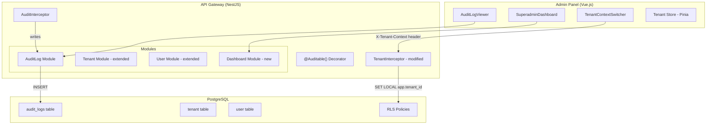

# Design Document: Superadmin Cross-Tenant Access & Audit Logging

## Overview

This design extends the existing multi-tenant school management system with application-layer capabilities for the Superadmin user: tenant context switching for scoped operations, a cross-tenant dashboard, comprehensive audit logging for sensitive entities, and a standardized pagination pattern.

The system already has the `SUPER_ADMIN` role and RLS bypass in `TenantInterceptor`. This design adds:
- **Tenant context switching** via `X-Tenant-Context` request header, modifying the existing interceptor to optionally scope SUPER_ADMIN queries to a specific tenant
- **Audit logging** via a new `audit_logs` table (broader than the existing billing-only `audit_trail`) using a NestJS interceptor + decorator pattern for minimal service coupling
- **Cross-tenant dashboard** endpoint aggregating metrics across all tenants
- **Offset-based pagination** standard for all list endpoints via a reusable helper

### Key Design Decisions

| Decision | Choice | Rationale |
|----------|--------|-----------|
| Audit log approach | Interceptor + `@Auditable()` decorator | Minimal coupling — services don't need to know about audit logging. Interceptor captures before/after state automatically. |
| Tenant context mechanism | `X-Tenant-Context` HTTP header | Stateless on the server side. Header approach works with existing interceptor architecture and doesn't pollute JWT. |
| New audit table vs extending `audit_trail` | New `audit_logs` table | Existing `audit_trail` is billing-specific with different schema. The new table has richer metadata (IP, role, before/after JSONB) and covers all sensitive entity types. |
| Audit failure handling | Strict rollback for financial/user ops, soft-fail for tenant config | Matches requirement distinction between high-severity (financial) and lower-severity (config) operations. |
| Pagination | Offset-based with `page`, `page_size`, `total_count` | Meets requirement for numbered page controls. Simple, predictable, works well for admin panel use cases with moderate data volumes. |
| Dashboard metrics | Single aggregation endpoint with raw SQL | Cross-tenant aggregation bypasses RLS by design. Single query is more efficient than N+1 tenant queries. |

---

## Architecture



### Request Flow for Superadmin with Tenant Context

```mermaid
sequenceDiagram
    participant AP as Admin Panel
    participant API as NestJS API
    participant TI as TenantInterceptor
    participant AI as AuditInterceptor
    participant SVC as Service Layer
    participant DB as PostgreSQL

    AP->>API: GET /users (X-Tenant-Context: uuid)
    API->>TI: Intercept request
    TI->>TI: Detect SUPER_ADMIN + header present
    TI->>DB: BEGIN; SET LOCAL app.tenant_id = 'uuid'
    TI->>API: Proceed with tenant-scoped client
    API->>SVC: Execute business logic
    SVC->>DB: Query (RLS applies to scoped tenant)
    DB-->>SVC: Results (filtered by tenant)
    SVC-->>API: Response
    API->>AI: AuditInterceptor (if @Auditable)
    AI->>DB: INSERT INTO audit_logs
    API-->>AP: Response with scoped data
```

---

## Components and Interfaces

### 1. Modified TenantInterceptor

Extends the existing interceptor to handle `X-Tenant-Context` header for SUPER_ADMIN users.

```typescript
// apps/api/src/common/interceptors/tenant.interceptor.ts (modified)
// New behavior for SUPER_ADMIN:
// - No header → skip RLS entirely (cross-tenant access)
// - With X-Tenant-Context header → acquire pool client, SET LOCAL app.tenant_id

interface TenantContextBehavior {
  // When SUPER_ADMIN has no X-Tenant-Context header
  NO_CONTEXT: 'bypass_rls';
  // When SUPER_ADMIN has valid X-Tenant-Context header
  WITH_CONTEXT: 'scope_to_tenant';
}
```

### 2. AuditLog Module

```typescript
// apps/api/src/modules/audit-log/audit-log.module.ts
@Module({
  imports: [],
  controllers: [AuditLogController],
  providers: [AuditLogService, AuditInterceptor],
  exports: [AuditLogService, AuditInterceptor],
})
export class AuditLogModule {}
```

#### AuditLogService Interface

```typescript
interface CreateAuditLogDto {
  action: AuditAction;         // 'create' | 'update' | 'delete' | 'deactivate' | 'activate' | 'role_change' | 'password_reset'
  actorUserId: string;
  actorRole: string;
  entityType: AuditEntityType; // 'tagihan' | 'pembayaran' | 'user' | 'role_assignment' | 'tenant_config'
  entityId: string;
  tenantId: string;
  ipAddress: string;
  beforeValues?: Record<string, unknown> | null;
  afterValues?: Record<string, unknown> | null;
}

interface AuditLogQueryDto {
  tenantId?: string;
  entityType?: AuditEntityType;
  action?: AuditAction;
  actorUserId?: string;
  dateFrom?: string;  // ISO 8601
  dateTo?: string;    // ISO 8601
  page?: number;      // default 1
  pageSize?: number;  // default 20
}

interface AuditLogResponse {
  data: AuditLogEntry[];
  meta: PaginationMeta;
}
```

### 3. @Auditable() Decorator + AuditInterceptor

The decorator marks controller methods for audit logging. The interceptor reads decorator metadata and handles before/after capture.

```typescript
// apps/api/src/modules/audit-log/decorators/auditable.decorator.ts
export interface AuditableOptions {
  entityType: AuditEntityType;
  action: AuditAction;
  // How to extract entity ID from request (param name or body field)
  entityIdSource: 'params.id' | 'body.id' | 'response.id';
  // How to extract tenant_id (from body, params, or entity lookup)
  tenantIdSource?: 'body.tenant_id' | 'params.tenantId' | 'entity_lookup';
  // Whether audit failure should rollback the operation (default: true for sensitive entities)
  strictMode?: boolean;
  // Fields to exclude from before/after diff (e.g., password hashes)
  excludeFields?: string[];
}

export const Auditable = (options: AuditableOptions) => SetMetadata(AUDITABLE_KEY, options);
```

```typescript
// apps/api/src/modules/audit-log/interceptors/audit.interceptor.ts
@Injectable()
export class AuditInterceptor implements NestInterceptor {
  // 1. Before handler: fetch current entity state (for "before" values)
  // 2. After handler: compare with response to determine "after" values
  // 3. Write audit_log entry
  // 4. If strictMode=true and audit write fails → throw to trigger rollback
  // 5. If strictMode=false and audit write fails → log warning, continue
}
```

**Usage example:**
```typescript
@Patch(':id')
@Auditable({
  entityType: 'tagihan',
  action: 'update',
  entityIdSource: 'params.id',
  tenantIdSource: 'entity_lookup',
  strictMode: true,
  excludeFields: ['bukti_transfer_url'],
})
async updateTagihan(@Param('id') id: string, @Body() dto: UpdateTagihanDto) {
  return this.tagihanService.update(id, dto);
}
```

### 4. Dashboard Module

```typescript
// apps/api/src/modules/dashboard/dashboard.module.ts
@Module({
  imports: [],
  controllers: [DashboardController],
  providers: [DashboardService],
})
export class DashboardModule {}
```

#### DashboardController

```typescript
@Controller('dashboard')
@UseGuards(JwtAuthGuard, RolesGuard)
export class DashboardController {
  @Get('superadmin/metrics')
  @Roles(Role.SUPER_ADMIN)
  async getCrossTenantMetrics(): Promise<CrossTenantMetrics> {}
}
```

#### CrossTenantMetrics Response

```typescript
interface CrossTenantMetrics {
  overview: {
    totalTenants: number;
    activeTenants: number;
    inactiveTenants: number;
    totalUsers: number;        // enabled accounts
    totalStudents: number;     // status 'aktif'
    totalUnpaidInvoices: number;
  };
  tenants: TenantSummary[];
}

interface TenantSummary {
  id: string;
  nama: string;
  isActive: boolean;
  userCount: number;
  studentCount: number;
  unpaidAmount: number;       // sum of (nominal - total_dibayar) for unpaid invoices
  hasOverdueInvoices: boolean; // any invoice with jatuh_tempo > 30 days overdue
}
```

### 5. Pagination Helper

```typescript
// apps/api/src/common/dto/pagination.dto.ts
export class PaginationQueryDto {
  @IsOptional()
  @Type(() => Number)
  @IsInt()
  @Min(1)
  page: number = 1;

  @IsOptional()
  @Type(() => Number)
  @IsInt()
  @Min(1)
  @Max(100)
  page_size: number = 20;
}

// apps/api/src/common/interfaces/pagination.interface.ts
export interface PaginationMeta {
  page: number;
  page_size: number;
  total_count: number;
  total_pages: number;
}

export interface PaginatedResponse<T> {
  data: T[];
  meta: PaginationMeta;
}

// apps/api/src/common/utils/paginate.ts
export function paginate<T>(
  items: T[],
  totalCount: number,
  page: number,
  pageSize: number,
): PaginatedResponse<T> {
  return {
    data: items,
    meta: {
      page,
      page_size: pageSize,
      total_count: totalCount,
      total_pages: Math.ceil(totalCount / pageSize),
    },
  };
}
```

### 6. Admin Panel Components

#### TenantContextSwitcher (Header Component)

```typescript
// apps/admin/src/components/layout/TenantContextSwitcher.vue
// Renders only when user.role === SUPER_ADMIN
// Contains:
// - SearchSelect for tenant search (debounced, min 1 char)
// - Active tenant badge with name + clear button
// - Persists selection to sessionStorage
```

#### Tenant Store (Pinia)

```typescript
// apps/admin/src/stores/tenant-context.ts
export const useTenantContextStore = defineStore('tenantContext', () => {
  const activeTenant = ref<{ id: string; nama: string } | null>(
    loadFromSessionStorage()
  );

  function setTenant(tenant: { id: string; nama: string }) { /* ... */ }
  function clearTenant() { /* ... */ }
  
  return { activeTenant, setTenant, clearTenant };
});
```

The API client interceptor injects `X-Tenant-Context` header when `activeTenant` is set:

```typescript
// In apps/admin/src/api/client.ts — new request interceptor
api.interceptors.request.use((config) => {
  const tenantContext = useTenantContextStore();
  if (tenantContext.activeTenant) {
    config.headers['X-Tenant-Context'] = tenantContext.activeTenant.id;
  }
  return config;
});
```

#### SuperadminDashboard Component

```typescript
// apps/admin/src/components/dashboard/SuperadminDashboard.vue
// Displays:
// - Overview cards (total tenants, users, students, unpaid invoices)
// - Per-tenant summary table with overdue indicators
// - Refresh button
```

#### AuditLogViewer

```typescript
// apps/admin/src/views/AuditLogView.vue
// For SUPER_ADMIN: full filters (tenant, entity type, action, actor, date range)
// For ADMIN/BENDAHARA: tenant filter hidden, entity type restricted
// Features:
// - Paginated table (20 per page, offset-based)
// - Detail panel with before/after side-by-side diff
// - Empty state message
```

### 7. API Endpoint Design

| Method | Path | Role | Description |
|--------|------|------|-------------|
| GET | `/dashboard/superadmin/metrics` | SUPER_ADMIN | Cross-tenant aggregated metrics |
| GET | `/audit-logs` | SUPER_ADMIN, ADMIN, BENDAHARA | List audit logs (scoped by role) |
| GET | `/audit-logs/:id` | SUPER_ADMIN, ADMIN, BENDAHARA | Get single audit log detail |
| GET | `/users` | SUPER_ADMIN | Cross-tenant user list (with pagination) |
| PATCH | `/users/:id/role` | SUPER_ADMIN | Update user role |
| PATCH | `/users/:id/deactivate` | SUPER_ADMIN | Deactivate user + invalidate sessions |
| PATCH | `/users/:id/activate` | SUPER_ADMIN | Reactivate user |
| POST | `/users/:id/reset-password` | SUPER_ADMIN | Reset password + send email |
| GET | `/tenants` | SUPER_ADMIN | List all tenants (existing, add pagination) |
| GET | `/tenants/search` | SUPER_ADMIN | Search tenants for context switcher |

---

## Data Models

### audit_logs Table

```sql
CREATE TABLE audit_logs (
  id UUID PRIMARY KEY DEFAULT gen_random_uuid(),
  tenant_id UUID NOT NULL REFERENCES tenant(id),
  actor_user_id UUID NOT NULL REFERENCES "user"(id),
  actor_role VARCHAR(50) NOT NULL,
  action VARCHAR(50) NOT NULL,           -- 'create', 'update', 'delete', 'deactivate', 'activate', 'role_change', 'password_reset'
  entity_type VARCHAR(50) NOT NULL,      -- 'tagihan', 'pembayaran', 'user', 'role_assignment', 'tenant_config'
  entity_id UUID NOT NULL,
  ip_address VARCHAR(45) NOT NULL,       -- IPv4 or IPv6
  before_values JSONB,                   -- NULL for create operations
  after_values JSONB,                    -- NULL for delete operations
  created_at TIMESTAMPTZ NOT NULL DEFAULT NOW()
  -- NO updated_at — append-only, immutable
);

-- Indexes
CREATE INDEX idx_audit_logs_tenant_created ON audit_logs(tenant_id, created_at DESC);
CREATE INDEX idx_audit_logs_entity ON audit_logs(entity_type, entity_id);
CREATE INDEX idx_audit_logs_actor ON audit_logs(actor_user_id, created_at DESC);
CREATE INDEX idx_audit_logs_action ON audit_logs(action, created_at DESC);

-- RLS policy: non-superadmin users can only see their own tenant's logs
-- (enforced at application layer since SUPER_ADMIN bypasses RLS)

-- Prevent UPDATE/DELETE at application layer via:
-- 1. No update/delete methods in AuditLogService
-- 2. DB-level rule (optional additional safety):
CREATE RULE audit_logs_no_update AS ON UPDATE TO audit_logs DO INSTEAD NOTHING;
CREATE RULE audit_logs_no_delete AS ON DELETE TO audit_logs DO INSTEAD NOTHING;
```

### Drizzle Schema

```typescript
// apps/api/src/drizzle/schema/audit-log.ts
import { pgTable, uuid, varchar, timestamp, jsonb, index } from 'drizzle-orm/pg-core';

export const auditLogs = pgTable(
  'audit_logs',
  {
    id: uuid('id').primaryKey().defaultRandom(),
    tenantId: uuid('tenant_id').notNull(),
    actorUserId: uuid('actor_user_id').notNull(),
    actorRole: varchar('actor_role', { length: 50 }).notNull(),
    action: varchar('action', { length: 50 }).notNull(),
    entityType: varchar('entity_type', { length: 50 }).notNull(),
    entityId: uuid('entity_id').notNull(),
    ipAddress: varchar('ip_address', { length: 45 }).notNull(),
    beforeValues: jsonb('before_values'),
    afterValues: jsonb('after_values'),
    createdAt: timestamp('created_at', { withTimezone: true }).notNull().defaultNow(),
  },
  (table) => ({
    tenantCreatedIdx: index('idx_audit_logs_tenant_created').on(table.tenantId, table.createdAt),
    entityIdx: index('idx_audit_logs_entity').on(table.entityType, table.entityId),
    actorIdx: index('idx_audit_logs_actor').on(table.actorUserId, table.createdAt),
    actionIdx: index('idx_audit_logs_action').on(table.action, table.createdAt),
  }),
);
```

### Enums

```typescript
// apps/api/src/modules/audit-log/audit-log.types.ts
export type AuditAction =
  | 'create'
  | 'update'
  | 'delete'
  | 'deactivate'
  | 'activate'
  | 'role_change'
  | 'password_reset';

export type AuditEntityType =
  | 'tagihan'
  | 'pembayaran'
  | 'user'
  | 'role_assignment'
  | 'tenant_config';
```

---

## Correctness Properties

*A property is a characteristic or behavior that should hold true across all valid executions of a system — essentially, a formal statement about what the system should do. Properties serve as the bridge between human-readable specifications and machine-verifiable correctness guarantees.*

### Property 1: Cross-tenant read without context returns all tenants with tenant_id

*For any* set of entities distributed across multiple tenants, when the Superadmin performs a list read without an `X-Tenant-Context` header, every record in the response SHALL include a non-null `tenant_id` field and the result set SHALL contain records from all tenants that have data.

**Validates: Requirements 1.1, 1.3**

### Property 2: Tenant context header scopes all results to that tenant

*For any* valid tenant UUID provided in the `X-Tenant-Context` header, when the Superadmin performs a list read, ALL records in the response SHALL have `tenant_id` equal to the specified UUID, and no records from other tenants SHALL appear.

**Validates: Requirements 1.4, 2.2**

### Property 3: Non-superadmin authorization rejection

*For any* user with a role other than SUPER_ADMIN (i.e., ADMIN, KEPALA_SEKOLAH, GURU, BENDAHARA, ORANG_TUA), when that user attempts to access any Superadmin-only endpoint, the API SHALL return HTTP 403 Forbidden.

**Validates: Requirements 1.6, 3.4**

### Property 4: Audit log creation for sensitive entity operations

*For any* create, update, or delete operation performed on a sensitive entity (Tagihan, Pembayaran, User, Role assignment, Tenant config), the system SHALL create an audit_logs entry containing: a valid action type, actor_user_id matching the authenticated user, actor_role matching the user's role, a timestamp in ISO 8601 with timezone, the correct entity_type, the correct entity_id, the operation's tenant_id, and the request IP address.

**Validates: Requirements 5.1, 5.6**

### Property 5: Audit log captures before/after values for updates

*For any* update operation on a sensitive entity where at least one scalar field changed, the resulting audit_logs entry SHALL contain `before_values` with the previous field values and `after_values` with the new field values, and these SHALL differ on at least one key. Binary content fields (e.g., bukti_transfer_url) SHALL be excluded from the diff.

**Validates: Requirements 5.2**

### Property 6: Audit log filter correctness

*For any* valid combination of audit log query filters (tenant_id, entity_type, action, actor_user_id, date_from, date_to), every entry in the response SHALL satisfy ALL applied filter criteria simultaneously. No entry that violates any single filter criterion SHALL appear in results.

**Validates: Requirements 5.4**

### Property 7: Non-superadmin audit log access is tenant and entity scoped

*For any* user with role ADMIN or BENDAHARA querying the audit log endpoint, ALL returned entries SHALL have `tenant_id` equal to the requesting user's tenant, AND for BENDAHARA users, `entity_type` SHALL be restricted to only 'tagihan' or 'pembayaran'.

**Validates: Requirements 5.5, 6.4**

### Property 8: Audit write failure causes operation rollback for sensitive entities

*For any* sensitive entity operation (Tagihan, Pembayaran, User create/update/deactivate, Role assignment change) where the audit_logs INSERT fails, the original entity modification SHALL be rolled back — the entity's state in the database SHALL remain unchanged from before the operation was attempted.

**Validates: Requirements 5.7**

### Property 9: Overdue invoice detection

*For any* tenant that has at least one invoice with status 'belum_bayar' or 'cicilan' whose `tanggal_jatuh_tempo` is more than 30 days before the current date, the dashboard metrics response SHALL report `hasOverdueInvoices: true` for that tenant. For tenants with no such invoices, it SHALL report `hasOverdueInvoices: false`.

**Validates: Requirements 3.5**

### Property 10: Pagination metadata correctness

*For any* list endpoint called with valid `page` and `page_size` parameters, the response SHALL include `meta.total_count` equal to the actual total number of matching records, `meta.total_pages` equal to `ceil(total_count / page_size)`, `meta.page` equal to the requested page, and `data.length` SHALL be at most `page_size`.

**Validates: Requirements 7.2, 7.4**

### Property 11: Audit log excludes sensitive password values

*For any* password reset operation that generates an audit log entry, the `before_values` and `after_values` fields SHALL NOT contain the plaintext password, password hash, or temporary password value.

**Validates: Requirements 8.6**

### Property 12: User search returns only matching users

*For any* search term of 3 or more characters, every user in the response SHALL have the search term appearing (case-insensitive) in at least one of: email, nama, or phone fields.

**Validates: Requirements 8.7**

### Property 13: Tenant context header propagation from frontend

*For any* active tenant context in the Pinia store (non-null `activeTenant`), every API request made by the axios instance SHALL include an `X-Tenant-Context` header with the value equal to `activeTenant.id`. When `activeTenant` is null, no `X-Tenant-Context` header SHALL be present.

**Validates: Requirements 2.1, 2.4**

---

## Error Handling

### Audit Log Failure Strategies

| Entity Category | On Audit Write Failure | Rationale |
|----------------|----------------------|-----------|
| Tagihan, Pembayaran, User (CUD), Role assignment | **Rollback** original operation, return HTTP 500 | Financial and user operations require accountability trail |
| Tenant config updates | **Allow** change to persist, log warning | Lower severity; operational alerting handles the gap |

### Implementation

```typescript
// In AuditInterceptor — after handler execution
if (auditWriteFailed && auditOptions.strictMode) {
  // Throw error to trigger TenantInterceptor's rollback
  throw new InternalServerErrorException(
    'Operasi tidak dapat diselesaikan karena pencatatan audit gagal'
  );
}

if (auditWriteFailed && !auditOptions.strictMode) {
  this.logger.error(`Audit write failed for ${entityType}:${entityId}`, error);
  // Continue — response already sent
}
```

### Error Responses

| Scenario | HTTP Status | Message |
|----------|-------------|---------|
| Create without tenant_id (Superadmin) | 400 | `tenant_id wajib disertakan untuk operasi create oleh Superadmin` |
| Invalid/deactivated tenant in X-Tenant-Context | 400 | `Tenant tidak tersedia atau tidak aktif` |
| Non-superadmin accessing superadmin endpoint | 403 | `You do not have permission to access this resource` |
| RLS session variable setup fails | 500 | `Konteks tenant tidak dapat disiapkan` |
| Audit write failure (strict mode) | 500 | `Operasi tidak dapat diselesaikan karena pencatatan audit gagal` |
| Assign SUPER_ADMIN role | 400 | `Role super_admin tidak dapat diberikan ke user` |
| Deactivate already-inactive user | 400 | `User sudah dalam status nonaktif` |
| User not found | 404 | `User tidak ditemukan` |
| Date range > 365 days for audit query | 400 | `Rentang tanggal maksimal 365 hari` |

### Transaction Boundaries

For sensitive entity operations with strict audit mode:

```
BEGIN TRANSACTION
  1. Execute entity operation (create/update/delete)
  2. Write audit_log entry
  3. If both succeed → COMMIT
  4. If either fails → ROLLBACK
END TRANSACTION
```

This is achieved by wrapping the entire request in the existing `TenantInterceptor` transaction when a tenant-scoped client is active, or by using a manual transaction in `AuditInterceptor` for cross-tenant (no-context) operations.

---

## Testing Strategy

### Property-Based Tests (PBT)

**Library**: [fast-check](https://github.com/dubzzz/fast-check) (TypeScript PBT library)
**Configuration**: Minimum 100 iterations per property

Each property test from the Correctness Properties section will be implemented as a single `fast-check` property test:

| Property | Test Approach |
|----------|--------------|
| P1: Cross-tenant read | Generate N tenants with random entities, query without header, assert all tenant_ids present |
| P2: Tenant context scoping | Generate entities in M tenants, pick random tenant UUID for header, assert all results match |
| P3: Authorization rejection | For each non-SUPER_ADMIN role × each superadmin endpoint, assert 403 |
| P4: Audit log creation | Generate random sensitive entity operations, verify audit_log entry fields |
| P5: Before/after values | Generate random entity states, perform random field updates, verify diff captured |
| P6: Filter correctness | Generate audit log entries with random attributes, apply random filter combinations, verify all results match |
| P7: Non-superadmin scoping | Generate audit entries across tenants, query as ADMIN/BENDAHARA, verify tenant + entity_type scoping |
| P8: Audit rollback | Mock audit INSERT to fail, execute sensitive operation, verify entity unchanged |
| P9: Overdue detection | Generate tenants with invoices at random dates/statuses, verify hasOverdueInvoices flag |
| P10: Pagination metadata | Generate random total counts, request random page/page_size, verify meta fields |
| P11: Password exclusion | Generate password reset operations, verify audit log contains no password values |
| P12: User search matching | Generate random users with random names/emails/phones, search random substrings, verify all results contain search term |
| P13: Header propagation | Set random tenant UUIDs in store, intercept outgoing requests, verify header presence/absence |

**Tag format**: `Feature: superadmin-cross-tenant-access, Property {N}: {title}`

### Unit Tests (Example-Based)

- Tenant context switcher renders/hides based on role
- Session storage persistence and restoration of tenant context
- Dashboard component renders correct metrics and overdue indicators
- Audit log detail view renders before/after side-by-side
- Empty state message when no audit entries match filters
- Pagination controls render with correct page numbers

### Integration Tests

- Full request flow: login as SUPER_ADMIN → set tenant context → query scoped data
- Tenant creation with admin user + email enqueue (existing, extend with audit)
- User deactivation → session invalidation within 5 seconds
- Dashboard metrics endpoint returns correct aggregations against test data
- Audit log query with date range boundaries

### E2E Tests

- Superadmin login → switch tenant → verify scoped data → clear context → verify cross-tenant
- Create tenant → verify audit log entry → query audit log via viewer
- Role change → verify audit log with before/after → verify old sessions invalidated
