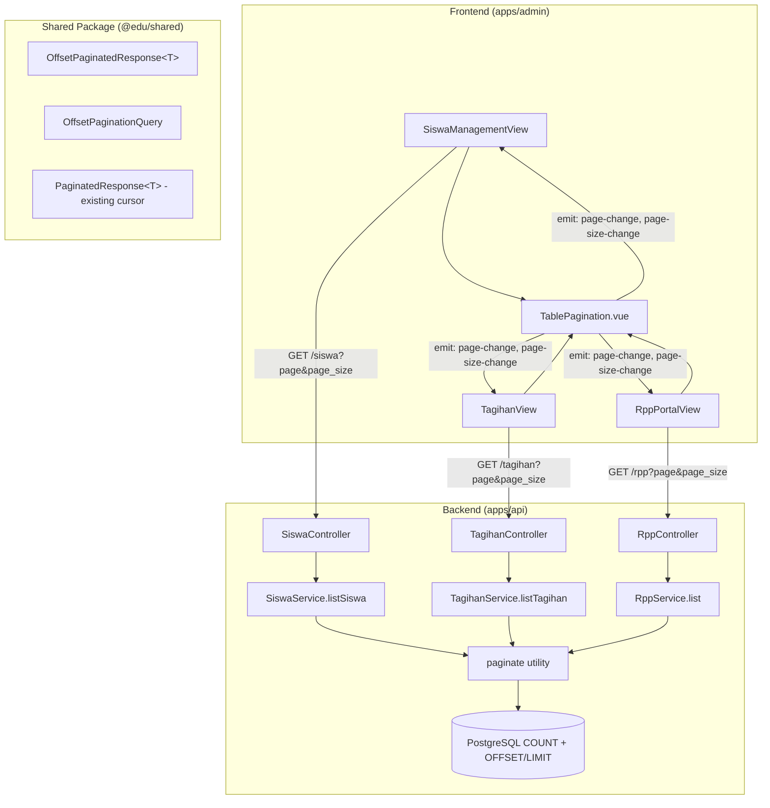

# Design Document: Table Pagination

## Overview

Fitur ini migrasi tiga endpoint API (`/siswa`, `/tagihan`, `/rpp`) dari cursor-based pagination ke offset-based pagination, dan mengganti UI "Muat lebih banyak" dengan komponen pagination bernomor yang reusable. Referensi implementasi sudah ada di `AuditLogView.vue` dan utility `paginate()` di backend.

**Keputusan arsitektural utama:**
- Menggunakan pattern yang sudah ada di `apps/api/src/common/utils/paginate.ts` dan `apps/api/src/common/interfaces/pagination.interface.ts` sebagai foundation
- Menambah interface baru di `@edu/shared` agar tipe konsisten antara frontend dan backend
- Membuat satu komponen `TablePagination.vue` yang reusable (bukan copy-paste logic dari AuditLogView)
- Tetap mempertahankan interface cursor-based yang ada untuk backward compatibility

## Architecture



**Flow per request:**
1. View mengirim request dengan `page`, `page_size`, dan filter params
2. Controller menerima DTO yang sudah divalidasi (`class-validator`)
3. Service menjalankan 2 query paralel: COUNT (total) + SELECT (data slice dengan OFFSET/LIMIT)
4. Helper `paginate()` membungkus hasil ke format `OffsetPaginatedResponse<T>`
5. Frontend menerima response, update tabel dan pagination state

## Components and Interfaces

### 1. Shared Package (`@edu/shared`)

```typescript
// packages/shared/src/interfaces/api.interface.ts (additions)

/**
 * Offset-based pagination response.
 */
export interface OffsetPaginationMeta {
  page: number;
  page_size: number;
  total_count: number;
  total_pages: number;
}

export interface OffsetPaginatedResponse<T> {
  data: T[];
  meta: OffsetPaginationMeta;
}

/**
 * Offset-based pagination query params.
 */
export interface OffsetPaginationQuery {
  page?: number;
  page_size?: number;
}
```

### 2. Backend DTO (per module)

Setiap module yang terdampak akan mengganti cursor params dengan offset params pada DTO-nya:

```typescript
// Pattern untuk semua 3 DTO (ListSiswaQueryDto, ListTagihanQueryDto, GetRppQueryDto)
import { IsIn, IsInt, IsOptional, Min } from 'class-validator';
import { Type } from 'class-transformer';

// Tambahan fields (mengganti cursor/limit):
@IsOptional()
@Type(() => Number)
@IsInt()
@Min(1)
page?: number;

@IsOptional()
@Type(() => Number)
@IsInt()
@IsIn([15, 50, 100], { message: 'page_size harus salah satu dari: 15, 50, 100' })
page_size?: number;

// HAPUS: cursor?: string dan limit?: number
```

### 3. Backend Service Pattern

Setiap service method akan mengikuti pattern yang sama:

```typescript
async listSiswa(tenantId: string, query: ListSiswaQueryDto) {
  const page = query.page ?? 1;
  const pageSize = query.page_size ?? 15;
  const offset = (page - 1) * pageSize;

  const conditions = [ /* existing filter logic unchanged */ ];

  // Parallel queries for performance
  const [countResult, dataResult] = await Promise.all([
    this.db
      .select({ count: sql<number>`count(*)::int` })
      .from(siswa)
      .leftJoin(/* same joins as data query */)
      .where(and(...conditions)),
    this.db
      .select({ /* existing columns */ })
      .from(siswa)
      .leftJoin(/* existing joins */)
      .where(and(...conditions))
      .orderBy(/* existing order */)
      .limit(pageSize)
      .offset(offset),
  ]);

  const totalCount = countResult[0]?.count ?? 0;
  return paginate(dataResult, totalCount, page, pageSize);
}
```

### 4. Frontend Component: `TablePagination.vue`

```typescript
// apps/admin/src/components/ui/TablePagination.vue

interface Props {
  currentPage: number;
  totalPages: number;
  totalCount: number;
  pageSize: number;
  loading?: boolean;
}

interface Emits {
  (e: 'page-change', page: number): void;
  (e: 'page-size-change', size: number): void;
}
```

**Design Style: Circular Pagination (referensi gambar user)**

Template structure — layout horizontal dengan pill-shaped Previous/Next buttons dan circular page numbers:
```
┌──────────────────────────────────────────────────────────────────────────────┐
│ [← Previous]   [1] [2] [3] [4] ... [17]   [Next →]   [15 Items ▼]          │
└──────────────────────────────────────────────────────────────────────────────┘
│ Menampilkan X dari Y entri                                                    │
```

**Styling specifications (disesuaikan dengan tema biru admin):**
- **Previous/Next buttons**: Pill-shaped (`rounded-full`), `bg-primary-600 text-white` saat enabled, `border border-border text-text-tertiary` saat disabled, padding `px-4 py-2`, dengan arrow icon (← / →)
- **Page number buttons**: Circular (`rounded-full w-9 h-9`), `bg-primary-600 text-white` untuk active page, `bg-surface-50 text-text-primary hover:bg-primary-50` untuk inactive pages
- **Ellipsis**: `text-text-tertiary` tanpa background
- **Items dropdown**: Pill-shaped (`rounded-full`), `border border-border bg-white`, menampilkan "{n} Items ▼"
- **Info text**: Di bawah pagination row, `text-sm text-text-secondary`

**Visible pages algorithm (same as AuditLogView):**
```typescript
const visiblePages = computed(() => {
  const pages: number[] = [];
  const total = props.totalPages;
  const current = props.currentPage;

  if (total <= 7) {
    for (let i = 1; i <= total; i++) pages.push(i);
  } else {
    pages.push(1);
    if (current > 3) pages.push(-1); // ellipsis
    const start = Math.max(2, current - 1);
    const end = Math.min(total - 1, current + 1);
    for (let i = start; i <= end; i++) pages.push(i);
    if (current < total - 2) pages.push(-1); // ellipsis
    pages.push(total);
  }
  return pages;
});
```

### 5. View Integration Pattern

Setiap view akan mengikuti pattern ini (mengganti cursor logic):

```typescript
// State
const currentPage = ref(1);
const pageSize = ref(15);
const totalCount = ref(0);
const totalPages = ref(0);

// Fetch function
async function fetchData() {
  loading.value = true;
  try {
    const params = {
      page: currentPage.value,
      page_size: pageSize.value,
      // ...existing filter params
    };
    const { data } = await api.get<OffsetPaginatedResponse<T>>(endpoint, { params });
    items.value = data.data; // REPLACE, not append
    totalCount.value = data.meta.total_count;
    totalPages.value = data.meta.total_pages;
  } catch (error) {
    console.error('Failed to fetch:', error);
  } finally {
    loading.value = false;
  }
}

// Event handlers
function onPageChange(page: number) {
  currentPage.value = page;
  fetchData();
}

function onPageSizeChange(size: number) {
  pageSize.value = size;
  currentPage.value = 1;
  fetchData();
}

// Filter watchers reset page to 1
watch([filterA, filterB], () => {
  currentPage.value = 1;
  fetchData();
});

// Search debounce
watch(search, () => {
  clearTimeout(searchTimeout);
  searchTimeout = setTimeout(() => {
    currentPage.value = 1;
    fetchData();
  }, 300);
});
```

## Data Models

### Response Format (Offset Pagination)

```typescript
// Sebelum (cursor-based):
{
  data: T[],
  meta: {
    has_next: boolean,
    cursor: string | null,
    total?: number
  }
}

// Sesudah (offset-based):
{
  data: T[],
  meta: {
    page: number,          // 1-indexed current page
    page_size: number,     // items per page (15 | 50 | 100)
    total_count: number,   // total matching records
    total_pages: number    // ceil(total_count / page_size)
  }
}
```

### Query Parameters (per endpoint)

| Endpoint | Remove | Add | Keep |
|----------|--------|-----|------|
| `/siswa` | `cursor`, `limit` | `page`, `page_size` | `search`, `kelas_id`, `status`, `tahun_ajaran_id`, `nisn` |
| `/tagihan` | `cursor`, `limit` | `page`, `page_size` | `status`, `kelas_id`, `bulan`, `tahun`, `search` |
| `/rpp` | `cursor`, `limit` | `page`, `page_size` | `search`, `mapel`, `kategori`, `tahun` |

### Database Query Pattern

```sql
-- Count query (selalu menggunakan filter yang sama dengan data query)
SELECT count(*)::int FROM siswa
  LEFT JOIN kelas ON siswa.kelas_id = kelas.id
  WHERE siswa.tenant_id = $1 AND [filter conditions];

-- Data query
SELECT ... FROM siswa
  LEFT JOIN kelas ON siswa.kelas_id = kelas.id
  WHERE siswa.tenant_id = $1 AND [filter conditions]
  ORDER BY siswa.id ASC
  LIMIT $page_size OFFSET ($page - 1) * $page_size;
```

## Correctness Properties

*A property is a characteristic or behavior that should hold true across all valid executions of a system — essentially, a formal statement about what the system should do. Properties serve as the bridge between human-readable specifications and machine-verifiable correctness guarantees.*

### Property 1: Pagination metadata correctness

*For any* dataset of N items matching a filter, and *for any* valid page (≥ 1) and page_size ∈ {15, 50, 100}, the pagination response SHALL satisfy:
- `meta.total_count === N`
- `meta.total_pages === Math.ceil(N / page_size)`
- `meta.page === page`
- `meta.page_size === page_size`
- `data.length === min(page_size, max(0, N - (page - 1) * page_size))`

**Validates: Requirements 1.1, 1.2, 1.3, 1.8, 1.9**

### Property 2: Invalid page_size rejection

*For any* integer value that is NOT in the set {15, 50, 100}, the API SHALL reject the request with HTTP 400. Conversely, *for any* value in {15, 50, 100}, the request SHALL be accepted (given other params are valid).

**Validates: Requirements 1.6**

### Property 3: Out-of-range page returns empty data with correct meta

*For any* dataset of N items and *for any* page > Math.ceil(N / page_size), the response SHALL have `data` as an empty array while `meta.total_count` and `meta.total_pages` remain accurate (reflecting the actual dataset size, not the empty result).

**Validates: Requirements 1.10**

### Property 4: Ellipsis windowing algorithm

*For any* `totalPages > 7` and *for any* `currentPage` where `1 ≤ currentPage ≤ totalPages`, the visible pages array SHALL:
- Always contain page 1 (first)
- Always contain page `totalPages` (last)
- Always contain `currentPage`
- Contain `currentPage - 1` if `currentPage > 1` and `currentPage - 1 > 1`
- Contain `currentPage + 1` if `currentPage < totalPages` and `currentPage + 1 < totalPages`
- Use ellipsis markers (value -1) for gaps between non-consecutive page numbers

**Validates: Requirements 2.4**

### Property 5: Navigation button emit correctness

*For any* valid `currentPage` and `totalPages` (where `1 ≤ currentPage ≤ totalPages`), the navigation buttons SHALL emit:
- First → always emits `1`
- Prev → emits `currentPage - 1` (only callable when `currentPage > 1`)
- Next → emits `currentPage + 1` (only callable when `currentPage < totalPages`)
- Last → always emits `totalPages`

**Validates: Requirements 2.9**

### Property 6: Pagination info text correctness

*For any* valid combination of `currentPage`, `totalPages`, `totalCount`, and `pageSize`, the rendered info text SHALL display values that satisfy:
- X (displayed items) = actual number of items on current page
- Y = totalCount
- N = currentPage
- M = totalPages

**Validates: Requirements 2.5**

## Error Handling

| Scenario | Backend Response | Frontend Behavior |
|----------|-----------------|-------------------|
| `page < 1` | HTTP 400 `{ message: "page harus minimal 1" }` | Tidak mungkin terjadi (UI tidak mengizinkan) |
| `page_size` invalid | HTTP 400 `{ message: "page_size harus salah satu dari: 15, 50, 100" }` | Tidak mungkin terjadi (dropdown terbatas) |
| `page > total_pages` | 200 dengan `data: []` dan meta akurat | Tampilkan state kosong, pagination tetap terlihat |
| Network error | - | Tampilkan pesan error, pertahankan data terakhir (Req 6.6) |
| Count query gagal | HTTP 500 | Tampilkan toast error, retry button |
| `cursor` param dikirim | Param diabaikan (tidak ada di DTO, `class-validator` strip unknown) | N/A (frontend tidak mengirim cursor) |

**Catatan tentang `forbidNonWhitelisted`:** Jika NestJS dikonfigurasi dengan `whitelist: true` dan `forbidNonWhitelisted: true` pada global validation pipe, maka mengirim `cursor` akan otomatis menghasilkan 400. Jika hanya `whitelist: true` (strip unknown), cursor akan diabaikan. Kedua pendekatan memenuhi Requirement 1.11.

## Testing Strategy

### Unit Tests (Example-based)

| Test | Target | Validates |
|------|--------|-----------|
| Default page=1 when omitted | Backend DTO/Service | Req 1.4 |
| Default page_size=15 when omitted | Backend DTO/Service | Req 1.5 |
| Render navigation buttons | TablePagination.vue | Req 2.1 |
| Disable First/Prev on page 1 | TablePagination.vue | Req 2.2 |
| Disable Next/Last on last page | TablePagination.vue | Req 2.3 |
| Hide navigation when totalPages ≤ 1 | TablePagination.vue | Req 2.7 |
| Page size dropdown has 3 options | TablePagination.vue | Req 3.2 |
| Page size change resets to page 1 | View integration | Req 3.4 |
| Search debounce 300ms | View integration | Req 4.3, 5.3, 6.3 |
| Filter change resets page immediately | View integration | Req 4.4 |
| Error preserves last data | View integration | Req 6.6 |

### Property-Based Tests

Testing library: **fast-check** (sudah tersedia di ekosistem project TypeScript)

| Property | Min Iterations | Tag |
|----------|---------------|-----|
| Pagination metadata correctness | 100 | Feature: table-pagination, Property 1 |
| Invalid page_size rejection | 100 | Feature: table-pagination, Property 2 |
| Out-of-range page empty data | 100 | Feature: table-pagination, Property 3 |
| Ellipsis windowing algorithm | 100 | Feature: table-pagination, Property 4 |
| Navigation button emit correctness | 100 | Feature: table-pagination, Property 5 |
| Pagination info text correctness | 100 | Feature: table-pagination, Property 6 |

**Property test strategy:**
- Properties 1-3 test the `paginate()` utility function dan service logic (pure function, no DB needed)
- Properties 4-6 test the `TablePagination.vue` component logic (computed values, pure functions extractable from component)
- Semua property test menggunakan generator untuk `page`, `page_size`, `totalCount`, `totalPages`, dan `currentPage`

### Integration Tests

| Test | Scope |
|------|-------|
| GET /siswa with page/page_size returns correct format | API endpoint |
| GET /tagihan with filters + pagination | API endpoint |
| GET /rpp with filters + pagination | API endpoint |
| SiswaManagementView renders pagination and navigates | E2E view |
