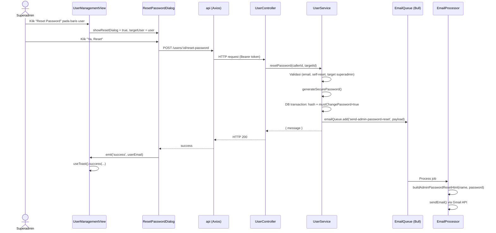

# Design Document: User Password Reset

## Overview

Fitur ini memungkinkan superadmin mereset password pengguna (admin, kepala_sekolah, guru, bendahara) langsung dari tabel user management. Ketika direset, sistem membuat password baru acak yang memenuhi kriteria keamanan, menyimpannya ke database secara atomik bersama flag `must_change_password = true`, dan mengirim email notifikasi ke user berisi password sementara beserta peringatan bahwa aksi dilakukan oleh administrator.

Backend sudah memiliki endpoint `POST /users/:id/reset-password` dan method `resetPassword()` di `UserService`, namun keduanya belum lengkap: password generator saat ini menghasilkan karakter base64url saja (tidak ada simbol), validasi email/self-reset/target-superadmin belum ada, dan template email yang digunakan adalah template "reset link" yang salah. Frontend belum memiliki tombol, dialog konfirmasi, maupun API call untuk fitur ini.

## Architecture



### Komponen yang Dimodifikasi vs Dibuat Baru

| Komponen | Status | Lokasi |
|---|---|---|
| `UserManagementView.vue` | Modifikasi | `apps/admin/src/views/` |
| `ResetPasswordDialog.vue` | Buat baru | `apps/admin/src/components/` |
| `UserService.resetPassword()` | Modifikasi | `apps/api/src/modules/user/` |
| `EmailProcessor` | Modifikasi | `apps/api/src/jobs/email.processor.ts` |
| Template `buildAdminPasswordResetHtml` | Buat baru | `apps/api/src/jobs/email.processor.ts` |

## Components and Interfaces

### Backend: UserService.resetPassword()

Signature saat ini:

```typescript
async resetPassword(userId: string): Promise<{ message: string }>
```

Perlu diubah untuk menerima caller context:

```typescript
async resetPassword(callerId: string, callerRole: string, targetId: string): Promise<{ message: string }>
```

**Logika validasi yang perlu ditambahkan** (sebelum generate password):

```typescript
// 1. Validasi self-reset
if (callerId === targetId) {
  throw new ForbiddenException('Tidak dapat mereset password sendiri');
}

// 2. Lookup user target
const existingUser = await this.db.select(...).where(eq(user.id, targetId)).limit(1);
if (!existingUser[0]) throw new NotFoundException('User tidak ditemukan');

// 3. Validasi target bukan superadmin
if (existingUser[0].role === Role.SUPER_ADMIN) {
  throw new ForbiddenException('Tidak dapat mereset password superadmin');
}

// 4. Validasi email target tidak kosong
const email = existingUser[0].email?.trim();
if (!email) {
  throw new BadRequestException('User tidak memiliki alamat email');
}
```

**Password generator yang perlu diperbaiki:**

```typescript
generateSecurePassword(): string {
  const upper = 'ABCDEFGHIJKLMNOPQRSTUVWXYZ';
  const lower = 'abcdefghijklmnopqrstuvwxyz';
  const digits = '0123456789';
  const symbols = '!@#$%^&*';
  const all = upper + lower + digits + symbols;

  // Pastikan minimal 1 karakter dari setiap kelompok
  const required = [
    upper[crypto.randomInt(upper.length)],
    lower[crypto.randomInt(lower.length)],
    digits[crypto.randomInt(digits.length)],
    symbols[crypto.randomInt(symbols.length)],
  ];

  // Isi sisa 8 karakter dari all charset
  const rest = Array.from({ length: 8 }, () => all[crypto.randomInt(all.length)]);

  // Shuffle untuk menghindari posisi yang predictable
  return [...required, ...rest]
    .sort(() => crypto.randomInt(3) - 1)
    .join('');
}
```

### Backend: UserController

Endpoint `POST /users/:id/reset-password` perlu mem-pass caller info ke service:

```typescript
@Post(':id/reset-password')
@Roles(Role.SUPER_ADMIN)
@HttpCode(HttpStatus.OK)
@UseInterceptors(AuditInterceptor)
@Auditable({
  entityType: 'user',
  action: 'password_reset',
  entityIdSource: 'params.id',
  strictMode: true,
  excludeFields: ['password', 'password_hash', 'temp_password'],
})
async resetPassword(
  @Param('id', ParseUUIDPipe) id: string,
  @Req() req: Request,
) {
  const currentUser = (req as Request & { user: RequestUser }).user;
  return this.userService.resetPassword(currentUser.id, currentUser.role, id);
}
```

### Backend: Email Processor

Tambahkan interface payload dan job handler baru:

```typescript
export interface AdminPasswordResetJobData {
  to: string;
  name: string;
  password: string; // plaintext, sebelum hash
}
```

Job name: `'send-admin-password-reset'` — dibedakan dari `'send-password-reset'` yang sudah ada (reset link flow).

Template baru `buildAdminPasswordResetHtml(name, password)` — lihat bagian [Email Template](#email-template) di bawah.

### Frontend: ResetPasswordDialog.vue

```typescript
// Props
defineProps<{
  show: boolean;
  user: { id: string; nama: string | null; email: string | null } | null;
}>()

// Emits
defineEmits<{
  close: [];
  success: [userEmail: string];
}>()
```

State internal:
- `loading: Ref<boolean>` — disable tombol "Ya, Reset" dan tampilkan spinner saat request berlangsung
- Error ditangani oleh global Axios interceptor (`useToast().error`) dan juga ditampilkan inline di dialog

Saat klik "Ya, Reset":
1. Set `loading = true`, disable tombol
2. `await api.post('/users/' + props.user.id + '/reset-password')`
3. Sukses: `emit('success', props.user.email)`, `emit('close')`
4. Error: `loading = false` (toast sudah ditampilkan oleh Axios interceptor), dialog tetap terbuka

### Frontend: UserManagementView.vue — Perubahan

1. Import `useAuthStore` dari `@/stores`
2. Import `ResetPasswordDialog` dari `@/components/ResetPasswordDialog.vue`
3. Import `useToast` dari `@/composables/useToast`
4. Tambah state: `showResetDialog = ref(false)`, `resettingUser = ref<User | null>(null)`
5. Di kolom Aksi tabel, tambahkan tombol kondisional:

```html
<ActionButton
  v-if="authStore.hasRole(Role.SUPER_ADMIN) && user.role !== Role.SUPER_ADMIN"
  variant="purple"
  :disabled="!user.email || !user.email.trim()"
  @click="openResetDialog(user)"
>
  Reset Password
</ActionButton>
```

6. Handler sukses:

```typescript
function onResetSuccess(userEmail: string) {
  toast.success(`Password berhasil direset dan email telah dikirim ke ${userEmail}`, { duration: 5000 });
}
```

## Data Models

### User Table (tidak ada perubahan skema)

Kolom yang relevan sudah ada:
- `password_hash: text` — disimpan hasil bcrypt hash password baru
- `must_change_password: boolean` — di-set `true` setelah reset
- `email: text | null` — digunakan sebagai alamat tujuan email

### Email Queue Job

```typescript
// Queue: QUEUE_NAMES.EMAIL
// Job name: 'send-admin-password-reset'
interface AdminPasswordResetJobData {
  to: string;       // email user yang direset
  name: string;     // nama lengkap user
  password: string; // password plaintext sementara (sebelum hash)
}
```

### Email Template

Template HTML `buildAdminPasswordResetHtml(name: string, password: string): string` mengikuti struktur yang konsisten dengan email lain di sistem (font Arial, warna `#2563eb`, max-width 600px, footer standar):

```html
<!-- Konten utama template -->
<h2>Password Anda Telah Direset</h2>
<p>Halo {name},</p>
<p>Password akun Anda telah direset oleh administrator sistem.</p>
<!-- Kotak password sementara -->
<div style="background: #f3f4f6; padding: 16px; border-radius: 8px;">
  <p><strong>Password Sementara:</strong> <code>{password}</code></p>
</div>
<!-- Langkah login -->
<p>Langkah-langkah login:</p>
<ol>
  <li>Buka aplikasi Teman Sekolah</li>
  <li>Login dengan email dan password sementara di atas</li>
  <li>Sistem akan meminta Anda membuat password baru segera setelah login</li>
</ol>
<!-- Peringatan -->
<p style="color: #dc2626;">
  ⚠ Perhatian: Email ini dikirim karena aksi administrator, bukan permintaan Anda sendiri.
  Jika Anda tidak mengharapkan perubahan ini, segera hubungi administrator sekolah Anda.
</p>
```

## Correctness Properties

*A property is a characteristic or behavior that should hold true across all valid executions of a system — essentially, a formal statement about what the system should do. Properties serve as the bridge between human-readable specifications and machine-verifiable correctness guarantees.*

### Property 1: Visibilitas tombol berdasarkan kombinasi role

*For any* kumpulan baris user dengan role yang bervariasi (termasuk super_admin dan non-super_admin) dan untuk setiap nilai role pengguna yang login (super_admin atau bukan), tombol "Reset Password" SHALL ditampilkan pada baris tersebut **jika dan hanya jika** pengguna yang login adalah super_admin DAN role user pada baris tersebut bukan super_admin.

**Validates: Requirements 1.1, 1.2, 6.1, 6.2**

---

### Property 2: Password generator memenuhi semua kriteria keamanan

*For any* panggilan ke `generateSecurePassword()`, output SHALL memiliki panjang minimal 12 karakter, mengandung minimal 1 huruf besar, minimal 1 huruf kecil, minimal 1 angka, dan minimal 1 karakter simbol (`!@#$%^&*`).

**Validates: Requirements 3.1**

---

### Property 3: Response reset tidak mengandung password plaintext

*For any* panggilan sukses ke `POST /users/:id/reset-password` dengan user ID yang valid, response body SHALL tidak mengandung field `password`, `tempPassword`, `temp_password`, atau nilai password plaintext.

**Validates: Requirements 3.3**

---

### Property 4: Template email admin-reset mengandung semua elemen wajib

*For any* nama user dan password sementara yang valid, output `buildAdminPasswordResetHtml(name, password)` SHALL mengandung: nama user, password sementara, instruksi login, dan teks peringatan bahwa aksi dilakukan oleh administrator.

**Validates: Requirements 4.4, 4.5**

---

### Property 5: Notifikasi sukses mengandung email user

*For any* user dengan alamat email valid, ketika reset password berhasil (HTTP 200), notifikasi sukses yang ditampilkan SHALL mengandung alamat email user tersebut.

**Validates: Requirements 5.1**

## Error Handling

### Backend

| Kondisi | Exception | HTTP Code | Pesan |
|---|---|---|---|
| User target tidak ditemukan | `NotFoundException` | 404 | "User tidak ditemukan" |
| Caller bukan super_admin | `ForbiddenException` (via `RolesGuard`) | 403 | "Akses ditolak" |
| Target adalah super_admin | `ForbiddenException` | 403 | "Tidak dapat mereset password superadmin" |
| Caller mereset dirinya sendiri | `ForbiddenException` | 403 | — (tanpa pesan spesifik per requirements, pakai "Tidak dapat mereset password sendiri") |
| Email user kosong/null/whitespace | `BadRequestException` | 400 | "User tidak memiliki alamat email" |
| Email queue gagal (add job) | Log error, **tidak throw** | — | Reset tetap dianggap sukses |

**Catatan penting**: Kegagalan email queue (req 4.3) tidak boleh membatalkan operasi reset yang sudah berhasil disimpan ke database. Pattern `try/catch` pada `emailQueue.add()` digunakan — error di-log tapi tidak di-rethrow.

### Frontend

| Kondisi | Handling |
|---|---|
| API error dengan `response.data.message` | Toast error dengan pesan dari API (sudah ditangani global Axios interceptor) |
| API error tanpa message | Fallback: "Gagal mereset password. Silakan coba lagi." (override global interceptor fallback) |
| Loading state | Tombol "Ya, Reset" di-disable, tampil spinner |
| User email kosong | Tombol disabled di tabel (tidak bisa diklik sama sekali) |

Untuk error handling di `ResetPasswordDialog.vue`, karena Axios interceptor sudah menampilkan toast error secara global, dialog hanya perlu me-reset loading state tanpa menampilkan toast sendiri.

## Testing Strategy

### Unit Tests (Jest + ts-jest)

**Backend — `user.service.spec.ts`:**

- `resetPassword()` throws `ForbiddenException` ketika `callerId === targetId`
- `resetPassword()` throws `ForbiddenException` ketika target user adalah `super_admin`
- `resetPassword()` throws `BadRequestException` ketika target user tidak memiliki email
- `resetPassword()` throws `NotFoundException` ketika user tidak ditemukan
- `resetPassword()` tetap return sukses ketika `emailQueue.add()` gagal (error isolation)
- `generateSecurePassword()` selalu menghasilkan password yang memenuhi semua kriteria karakter

**Backend — `email.processor.spec.ts`:**

- `buildAdminPasswordResetHtml(name, password)` mengandung nama, password, instruksi login, peringatan admin

### Property-Based Tests (fast-check)

Library: **fast-check** (sudah digunakan di project — lihat `apps/admin/src/components/__tests__/OnboardingPreview.property.test.ts`).

Konfigurasi: minimum **100 iterasi** per property test (`numRuns: 100`).

Setiap property test ditandai dengan komentar:
`// Feature: user-password-reset, Property {N}: {teks property}`

**Property 1 — Visibilitas tombol:**

File: `apps/admin/src/components/__tests__/ResetPasswordDialog.property.test.ts`

```typescript
// Feature: user-password-reset, Property 1: Visibilitas tombol berdasarkan kombinasi role
fc.property(
  fc.array(fc.record({
    role: fc.constantFrom(...ALL_ROLES),
    email: fc.option(fc.emailAddress(), { nil: null }),
  })),
  fc.constantFrom('super_admin', 'admin', 'guru'),
  (userRows, loggedInRole) => {
    // Render tabel dengan loggedInRole
    // Verifikasi: tombol muncul iff (loggedInRole === 'super_admin' && row.role !== 'super_admin')
  }
)
```

**Property 2 — Password generator:**

File: `apps/api/src/modules/user/user.service.spec.ts`

```typescript
// Feature: user-password-reset, Property 2: Password generator memenuhi semua kriteria keamanan
fc.property(
  fc.constant(null), // no meaningful input variation — test the generator itself
  () => {
    const password = service.generateSecurePassword();
    expect(password.length).toBeGreaterThanOrEqual(12);
    expect(password).toMatch(/[A-Z]/);
    expect(password).toMatch(/[a-z]/);
    expect(password).toMatch(/[0-9]/);
    expect(password).toMatch(/[!@#$%^&*]/);
  }
)
```

**Property 3 — Response tidak mengandung password:**

File: `apps/api/src/modules/user/user.service.spec.ts`

```typescript
// Feature: user-password-reset, Property 3: Response reset tidak mengandung password plaintext
fc.property(
  fc.uuid(), // berbagai user IDs
  async (targetId) => {
    // Mock DB dan emailQueue
    // Verifikasi result tidak memiliki key password/tempPassword
    const result = await service.resetPassword(callerId, 'super_admin', targetId);
    const keys = Object.keys(result);
    expect(keys).not.toContain('password');
    expect(keys).not.toContain('tempPassword');
    expect(keys).not.toContain('temp_password');
  }
)
```

**Property 4 — Template email:**

File: `apps/api/src/jobs/email.processor.spec.ts`

```typescript
// Feature: user-password-reset, Property 4: Template email admin-reset mengandung semua elemen wajib
fc.property(
  fc.string({ minLength: 1, maxLength: 50 }).filter(s => s.trim().length > 0),
  fc.string({ minLength: 12, maxLength: 20 }),
  (name, password) => {
    const html = emailTemplates.buildAdminPasswordResetHtml(name, password);
    expect(html).toContain(name);
    expect(html).toContain(password);
    expect(html.toLowerCase()).toContain('login');
    expect(html.toLowerCase()).toMatch(/administrator|admin/);
  }
)
```

**Property 5 — Notifikasi sukses mengandung email:**

File: `apps/admin/src/views/__tests__/UserManagementView.property.test.ts`

```typescript
// Feature: user-password-reset, Property 5: Notifikasi sukses mengandung email user
fc.property(
  fc.emailAddress(),
  async (userEmail) => {
    // Mock api.post return 200
    // Trigger onResetSuccess(userEmail)
    // Verifikasi toast message mengandung userEmail
  }
)
```

### Integration Tests

- `POST /users/:id/reset-password` menyimpan `mustChangePassword = true` dan hash baru ke database (real DB)
- `POST /users/:id/reset-password` dengan user ID superadmin returns 403
- `POST /users/:id/reset-password` tanpa token superadmin returns 403
- `EmailProcessor.handleAdminPasswordReset()` memanggil Gmail API dengan payload benar (mock Gmail)

### Catatan: PBT tidak cocok untuk

- Atomicity database transaction (req 3.2) → integration test dengan real DB
- Audit log (req 3.6) → integration test
- Email queue behavior (req 4.1, 4.2) → integration test dengan mock queue
